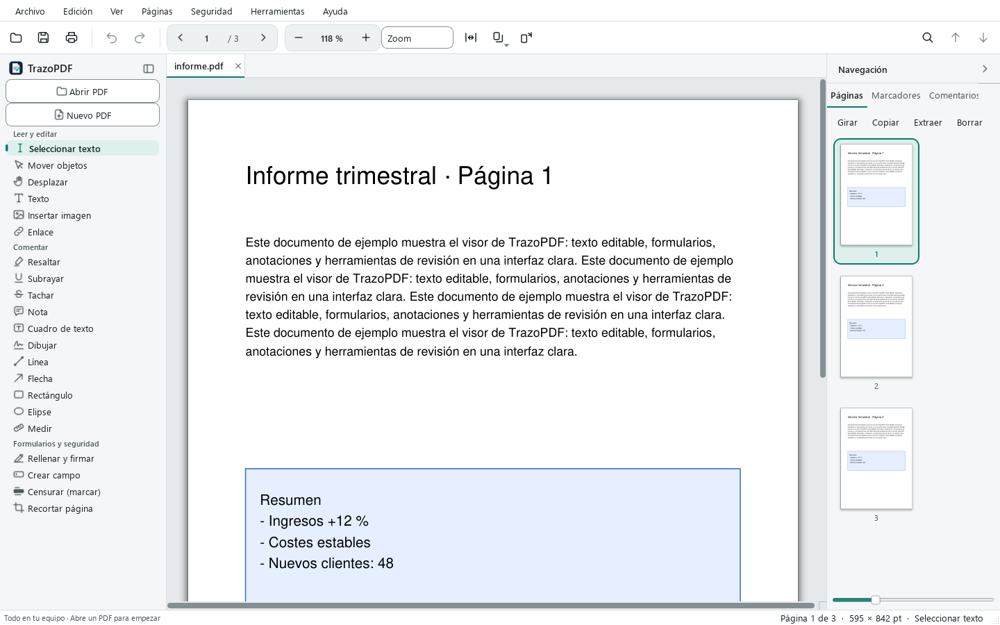
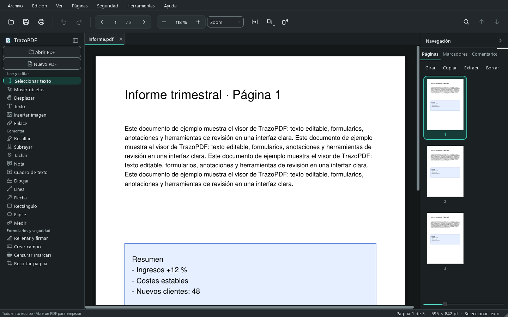

# TrazoPDF

[Español](README.es.md) · [English](README.md) · **Français** · [Deutsch](README.de.md) · [Português](README.pt.md)

Éditeur de PDF gratuit et open source pour Windows. Il permet de réaliser les tâches courantes avec les fichiers PDF —lire, rechercher, annoter, remplir des formulaires, fusionner, diviser, caviarder ou convertir— sans envoyer les documents à aucun service en ligne.

C'est un éditeur de PDF simple pour un usage quotidien. Il ne prétend pas couvrir toutes les fonctions spécialisées : les services en nuage, les flux d'envoi de signatures et plusieurs fonctions spécialisées n'en font pas partie. Les limites précises de chaque fonction sont décrites dans [docs/FEATURES.md](docs/FEATURES.md).





## Fonctions principales

- Lecture avec zoom, affichage continu et sur deux pages, recherche et remplacement de texte, et signets.
- Sélection de texte par caractères, mots et lignes, avec copie.
- Modification du texte et des blocs d'un PDF existant, et saisie directe sur la page.
- Images : sélectionner, déplacer, redimensionner, remplacer et supprimer.
- Annotations : surlignage, soulignement, barré, notes avec réponses et état, formes, lignes, flèches, zones de texte et encre.
- Liens web, de courriel et vers des pages internes.
- Pages : organiser, supprimer, dupliquer, fusionner, diviser, extraire, recadrer et pivoter.
- Formulaires AcroForm : créer des champs et les remplir sur la page.
- Caviardage appliqué, recherche de données sensibles à caviarder, métadonnées, pièces jointes et nettoyage du document.
- Anonymiser le document (Sécurité) : détecte les données personnelles, génère une nouvelle copie, la vérifie et fournit un rapport.
- En-têtes et pieds de page, numérotation Bates, tampons, étiquettes de page, aplatissement, optimisation de la taille, vérification du document et comparaison de texte.
- Mots de passe et chiffrement AES-256.
- Signature numérique avec un certificat personnel au format PKCS#12, invisible ou avec une apparence visible, avec plusieurs signatures et validation locale (sans vérifier la révocation ; ce n'est pas une signature qualifiée eIDAS).
- OCR pour les numérisations intégré au programme, sans rien installer : espagnol, anglais, français, allemand et portugais, avec redressement et détection de l'orientation.
- Traitement par lots avec des recettes, y compris en ligne de commande.
- Conversion de Office en PDF avec LibreOffice, et exportation de PDF vers DOCX, XLSX et PPTX.
- Comparaison visuelle de deux PDF avec rapport en ZIP.
- Annuler et rétablir pendant la session.
- Plusieurs PDF ouverts dans des onglets, avec enregistrement automatique et récupération des modifications non enregistrées, copie `.bak` facultative, Enregistrer une copie et Revenir.
- Mesure de distances, calques facultatifs et actions guidées pour les tâches fréquentes.
- Raccourcis clavier consultables avec F1 ; par exemple `F` pour Remplir et signer et `K` pour Créer un champ.
- Interface en espagnol, anglais, français, allemand et portugais (Aide > Langue, ou la langue du système).

Le guide complet d'utilisation se trouve dans le [manuel de l'utilisateur](docs/manual/fr.md).

Consultez [docs/FEATURES.md](docs/FEATURES.md) pour le périmètre et les limites de chaque domaine. Les modifications de chaque version sont dans le [CHANGELOG](CHANGELOG.md).

## Traitement par lots

**Outils > Traiter plusieurs PDF…** applique une recette (liste ordonnée d'étapes) à plusieurs fichiers sans toucher aux originaux. Étapes disponibles : anonymiser, OCR, optimiser, nettoyer les métadonnées et le contenu masqué, filigrane, numéroter les pages, numérotation Bates, pivoter, rogner les marges, signer avec un certificat et exporter le texte. Les recettes peuvent être enregistrées, importées et exportées au format `.json`. Trois recettes sont prédéfinies : *Anonymiser et archiver*, *Numérisation en PDF consultable* et *Réduire et nettoyer*.

Il est aussi possible de l'utiliser sans fenêtre, par exemple pour automatiser un scanner :

```
"TrazoPDF.exe" --batch receta.json --in C:\Escaneos --out C:\Salida --recursive --on-conflict renombrar
"TrazoPDF.exe" --watch C:\Entrada --recipe receta.json --out C:\Salida
```

`--on-conflict` accepte `renombrar` (par défaut), `omitir` et `sobrescribir` ; `--interval` modifie le nombre de secondes entre deux vérifications de `--watch` (5 par défaut). Le code de sortie vaut 0 si tout s'est bien passé, 1 si un fichier a échoué et 2 si l'utilisation est incorrecte. Le rapport s'affiche et est enregistré sous le nom `batch-report.json` dans le dossier de sortie. Si la recette signe avec un certificat, le mot de passe est lu dans la variable d'environnement `PDFEDITOR_SIGN_PASSWORD`. Les détails figurent dans le [manuel](docs/manual/fr.md#traitement-par-lots-et-recettes).

## Télécharger et installer

Les versions publiées se trouvent sur la page des [Releases](../../releases). Il existe deux façons de l'installer :

- **Programme d'installation** (`TrazoPDF-x.y.z-setup.exe`) : s'installe pour votre utilisateur, sans droits d'administrateur. Vous pouvez choisir de l'installer pour tous les utilisateurs de l'ordinateur. Il crée le raccourci dans le menu Démarrer et, si vous le cochez, sur le bureau. Il enregistre l'application dans « Ouvrir avec » pour les PDF, sans modifier votre programme par défaut.
- **Dossier portable** (`TrazoPDF-x.y.z-windows.zip`) : décompressez le fichier et lancez `TrazoPDF.exe`. Aucune installation n'est nécessaire.

Vérifiez l'intégrité du fichier téléchargé avec le fichier `SHA256SUMS.txt` de la même version.

Configuration requise : Windows 10 ou 11 en 64 bits.

> **Non signé.** Le programme d'installation et l'exécutable ne sont pas signés avec un certificat de code. Windows SmartScreen peut donc afficher un avertissement « éditeur inconnu ». Si vous avez téléchargé le fichier depuis la page officielle des Releases, choisissez *Informations complémentaires*, puis *Exécuter quand même*, et vérifiez d'abord la somme avec `SHA256SUMS.txt`.

## Compiler à partir du code source

Il faut Python 3.13 pour Windows.

```powershell
py -3.13 -m venv .venv
.\.venv\Scripts\python.exe -m pip install -r requirements.txt
.\.venv\Scripts\python.exe -m pdf_editor
```

Pour générer le dossier de l'application :

```powershell
.\build.ps1
```

Le résultat se trouve dans `dist\TrazoPDF\`, avec `TrazoPDF.exe` et un fichier `SHA256SUMS.txt` à côté du dossier. Pour créer le programme d'installation, il faut [Inno Setup 6](https://jrsoftware.org/isinfo.php) :

```powershell
.\installer\build-installer.ps1
```

Le script cherche `ISCC.exe` dans l'installation d'Inno Setup ; s'il ne le trouve pas, vous pouvez indiquer son chemin avec la variable d'environnement `INNO_SETUP_ISCC`. Le programme d'installation est créé dans `installer\Output\`.

Les tests s'exécutent sans fenêtres visibles :

```powershell
$env:QT_QPA_PLATFORM = "offscreen"
.\.venv\Scripts\python.exe -m pytest -q
```

## Dépendances externes facultatives

- **LibreOffice** (non inclus) : conversion de documents Office en PDF. Il n'est nécessaire que pour cette fonction. Téléchargement : https://www.libreoffice.org/
- **Tesseract OCR** : il n'est plus une dépendance externe dans la version installée ni dans la version portable, qui l'incluent avec les modèles pour l'espagnol, l'anglais, le français, l'allemand et le portugais. Seule l'exécution depuis le code source exige qu'il soit installé et accessible (les modèles supplémentaires se téléchargent avec `tools/fetch_tessdata.ps1`). Téléchargement : https://github.com/UB-Mannheim/tesseract/wiki

## Raccourcis clavier

| Raccourci | Action |
| --- | --- |
| `Ctrl+O` | Ouvrir |
| `Ctrl+S` | Enregistrer |
| `Ctrl+Maj+S` | Enregistrer sous |
| `Ctrl+Z` | Annuler |
| `Ctrl+Maj+Z` | Rétablir |
| `Ctrl+Y` | Rétablir |
| `Ctrl+A` | Tout sélectionner (miniatures ou texte, selon le focus) |
| `Ctrl+Tab` / `Ctrl+Maj+Tab` | Changer d'onglet de document |
| `Alt+1` à `Alt+9` | Aller à l'onglet indiqué |
| `Ctrl+W` | Fermer le document actuel |
| `F1` | Raccourcis clavier (Aide) |
| `Ctrl+E` | Modifier le PDF |
| `Ctrl+F` | Rechercher |
| `F3` / `Maj+F3` | Résultat suivant / précédent |
| `Ctrl+R` | Pivoter |
| `Ctrl+P` | Imprimer |
| `Ctrl+C` | Copier le texte sélectionné |
| `Ctrl+Entrée` | Appliquer le texte en cours de saisie |
| `Échap` | Annuler la saisie en cours |
| `F2` | Modifier le bloc sélectionné |
| `Suppr` | Supprimer l'élément sélectionné |
| `Ctrl` + molette de la souris | Modifier le zoom |

## Confidentialité

TrazoPDF est conçu pour que vos documents ne quittent jamais votre ordinateur.

- **Tout s'exécute en local**, y compris l'OCR (Tesseract et ses modèles de langue sont inclus dans l'application), l'anonymisation irréversible, la suppression des métadonnées, les recettes par lots, les automatisations de dossiers et la signature numérique. Aucune conversion dans le nuage, aucun envoi de fichiers.
- **Pas de compte, pas de télémétrie, pas de publicité, pas de vérification de mises à jour.** L'application n'ouvre aucune connexion réseau d'elle-même. Les seules exceptions sont les liens sur lesquels vous cliquez et l'horodatage optionnel, désactivé tant que vous n'indiquez pas vous-même une autorité d'horodatage.
- **Vérifiable, pas seulement promis.** Le code est ouvert (AGPL-3.0-or-later). Toute la suite de tests automatiques s'exécute avec l'accès réseau sortant bloqué : une modification qui tenterait d'envoyer des données ferait échouer la compilation. Les versions publient des sommes SHA-256, et vous pouvez vérifier vous-même : bloquez `TrazoPDF.exe` dans le pare-feu Windows, toutes les fonctions continuent de marcher.
- **Des outils pour retirer ce qui ne se voit pas** : anonymisation avec contrôle et rapport, nettoyage des métadonnées et des données cachées, et caviardage réel qui supprime le texte dessous.

Les détails et la façon de vérifier se trouvent dans [PRIVACY.md](PRIVACY.md).

## Licence

TrazoPDF est distribué sous la [GNU Affero General Public License v3.0 ou ultérieure](LICENSE) (AGPL-3.0-or-later). Cette licence est nécessaire parce que PyMuPDF, l'une de ses bibliothèques, est sous AGPL-3.0. Les licences des autres bibliothèques figurent dans [THIRD-PARTY.md](THIRD-PARTY.md).

Il s'agit d'une implémentation indépendante.

## Contribuer

Les contributions sont les bienvenues. Avant de commencer, lisez [CONTRIBUTING.md](CONTRIBUTING.md) et le [code de conduite](CODE_OF_CONDUCT.md). Pour signaler une vulnérabilité, suivez [SECURITY.md](SECURITY.md).
