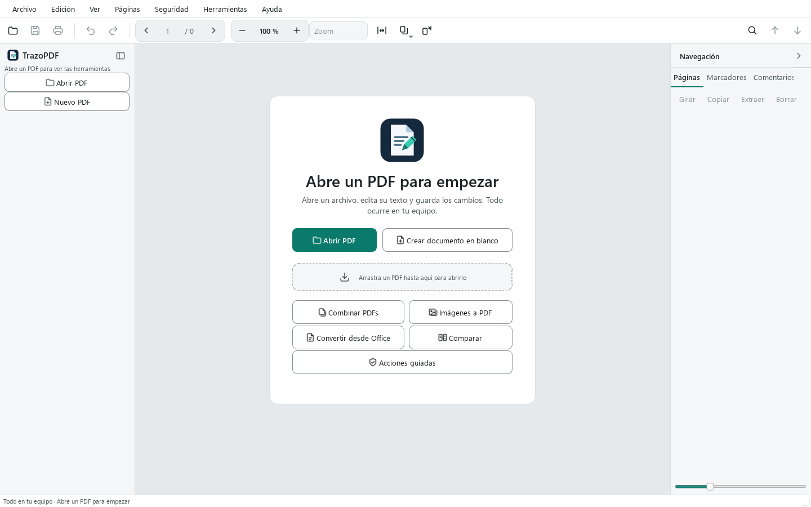

# Benutzerhandbuch von TrazoPDF

TrazoPDF ist ein kostenloser PDF-Editor für Windows. Er arbeitet lokal auf dem Computer: Es gibt keine Konten und keine Telemetrie, und Dokumente werden nirgendwo hochgeladen. Er wird unter der Lizenz AGPL-3.0-or-later verbreitet.

Dieses Handbuch erklärt jeden Bereich des Programms mit den tatsächlichen Namen von Menüs, Schaltflächen und Tastenkürzeln. Die Funktionen haben Grenzen; die wichtigsten stehen in Kapitel 15, die vollständigen Details in [FEATURES.md](../FEATURES.md).

## Inhalt

1. [Erste Schritte](#1-erste-schritte)
2. [Lesen und navigieren](#2-lesen-und-navigieren)
3. [Suchen](#3-suchen)
4. [Text und Bilder bearbeiten](#4-text-und-bilder-bearbeiten)
5. [Anmerken und kommentieren](#5-anmerken-und-kommentieren)
6. [Formulare und Signatur](#6-formulare-und-signatur)
7. [Seiten organisieren](#7-seiten-organisieren)
8. [Sicherheit](#8-sicherheit)
9. [OCR, Konvertierung und Export](#9-ocr-konvertierung-und-export)
10. [Vergleichen, Barrierefreiheit und Werkzeuge des Dokuments](#10-vergleichen-barrierefreiheit-und-werkzeuge-des-dokuments)
11. [Registerkarten, automatisches Speichern und Wiederherstellung](#11-registerkarten-automatisches-speichern-und-wiederherstellung)
12. [Sprachen](#12-sprachen)
13. [Tastenkürzel](#13-tastenkürzel)
14. [Fehlerbehebung](#14-fehlerbehebung)
15. [Bekannte Grenzen](#15-bekannte-grenzen)

---

## 1. Erste Schritte

### Anforderungen

Windows 10 oder 11, 64 Bit. Die OCR ist enthalten. [LibreOffice](https://www.libreoffice.org/) muss nur installiert werden, wenn Office-Dokumente in PDF umgewandelt werden sollen.

### Installation

Eine der beiden Versionen von der Seite Releases des Projekts herunterladen:

| Version | Datei | Verwendung |
| --- | --- | --- |
| Installer | `TrazoPDF-x.y.z-setup.exe` | Installiert für den eigenen Benutzer, ohne Administratorrechte. Man kann auch für alle Benutzer installieren. Legt die Verknüpfung im Startmenü an und, wenn angekreuzt, auf dem Desktop. Wird unter „Öffnen mit“ für PDF-Dateien eingetragen, ohne das Standardprogramm zu ändern. |
| Portabler Ordner | `TrazoPDF-x.y.z-windows.zip` | Datei entpacken und `TrazoPDF.exe` ausführen. Keine Installation nötig. |

Die heruntergeladene Datei mit `SHA256SUMS.txt` derselben Version prüfen.

Das Programm ist nicht signiert. Deshalb kann Windows beim ersten Start eine Warnung anzeigen. Siehe [SmartScreen](#windows-smartscreen-meldet-sich-beim-start-des-programms) in Kapitel 14.

### PDF öffnen

Es gibt vier Möglichkeiten:

- **Datei > Öffnen…** (`Strg+O`) oder die Schaltfläche **PDF öffnen** auf dem Willkommensbildschirm.
- **Datei > Zuletzt geöffnet** zeigt Name, Datum und Ordner der letzten Dateien.
- Ein PDF auf das Fenster ziehen.
- „Öffnen mit“ im Explorer, wenn das Installationsprogramm verwendet wurde.

Hat das PDF ein Öffnungskennwort, fragt das Programm danach. Das Feld hat eine Schaltfläche **Anzeigen**, mit der die Eingabe sichtbar wird, und zeigt Fehler an, ohne sich zu schließen.

Für eine leere Seite **Datei > Neues PDF** (`Strg+N`) oder **Leeres Dokument erstellen** auf dem Willkommensbildschirm verwenden.

### Der Willkommensbildschirm

Ohne geöffnetes Dokument sieht man:

- **PDF öffnen** und **Leeres Dokument erstellen**.
- Einen Bereich, in den ein PDF gezogen werden kann.
- Schnellzugriffe: **PDFs zusammenführen**, **Bilder in PDF**, **Aus Office konvertieren**, **Vergleichen** und **Geführte Aktionen**.
- Die Liste der zuletzt verwendeten Dateien mit Vorschaubild und Datum.



### Die Oberfläche


| Bereich | Inhalt |
| --- | --- |
| Menüleiste | Datei, Bearbeiten, Ansicht, Seiten, Sicherheit, Werkzeuge und Hilfe. |
| Symbolleiste (oben) | Öffnen, Speichern, Drucken, Rückgängig und Wiederholen; Seitennavigation (zurück, Seitennummer, Gesamtzahl, weiter); Zoom mit den Schaltflächen – und +, Liste **Zoom** mit Voreinstellungen, **An Seitenbreite anpassen**, **Ansicht und Zoom** und **Ansicht drehen**; rechts **Suchen** sowie die Pfeile für den vorherigen und den nächsten Treffer. |
| Werkzeugleiste (links) | Die Schaltflächen **PDF öffnen** und **Neues PDF** sowie drei Werkzeuggruppen: *Lesen und bearbeiten*, *Kommentieren* und *Formulare und Sicherheit*. |
| Dokument-Registerkarten | Eine Registerkarte je geöffnetem PDF, oberhalb der Arbeitsfläche. |
| Arbeitsfläche | Die Seite. Hier wird gelesen, ausgewählt und mit dem aktiven Werkzeug gearbeitet. |
| Seitenleiste (rechts) | Registerkarten **Seiten**, **Lesezeichen**, **Kommentare**, **Anhänge**, **Links**, **Ebenen**, **Felder** und **Eigenschaften**. |
| Statusleiste | Meldungen, aktuelle Seite, Seitengröße, aktives Werkzeug und Speicherstatus (*Nicht gespeichert*, *Automatisch gespeichert um HH:MM* oder *Gespeichert*). |

Ohne geöffnetes Dokument zeigt die Werkzeugleiste nur **PDF öffnen** und **Neues PDF** sowie einen Hinweis, ein PDF zu öffnen.

### Die Werkzeugleiste

Jedes Werkzeug hat einen Buchstaben als Tastenkürzel. Der Buchstabe wird gedrückt, während die Arbeitsfläche aktiv ist; beim Schreiben von Text funktioniert das nicht. Fährt man mit der Maus über eine Schaltfläche, steht der Buchstabe in Klammern.

| Gruppe | Werkzeug | Taste |
| --- | --- | --- |
| Lesen und bearbeiten | Text auswählen | `V` |
| | Objekte verschieben | `E` |
| | Verschieben | `H` |
| | Text | `T` |
| | Bild einfügen | `I` |
| | Link | `L` |
| Kommentieren | Hervorheben | `M` |
| | Unterstreichen | `U` |
| | Durchstreichen | `X` |
| | Notiz | `N` |
| | Textfeld | ohne Taste |
| | Zeichnen | `D` |
| | Linie, Pfeil, Rechteck, Ellipse | ohne Taste |
| | Messen | `Strg+Alt+M` |
| Formulare und Sicherheit | Ausfüllen und signieren | `F` |
| Formulare und Sicherheit | Feld erstellen | `K` |
| | Schwärzen (markieren) | `C` |
| | Seite zuschneiden | ohne Taste |

Um Platz zu gewinnen, die Schaltfläche am oberen Ende der Werkzeugleiste drücken oder **Ansicht > Kompakte Symbolleiste** (`Strg+B`) verwenden. Die Werkzeugleiste wird dann auf Symbole reduziert.

### Helles und dunkles Design

**Ansicht > Design** wählen und Hell, Dunkel oder das Systemdesign auswählen.


### Geführte Aktionen

**Werkzeuge > Geführte Aktionen…** öffnet ein andockbares Panel mit schrittweisen Assistenten. Jeder Schritt verwendet ein normales Werkzeug des Programms.

| Aktion | Schritte |
| --- | --- |
| Zum Versand vorbereiten | Metadaten und versteckte Daten entfernen, das Dokument komprimieren, eine Kopie speichern. |
| Zusammenführen und Seiten nummerieren | Dateien zusammenführen, Seiten nummerieren, speichern. |
| Vertrauliche Informationen schwärzen | Muster suchen und markieren, die Markierungen prüfen, Schwärzungen anwenden, versteckte Daten entfernen, eine Kopie speichern. |
| Ausfüllen und signieren | Dokument ausfüllen, mit Zertifikat signieren (optional), speichern. |

Eine Aktion wählen und **Weiter** drücken, um den aktuellen Schritt auszuführen. Mit **Überspringen** wird er übersprungen. Ein Schritt gilt nur dann als erledigt, wenn das Dokument tatsächlich geändert oder gespeichert wurde.

---

## 2. Lesen und navigieren

### Im Dokument navigieren

- Pfeile **vorherige Seite** und **nächste Seite** in der Symbolleiste oder eine Seitenzahl in das Seitenfeld eingeben.
- `Strg+G` setzt den Cursor in das Seitenfeld (**Zu Seite wechseln…**).
- Tastatur: `Bild↑` und `Bild↓` wechseln die Seite; `Pos1` und `Ende` gehen zur ersten und zur letzten Seite.
- Auf eine Miniatur im Panel **Seiten** klicken.
- Das Panel **Lesezeichen** zeigt das Inhaltsverzeichnis des Dokuments. Auf ein Lesezeichen klicken, um zu dessen Seite zu gelangen. Mit **Bearbeiten > Lesezeichen bearbeiten** lassen sich Lesezeichen hinzufügen und neu ordnen.

### Zoom

| Aktion | Vorgehen |
| --- | --- |
| Vergrößern und verkleinern | Schaltflächen + und – der Symbolleiste, `Strg++` und `Strg+-`, oder `Strg` + Mausrad. |
| Exakter Wert | Einen Prozentwert in das Zoomfeld eingeben (von 25 % bis 400 %). |
| Voreinstellungen | Liste **Zoom**: 50, 75, 100, 125, 150 und 200 %, **Breite anpassen**, **Seite anpassen**, **Originalgröße**. |
| Seite anpassen | `Strg+9` |
| Breite anpassen | `Strg+0` |
| Originalgröße (100 %) | `Strg+1` |

### Seitenlayout

In **Ansicht > Layout** (oder über die Schaltfläche **Ansicht und Zoom** der Symbolleiste) wählt man:

- **Eine Seite**
- **Zwei Seiten**
- **Kontinuierliches Scrollen**
- **Zwei Seiten, fortlaufend**

Die Textauswahl läuft in den fortlaufenden Ansichten über Seitengrenzen hinweg.

### Ansicht drehen

**Ansicht > Ansicht drehen** (`Strg+Umschalt+G`) dreht nur das, was man sieht. Die Datei bleibt unverändert. Um die Seiten des Dokuments zu drehen, wird **90° drehen** (`Strg+R`) verwendet, das in Kapitel 7 beschrieben ist.

### Weitere Ansichtsoptionen

- **Vollbild** (`F11`; `Esc` zum Beenden).
- **Seitenbereich** (`Strg+Umschalt+B`) blendet das Seitenpanel ein oder aus.
- **Nachrichtenverlauf** zeigt die letzten 20 Meldungen der Statusleiste.

### Speicher pro Datei

Jede Datei merkt sich ihre Seite, den Zoom und die Scrollposition. Beim erneuten Öffnen macht man dort weiter, wo man aufgehört hat.

### Drucken

**Datei > Drucken…** (`Strg+P`) öffnet eine Druckvorschau. Die Seiten werden in der Auflösung des Druckers erzeugt, zwischen 150 und 600 dpi.

---

## 3. Suchen

1. `Strg+F` drücken oder auf die Lupe klicken. Unter der Symbolleiste öffnet sich eine Leiste.
2. Den Text eingeben. Die Treffer werden markiert, und ein Zähler zeigt, wie viele es sind.
3. `Eingabe` oder `F3` springt zum nächsten Treffer. `Umschalt+Eingabe` oder `Umschalt+F3` zum vorherigen. Man kann auch die Pfeile der Leiste verwenden.
4. `Esc` schließt die Leiste.

Optionen der Leiste:

| Schaltfläche | Wirkung |
| --- | --- |
| **Aa** | Unterscheidet Groß- und Kleinschreibung. |
| **Ganzes Wort** | Findet nur ganze Wörter. |
| **Ersetzen** | Zeigt eine zweite Zeile zum Ersetzen von Text. |

Die Suche findet nur Text, der eine Textebene hat. Bei einem gescannten Dokument zuerst [OCR](#9-ocr-konvertierung-und-export) ausführen. Das Ersetzen folgt den Grenzen der Textbearbeitung (Kapitel 4). Jede Registerkarte merkt sich ihre eigene Suche.

Um konkrete Daten zu finden und zu schwärzen, siehe [Schwärzung](#schwärzung).

---

## 4. Text und Bilder bearbeiten

### Text auswählen und kopieren

Mit **Text auswählen** (`V`) über den Text ziehen. Ein Doppelklick wählt ein Wort aus, ein Dreifachklick eine Zeile. `Strg+C` kopiert. `Strg+A` wählt den gesamten Text der Seite aus (oder alle Miniaturen, wenn der Fokus im Seitenpanel liegt).

### Das Textwerkzeug

Das Werkzeug **Text** (`T`) macht zwei Dinge, je nachdem, wohin man klickt:

- **Auf vorhandenen Text**: bearbeitet diesen Block.
- **Auf eine freie Stelle der Seite**: fügt an dieser Stelle neuen Text hinzu.

Während des Schreibens gilt:

| Taste | Wirkung |
| --- | --- |
| `Strg+Eingabe` | Übernimmt den Text. |
| `Esc` | Bricht die laufende Eingabe ab. |

Eine schwebende Leiste erlaubt es, Schriftart, Größe, Farbe, Fett und Kursiv zu ändern.

Mit **Objekte verschieben** (`E`) lässt sich ein Textblock auswählen, ziehen, mit `F2` bearbeiten und mit `Entf` löschen.

Grenzen: Das Programm ordnet andere Blöcke nicht neu an, wie es Word tun würde, originale Schriftarten können ersetzt werden, und schräger Text wird nicht direkt bearbeitet.

### Text ersetzen

Die Suchleiste mit `Strg+F` öffnen, **Ersetzen** drücken und den neuen Text eingeben. Das funktioniert nur mit echtem Text, nicht mit Bildern.

### Bilder

Mit **Objekte verschieben** (`E`) auf ein Bild klicken, um es auszuwählen. Man kann:

- es ziehen, um es zu verschieben;
- an einer Ecke ziehen, um es zu skalieren;
- es durch ein anderes Bild ersetzen. Der Bereich bleibt erhalten, daher kann das neue Bild verzerrt wirken;
- es mit `Entf` löschen.

Um ein neues Bild hinzuzufügen, **Bild einfügen** (`I`) in der Werkzeugleiste verwenden.

Diese Vorgänge funktionieren mit direkten Bildern des PDF. Verschachtelte oder eingebettete Bilder werden möglicherweise nicht unterstützt. Alles lässt sich mit `Strg+Z` rückgängig machen.

### Links

Das Werkzeug **Link** (`L`) erstellt einen Link, indem man einen Bereich auf der Seite aufzieht. Er kann auf eine Webadresse, eine E-Mail-Adresse oder eine Seite des Dokuments zeigen. Das Panel **Links** und **Bearbeiten > Dokumentlinks…** erlauben es, Links zu öffnen, zu bearbeiten und zu löschen. Links werden nur geöffnet, wenn man es ausdrücklich verlangt.

### Seite zuschneiden

**Seite zuschneiden** in der Werkzeugleiste (Gruppe *Formulare und Sicherheit*) ändert den sichtbaren Bereich der Seite. Es ist keine Möglichkeit zum Schwärzen: Das Abgeschnittene bleibt in der Datei erhalten.

### Rückgängig und Wiederholen

`Strg+Z` macht rückgängig. `Strg+Umschalt+Z` oder `Strg+Y` wiederholen. Der Verlauf gilt für die Sitzung und wird beim Schließen des Dokuments nicht gespeichert.

---

## 5. Anmerken und kommentieren

Die Werkzeuge der Gruppe **Kommentieren** in der Werkzeugleiste:

| Werkzeug | Wofür es dient |
| --- | --- |
| Hervorheben (`M`), Unterstreichen (`U`), Durchstreichen (`X`) | Text markieren. Den Text mit dem aktiven Werkzeug auswählen. |
| Notiz (`N`) | Ein Kommentar, der an einer Stelle der Seite verankert ist. |
| Textfeld | Freier Text innerhalb eines Rahmens. |
| Zeichnen (`D`) | Freihand-Tinte. |
| Linie, Pfeil, Rechteck, Ellipse | Formen. |
| Messen | Entfernungen auf der Seite messen. |

### Kommentare und Antworten

Kommentare haben einen Autor, einen Antwortverlauf und einen Status. Sie werden im Register **Kommentare** der Seitenleiste oder über **Bearbeiten > Kommentare und Anmerkungen…** verwaltet. Das Löschen eines Kommentars aus dieser Liste lässt sich rückgängig machen.

### Messen

**Messen** (`Strg+Alt+M`) wählen und auf der Seite ziehen, um eine Entfernung zu erhalten. Mit der Option **Bereich** lassen sich Eckpunkte markieren. Die Genauigkeit hängt vom eingestellten Maßstab ab; es handelt sich nicht um eine zertifizierte Messung.

### Eine Anmerkung löschen

Die Anmerkung auswählen und `Entf` drücken.

Das Aussehen von Anmerkungen kann je nach PDF-Programm, mit dem sie geöffnet werden, unterschiedlich sein.

---

## 6. Formulare und Signatur

### Ein Formular ausfüllen

1. **Ausfüllen und signieren** in der Werkzeugleiste wählen oder `F` drücken.
2. Auf ein Feld klicken und schreiben. Kontrollkästchen werden mit einem Klick markiert.
3. `Tab` springt zum nächsten Feld.

In der Palette dieses Werkzeugs kann man außerdem freien Text schreiben, Häkchen oder Kreuze setzen, das heutige Datum einfügen und eine **Signatur** einfügen, die gezeichnet, geschrieben oder aus einem Bild stammt (**+ Signatur erstellen**). Mit **Signatur merken** wird sie für die spätere Verwendung gespeichert.

Außerdem gibt es **Bearbeiten > Formulare ausfüllen…**, das einen Dialog mit den Feldern öffnet. Das Register **Felder** der Seitenleiste listet die Felder des Dokuments auf; ein Klick führt zu jedem Feld.

AcroForm-Formulare lassen sich auf jeder sichtbaren Seite ausfüllen, auch in den fortlaufenden Ansichten. Formularskripte werden nicht ausgeführt, und XFA-Formulare werden nicht bearbeitet.

Wenn die Felder nicht mehr bearbeitbar sein sollen, **Werkzeuge > Reduzieren…** verwenden: Es bindet Anmerkungen und Felder in den Inhalt der Seite ein. Dies kann in der Sitzung rückgängig gemacht werden.

### Felder erstellen

- **Feld erstellen** in der Werkzeugleiste (oder die Taste `K`): das Feld auf der Seite aufziehen.
- **Werkzeuge > Felder erkennen**: sucht in einem Formular ohne Felder nach Linien und Kästchen und schlägt vor, Felder zu erstellen. Man sieht eine Vorschau und kann auswählen, welche übernommen werden. Erkannt werden nur kurze Linien und quadratische Kästchen; die Vorschläge sollten daher geprüft werden.

### Mit Zertifikat signieren

Die digitale Signatur verwendet ein eigenes Zertifikat im Format PKCS#12 (`.p12` oder `.pfx`). Das ist nicht dasselbe wie ein Bild der eigenen Unterschrift, das mit **Ausfüllen und signieren** eingefügt wird: Die Signatur mit Zertifikat schützt die Datei vor späteren Änderungen.

1. **Sicherheit > Mit Zertifikat signieren…**
2. Das Zertifikat auswählen und sein Kennwort eingeben.
3. Unter **Erscheinungsbild der Signatur** entscheiden, ob sie unsichtbar oder sichtbar sein soll:
   - **Signatur auf der Seite sichtbar** (ohne Häkchen ist die Signatur unsichtbar: Es bleibt nur ein Nachweis in der Datei). Wird das Häkchen gesetzt, die **Seite** wählen und **auf der Seite ziehen, um das Rechteck zu zeichnen**, in dem die Signatur erscheinen soll.
   - Festlegen, was angezeigt wird: **Name des Unterzeichners**, **Datum und Uhrzeit**, **Grund** und **Ort** (die beiden letzten optional) und, falls gewünscht, ein **Signaturbild** aus den gespeicherten.
4. Unter **Signaturoptionen** kann **Zeitstempel hinzufügen** aktiviert werden (siehe unten).
5. Entscheiden, wohin die Kopie gespeichert wird. Es entsteht eine signierte Kopie; das geöffnete Dokument bleibt unverändert.

**Mehrere Signaturen.** Hat das Dokument bereits Signaturen, warnt der Dialog: Die eigene Signatur wird als neue Revision hinzugefügt, und die früheren bleiben gültig. Werden danach Änderungen vorgenommen und das Dokument gespeichert, verlieren sie ihre Gültigkeit.

Der Zeitstempel ist optional und deaktiviert. Wird er aktiviert, gibt man selbst die Adresse (`https://…`) der Zeitstempelstelle an, und erst dann wird das Netzwerk genutzt. Schlägt der Zeitstempel fehl, bietet das Programm an, ohne ihn zu signieren.

Um ein verschlüsseltes Dokument zu signieren, muss zuvor eine Kopie ohne Kennwort gespeichert werden. Das Programm entfernt den Schutz nicht selbstständig.

### Signaturen prüfen

**Sicherheit > Signaturen durchsuchen…** prüft jede Signatur des PDF lokal und zeigt für jede Signatur:

- den Unterzeichner und das angegebene Datum;
- die **Integrität**: ob das Dokument nach dem Signieren verändert wurde;
- die **kryptografische Gültigkeit**;
- die **Vertrauenskette** gegenüber den Stammzertifikaten des Systems. Ein selbstsigniertes Zertifikat oder eines mit unbekanntem Stamm erscheint als „Nicht verifiziert“: Das ist kein Fehler, sondern zeigt nur, dass das Programm ihm allein nicht vertrauen kann;
- den Zeitstempel, falls vorhanden.

Grenzen: Die **Sperrung** der Zertifikate wird **nicht geprüft** (es wird kein Netzwerk abgefragt), und das Ergebnis **entspricht keiner qualifizierten elektronischen Signatur nach eIDAS**. Es gibt keine Fernsignatur und keinen Versand an Unterzeichner. Bei wichtigen Dokumenten die Datei zusätzlich mit einem unabhängigen Lesegerät prüfen.

---

## 7. Seiten organisieren

### Das Panel Seiten

Das Panel **Seiten** zeigt Miniaturen. Eine oder mehrere auswählen (`Strg+Klick`, `Umschalt+Klick`, oder `Strg+A` für alle). Miniaturen ziehen, um sie neu anzuordnen. Wurden Seitenbezeichnungen vergeben, erscheinen sie unter den Miniaturen.

Über den Miniaturen befindet sich eine Leiste mit **Drehen**, **Kopieren**, **Extrahieren** und **Löschen**. Das Kontextmenü (Rechtsklick) bietet:

- 90° nach links drehen
- 90° nach rechts drehen
- Duplizieren
- Hier leer einfügen
- Aus Bild einfügen…
- Ausgewählte extrahieren…
- Löschen
- Seitenbezeichnungen…

### Menü Seiten

| Option | Was sie tut |
| --- | --- |
| **Dateien zusammenführen…** | Fügt weitere PDF an das Dokument an. Man kann auch mehrere PDF auf das Fenster ziehen. |
| **Leere Seite einfügen** | Fügt eine leere Seite hinzu. |
| **Seite einfügen…** | Leere Seite (A4, Letter, A3, A5 oder benutzerdefiniert), Bild als Seite oder Duplikat mit Kopien. |
| **Seite duplizieren** | Kopiert die aktuelle Seite. |
| **Seiten löschen** | Löscht die ausgewählten Seiten. |
| **90° drehen** (`Strg+R`) | Dreht die Seiten. |
| **Seiten extrahieren…** | Erstellt ein neues PDF mit den gewählten Seiten. |
| **In Dateien teilen…** | Teilt das Dokument auf mehrere Dateien, mit Optionen zur Aufteilung. |
| **Wasserzeichen…** | Fügt ein Wasserzeichen hinzu. |
| **Seiten nummerieren…** | Schreibt die Nummer auf jede Seite. |
| **Kopf- und Fußzeile…** | Text links, mittig und rechts. Unterstützt `{page}`, `{pages}`, `{date}` und `{filename}`. Mit Rändern, Farbe und Seitenbereich. |
| **Stempel…** | Vordefinierte Stempel oder ein Bild. Ein Klick zentriert sie, Ziehen legt die Größe fest. |
| **Seitenbezeichnungen…** | Logische Nummerierung nach Bereichen (arabisch, römisch, Buchstaben, mit Präfix). Ändert nur, was die Miniaturen anzeigen, nicht den gedruckten Text. |

### Bates-Nummerierung

**Werkzeuge > Erweitert > Bates-Nummerierung…**: Präfix, Suffix, Startnummer, Stellenzahl und Position, auf allen Seiten oder in einem Bereich. Die Nummer wird in den Inhalt der Seite geschrieben.

### PDF aus anderen Dateien erstellen

- **Datei > PDF erstellen > Bilder…** erstellt ein PDF aus Fotos.
- **Datei > PDF erstellen > Office…** wandelt Word, Excel oder PowerPoint um (benötigt [LibreOffice](#libreoffice-wird-nicht-gefunden)).

### Stapelverarbeitung und Rezepte

**Werkzeuge > Mehrere PDFs verarbeiten…** wendet ein **Rezept** (eine geordnete Liste von Schritten) auf viele Dateien auf einmal an. Die Originale werden nicht verändert: Die Ergebnisse werden in einen Ausgabeordner geschrieben.

1. **Dateien hinzufügen…** oder **Ordner hinzufügen…** (mit **Unterordner einbeziehen**, wenn sie durchsucht werden sollen). **Entfernen** nimmt die gewählten Dateien aus der Liste.
2. Den **Ausgabeordner** wählen.
3. Unter **Wenn die Ausgabedatei bereits vorhanden ist** entscheiden: **Ausgabe umbenennen**, **Datei überspringen** oder **Ausgabe überschreiben**.
4. Unter **Rezept** ein gespeichertes oder vordefiniertes Rezept wählen oder mit **Schritt hinzufügen** ein neues zusammenstellen. Mit **Parameter…**, **Schritt entfernen**, **Nach oben** und **Nach unten** lassen sich jeder Schritt und die Reihenfolge anpassen.
5. **Verarbeiten** drücken. Die Tabelle zeigt pro Datei den **Status** (OK, Übersprungen, Fehler oder Abgebrochen) und das **Ergebnis**. **Abbrechen** stoppt den Vorgang, ohne unvollständige Dateien zurückzulassen.

Schlägt eine Datei fehl, wird der Fehler protokolliert und mit der nächsten Datei weitergemacht. Verschlüsselte PDF werden nicht verarbeitet. Die Ausgabedateien erhalten das Suffix `_procesado` (`_texto`, wenn das Rezept mit **Text exportieren** endet).

#### Verfügbare Schritte

| Schritt | Was er tut |
| --- | --- |
| **Anonymisieren** | Wie [Dokument anonymisieren](#dokument-anonymisieren), mit deinen Begriffen und Ausdrücken. |
| **OCR (durchsuchbarer Text)** | Sprachen (zum Beispiel `spa+eng`; leer = automatisch) und **Seiten gerade ausrichten und orientieren**. Ist es der erste Schritt, werden auch Bilder (PNG, JPG, TIFF, BMP) akzeptiert. |
| **Optimieren** | Bilder auf dpi reduzieren (0 = unverändert), JPEG-Qualität und Metadaten entfernen. |
| **Metadaten und verborgene Inhalte bereinigen** | Entspricht **Versteckte Daten entfernen**. |
| **Wasserzeichen** | Text und Größe. |
| **Seiten nummerieren** | Startnummer. |
| **Bates-Nummerierung** | Präfix, Suffix, Startnummer, Stellenzahl und Position. |
| **Alle Seiten drehen** | 90, 180 oder 270 Grad. |
| **Ränder zuschneiden** | Linker, oberer, rechter und unterer Rand, in Punkt. |
| **Mit Zertifikat signieren** | Zertifikat `.p12`/`.pfx`, Grund und Ort. Die Signatur ist unsichtbar. |
| **Text exportieren** | Erzeugt eine `.txt`-Datei. Muss der letzte Schritt sein. |

#### Rezepte speichern, importieren und exportieren

Mit **Rezept speichern…** bleibt das Rezept in der eigenen Liste. Mit **Exportieren…** und **Importieren…** wird es als `.json`-Datei weitergegeben. Ein Rezept speichert nie Kennwörter: Das Kennwort des Zertifikats wird beim Ausführen abgefragt (oder, ohne Fenster, aus der Variablen `PDFEDITOR_SIGN_PASSWORD` gelesen).

Es gibt drei vordefinierte Rezepte:

- **Anonymisieren und archivieren**: anonymisieren und optimieren, dabei Metadaten entfernen.
- **Scan zu durchsuchbarem PDF**: OCR mit Geradeausrichtung und optimieren.
- **Verkleinern und bereinigen**: optimieren und Metadaten bereinigen.

#### Über die Befehlszeile

TrazoPDF verarbeitet Stapel auch ohne geöffnetes Fenster, zum Beispiel um einen Scanner zu automatisieren. Dafür wird ein mit **Exportieren…** gespeichertes Rezept als `.json` verwendet.

```
"TrazoPDF.exe" --batch receta.json --in C:\Escaneos --out C:\Salida --recursive --on-conflict renombrar
"TrazoPDF.exe" --watch C:\Entrada --recipe receta.json --out C:\Salida
```

| Option | Bedeutung |
| --- | --- |
| `--batch RECETA.json` | Verarbeitet die PDF aus `--in` (Datei oder Ordner) einmal. |
| `--watch CARPETA` | Überwacht den Ordner (mit `--recipe`) und verarbeitet jedes neue PDF, sobald das Kopieren abgeschlossen ist. Verarbeitete Dateien werden in den Unterordner `procesados` verschoben; fehlgeschlagene bleiben, wo sie sind. Beendet wird mit `Strg+C`. |
| `--recipe RECETA.json` | Rezept für `--watch`. |
| `--out CARPETA` | Ausgabeordner. |
| `--recursive` | Mit `--batch`: schließt Unterordner ein. |
| `--on-conflict` | `renombrar` (Standard), `omitir` oder `sobrescribir`. |
| `--interval N` | Sekunden zwischen den Prüfungen von `--watch` (Standard 5). |

Der Bericht wird ausgegeben und als `batch-report.json` im Ausgabeordner gespeichert. **Exitcodes:** `0`, wenn alles gut gelaufen ist, `1`, wenn eine Datei fehlgeschlagen ist, und `2`, wenn die Verwendung falsch ist (fehlende Argumente, Rezept oder Eingabe existieren nicht).

---

## 8. Sicherheit

### Kennwörter

**Sicherheit > Mit Kennwort speichern…** schützt das Dokument mit der Verschlüsselung AES-256.

- Öffnungskennwort: das Kennwort, das beim Öffnen der Datei abgefragt wird.
- Eigentümerkennwort: steuert die Berechtigungen zum Drucken, Bearbeiten und Kopieren. Man kann es selbst wählen. Bleibt es leer, erzeugt das Programm ein sicheres Kennwort und **zeigt es nur ein einziges Mal an**, mit einer Schaltfläche zum Kopieren. Es wird nirgendwo gespeichert: Es muss notiert werden.

**Sicherheit > Kopie ohne Kennwort speichern…** speichert eine ungeschützte Kopie.

Beim Speichern bleiben die Verschlüsselung, die Berechtigungen und die Kennwörter der Originaldatei erhalten. Kann das Programm sie nicht erhalten, bietet es an:

- das Eigentümerkennwort einzugeben,
- mit neuen Kennwörtern zu schützen, oder
- eine ungeschützte Kopie zu speichern.

Beim Öffnen eines eingeschränkten PDF wird ebenfalls angeboten, das Eigentümerkennwort einzugeben, damit die Einschränkungen beim Speichern erhalten bleiben.

Die Berechtigungen zum Drucken, Bearbeiten und Kopieren hängen davon ab, dass jedes Lesegerät sie respektiert. Das ursprüngliche Eigentümerkennwort lässt sich nicht wiederherstellen.

Exportieren, Seiten extrahieren, Teilen und Signieren aus einem geschützten Dokument erzeugt Dateien **ohne Kennwort**. Das Programm warnt vorher.

### Schwärzung

Schwärzen besteht aus zwei Schritten: markieren und anwenden.

1. **Markieren.** **Schwärzen (markieren)** (`C`) verwenden und über den Bereich ziehen, der verborgen werden soll. Alternativ **Sicherheit > Suchen und schwärzen…** nutzen.
2. **Anwenden.** **Sicherheit > Schwärzungen anwenden** entfernt endgültig, was unter den Markierungen liegt.

Wichtig: **Eine nicht angewendete Markierung verbirgt nichts.** Der Text bleibt in der Datei. Deshalb fragt das Programm bei Speichern, Exportieren, Extrahieren, Teilen, Signieren oder bei OCR bzw. einem Vergleich mit offenen Markierungen nach einer Bestätigung und bietet an, sie anzuwenden.

Beim Anwenden werden entfernt:

- der Text, die Bilder und die Grafiken unter der Markierung;
- die Links, Formularfelder und Anmerkungen, die sie berühren;
- die Metadaten, XMP-Daten und Lesezeichen, die den geschwärzten Text nennen.

#### Suchen und schwärzen

**Sicherheit > Suchen und schwärzen…** sucht nach Mustern: Karten (mit Luhn-Prüfung), IBAN, DNI/NIE, NIF/CIF, Telefonnummern, Datumsangaben und E-Mail-Adressen. Außerdem akzeptiert es eigenen Text oder eigene reguläre Ausdrücke. Die gewünschten Treffer werden markiert, danach wird angeboten, sie anzuwenden. Es werden nur Texte erkannt; bei einem Scan vorher OCR ausführen. Die Liste prüfen, denn es kann Fehlalarme und übersehene Treffer geben.

### Dokument anonymisieren

**Sicherheit > Dokument anonymisieren…** entfernt personenbezogene Daten eines Dokuments endgültig und prüft das Ergebnis. Alles geschieht auf dem eigenen Computer und arbeitet mit einer **neuen Kopie**: Das Original wird nicht verändert. Bei verschlüsselten Dokumenten funktioniert es nicht; vorher eine Kopie ohne Kennwort speichern.

**Was erkannt wird.** Unter **Wonach gesucht wird** gibt es Kästchen, die beim Öffnen alle markiert sind, für dieselben Muster wie bei **Suchen und schwärzen** (Karten, IBAN, DNI/NIE, NIF/CIF, Telefonnummern, Datumsangaben, E-Mail-Adressen) und drei weitere: Sozialversicherungsnummer, Kfz-Kennzeichen und IP-Adresse. Außerdem können **Begriffe** (einer pro Zeile: Namen, Adressen, Referenzen …) und **Ausdrücke** (reguläre Ausdrücke, einer pro Zeile) eingegeben werden, mit **Groß-/Kleinschreibung beachten** und **Nur ganze Wörter**.

**Vorschau.**

1. **Treffer suchen** drücken. Es erscheint eine Liste mit Seite, Typ und gefundenem Text.
2. Treffer abwählen, die nicht angetastet werden sollen, oder **Alle markieren** und **Alle abwählen** verwenden.
3. Die **Ausgabedatei** prüfen (Standard `name-anonimizado.pdf`, neben dem Original; **Durchsuchen…** zum Ändern).
4. **Anonymisieren** drücken.

Treffer in Metadaten, Anhängen oder Anmerkungen lassen sich nicht abwählen: Sie werden immer entfernt.

**Was passiert.** Die Schwärzung wird auf die gewählten Treffer angewendet, und die übrigen Kanäle werden bereinigt: Metadaten und XMP, Anhänge, JavaScript, Lesezeichen, Miniaturen sowie Anmerkungen und Felder, die die Daten nennen. Danach wird die gesamte Datei neu geschrieben, ohne Änderungsverlauf.

**Überprüfung.** Das Programm liest die Kopie erneut und sucht die Daten im Text der Seiten, in Anmerkungen, Metadaten, Lesezeichen und Anhängen sowie in den Bytes der Datei, nachdem sie entpackt wurden. Außerdem prüft es, dass keine Anhänge, Skripte oder verwaisten Objekte übrig sind. **Schlägt die Überprüfung fehl, wird keine Datei gespeichert.**

**Bericht.** Am Ende erscheint ein Bericht mit den Treffern nach Typ, wo sie gefunden wurden, was entfernt wurde und das Ergebnis jeder Prüfung. **Bericht speichern…** speichert ihn als `.txt` oder `.json`. Der Bericht enthält die entfernten Daten nicht.

**Grenzen.**

- Es werden nur Daten erkannt, die als Text vorliegen. Scans und Bilder werden nicht gelesen: Vorher OCR ausführen, damit Text zum Suchen vorhanden ist. Text innerhalb eines Bildes wird nicht entfernt.
- Die Überprüfung sucht nach Text, nicht nach der Form der Buchstaben: Eingebettete Schriften als Teilmenge können die Glyphen der verwendeten Zeichen beibehalten.
- Es kann Fehlalarme und übersehene Treffer geben. Die Liste der Vorschau und das Ergebnis prüfen.
- In Bereichen, die nicht analysiert werden, können Daten zurückbleiben, etwa der Inhalt von Bildern oder Informationen, die nur ein Mensch erkennt. Die Kopie vor dem Teilen prüfen.

Es ist auch als Schritt eines [Stapels](#stapelverarbeitung-und-rezepte) mit Rezepten verfügbar.

### Versteckte Daten entfernen

**Sicherheit > Versteckte Daten entfernen…** entfernt Metadaten, Anhänge, JavaScript, Links und weitere Elemente. Dabei können Formulare verändert und nützliche Inhalte entfernt werden; das Ergebnis deshalb prüfen.

### Metadaten und Anhänge

- **Datei > Eigenschaften…** (`Alt+Eingabe`) bearbeitet die Metadaten.
- **Bearbeiten > Angehängte Dateien…** und das Register **Anhänge** verwalten die eingebetteten Dateien (hinzufügen, extrahieren, löschen).

### Vor dem Teilen eines vertraulichen Dokuments

1. Schwärzungen anwenden oder **Dokument anonymisieren…** verwenden, das alles erledigt und das Ergebnis prüft.
2. Wird nicht anonymisiert, **Versteckte Daten entfernen…** ausführen.
3. Die Anhänge prüfen.
4. Mit **Kopie speichern…** eine Kopie speichern.

---

## 9. OCR, Konvertierung und Export

### OCR

**Werkzeuge > Text erkennen (OCR)…** wandelt gescannte Seiten in durchsuchbaren Text um. Die Texterkennung ist im Programm enthalten: Es muss nichts installiert werden und es wird kein Netzwerk benötigt.

1. Unter **Textsprachen** die Sprachen des Dokuments markieren: Spanisch, Englisch, Französisch, Deutsch und Portugiesisch. Mehrere Sprachen dauern länger.
2. Ist der Scan schief oder gedreht, **Seiten gerade ausrichten und Ausrichtung erkennen** markieren. Es werden Schräglagen bis etwa 10° korrigiert, und es dauert länger.
3. Mit OK bestätigen und warten: Der Fortschritt wird angezeigt, und man kann abbrechen.

Funktioniert mit gescannten und gemischten Seiten und vermeidet doppelten Text, der bereits vorhanden ist. Das Ergebnis prüfen: Es können Erkennungsfehler bleiben. OCR erstellt eine Textebene. Der Scan wird damit nicht zu einem bearbeitbaren Dokument.

Es gibt auch einen Schritt **OCR (durchsuchbarer Text)** für [Stapel und Rezepte](#stapelverarbeitung-und-rezepte).

### Office in PDF

**Datei > PDF erstellen > Office…** verwendet LibreOffice. Das Layout muss nicht dem von Microsoft Office entsprechen.

### Exportieren

**Datei > Exportieren als** bietet:

| Option | Ergebnis |
| --- | --- |
| **Text (.txt)** | Der extrahierte Text. |
| **Word (.docx)** | Der extrahierte Text. Das Layout bleibt nicht erhalten. |
| **Excel (.xlsx)** | Die erkannten Tabellen; gibt es keine Tabellen, den Text zeilenweise. |
| **PowerPoint (.pptx)** | Ein Bild jeder Seite pro Folie. Die Elemente sind nicht bearbeitbar. |
| **Bilder…** | Jede Seite als Bild. |

Exporte eines geschützten Dokuments entstehen ohne Kennwort. Das Programm warnt vorher.

### Dateigröße reduzieren

**Werkzeuge > Dateigröße reduzieren…** verringert die Auflösung der Bilder, komprimiert sie neu, entfernt nicht verwendete Objekte und, falls gewünscht, Metadaten. Vor dem Anwenden wird die geschätzte Größe angezeigt. Das Reduzieren der dpi verringert die Qualität: Bei Zweifeln vorher eine Kopie speichern.

### Reduzieren

**Werkzeuge > Reduzieren…** bindet Anmerkungen und Felder in den Inhalt der Seite ein.

### Lange Vorgänge

OCR, Konvertierung, Export, Teilen, Signieren, Optimieren und Prüfen zeigen ihren Fortschritt an und können abgebrochen werden. Beim Abbrechen werden die teilweise erstellten Dateien gelöscht.

---

## 10. Vergleichen, Barrierefreiheit und Werkzeuge des Dokuments

### Dokumente vergleichen

**Werkzeuge > Dokumente vergleichen…** fragt, wie das aktuelle Dokument mit einem anderen PDF verglichen werden soll:

- **Darstellung (visuell)**: zeigt beide Dokumente und markiert die Unterschiede in Magenta. Es gibt drei Ansichten, Navigation zwischen den Änderungen, synchronisierten Zoom und Export des Berichts als ZIP. Der Vorgang ist abbrechbar. Ein neuer Vergleich benötigt einen leeren Ausgabeordner.
- **Text**: listet die Unterschiede der Textzeilen pro Seite auf.

Beide vergleichen nach Seitennummer. Der visuelle Vergleich rastert mit höchstens 110 dpi und 1400 px Seitenlänge und vergleicht keine Metadaten, Links, Signaturen oder verborgene Inhalte.

### Dokument prüfen

**Werkzeuge > Dokument prüfen…** erstellt einen schnellen Bericht über gescannte Seiten, nicht eingebettete Schriften, Barrierefreiheits-Tags, Titel, Sprache und JavaScript. Ein Doppelklick auf ein Element führt zur Seite. Es ist keine Validierung nach PDF/UA oder PDF/A.

### Barrierefreiheit prüfen

**Werkzeuge > Barrierefreiheit prüfen…** erstellt einen Bericht je Element: Titel, Sprache, Tags, Seiten ohne Text, Alternativtext und Lesezeichen. Titel und Sprache lassen sich mit einem Klick korrigieren (mit einer Liste zur Auswahl der Sprache). Der Bericht kann als Text exportiert werden. Auch hier handelt es sich nicht um eine Validierung nach PDF/UA.

### Weitere Werkzeuge des Dokuments

| Werkzeug | Wo |
| --- | --- |
| Dateigröße reduzieren | Werkzeuge |
| Reduzieren | Werkzeuge |
| Messen | Werkzeuge und Werkzeugleiste |
| Felder erkennen | Werkzeuge |
| Bates-Nummerierung | Werkzeuge > Erweitert |
| Ebenen | Register **Ebenen** der Seitenleiste |

Das Register **Ebenen** zeigt oder verbirgt die optionalen Inhaltsebenen, die das PDF enthält. Es erstellt oder bearbeitet keine Ebenen.

---

## 11. Registerkarten, automatisches Speichern und Wiederherstellung

### Mehrere Dokumente gleichzeitig

Jedes geöffnete PDF hat eine Registerkarte oberhalb der Arbeitsfläche. Jede Registerkarte speichert ihre Seite, den Zoom, die Scrollposition, die Suche, den Rückgängig-Verlauf, die Seitenleiste und eine Wiederherstellungskopie. Das Öffnen einer bereits geöffneten Datei aktiviert deren Registerkarte.

- Eine Registerkarte ziehen, um sie neu anzuordnen.
- Die Schaltfläche **×** der Registerkarte oder `Strg+W` schließt sie.
- Rechtsklick auf eine Registerkarte: **Schließen**, **Andere schließen** und **Im Ordner anzeigen**.

| Tastenkürzel | Wirkung |
| --- | --- |
| `Strg+Tab` / `Strg+Umschalt+Tab` | Nächste / vorherige Registerkarte |
| `Alt+1` bis `Alt+8` | Zu dieser Registerkarte wechseln |
| `Alt+9` | Zur letzten Registerkarte wechseln |
| `Strg+W` | Aktuelles Dokument schließen |

Wird ein Dokument mit ungespeicherten Änderungen geschlossen, fragt das Programm, was damit geschehen soll.

### Speichern

| Option | Wirkung |
| --- | --- |
| **Speichern** (`Strg+S`) | Speichert in die Datei. |
| **Speichern unter…** (`Strg+Umschalt+S`) | Speichert unter einem anderen Namen. |
| **Kopie speichern…** (`Strg+Alt+S`) | Schreibt eine andere Datei, ohne das geöffnete Dokument zu verändern. |
| **Zurücksetzen** | Lädt die gespeicherte Version neu und verwirft die Änderungen seit dem letzten Speichern. Es wird eine Bestätigung verlangt. |

Beim Speichern über eine bestehende Datei legt das Programm eine `.bak`-Kopie des Originals an, einmal pro Sitzung und Datei. Diese Kopie ist standardmäßig aktiviert.

### Automatisches Speichern und Wiederherstellung

- Jede Minute schreibt das Programm eine Wiederherstellungskopie jedes Dokuments mit ungespeicherten Änderungen. Die Originaldatei wird nicht berührt.
- Die Statusleiste zeigt *Nicht gespeichert*, *Automatisch gespeichert um HH:MM* oder *Gespeichert*.
- Wird das Programm unerwartet beendet, erscheint beim Start eine Meldung: „Es gibt ein nicht gespeichertes Dokument aus einer früheren Sitzung“. Man wählt **Wiederherstellen** oder **Verwerfen**.
- Die Wiederherstellungskopie wird beim Speichern oder beim regulären Schließen gelöscht.

Das automatische Speichern ersetzt das Speichern der Datei nicht. Dokumente mit Kennwortschutz werden nicht automatisch gespeichert, damit keine unverschlüsselte Kopie entsteht; das Programm weist einmal darauf hin.

### Zuletzt verwendete Dateien

**Datei > Zuletzt geöffnet** zeigt Name, Datum und Ordner. Dateien, die nicht mehr existieren, erscheinen als „Nicht verfügbar“ mit der Option **Aus Zuletzt verwendet entfernen**. **Liste leeren** leert die Liste.

---

## 12. Sprachen

Die Oberfläche ist in fünf Sprachen verfügbar:

| Code | Sprache |
| --- | --- |
| es | Spanisch |
| en | Englisch |
| fr | Französisch |
| de | Deutsch |
| pt | Portugiesisch |

### Sprache wechseln

1. **Hilfe > Sprache** öffnen und die Sprache wählen.
2. Das Programm **neu starten**. Die Änderung wird erst danach angewendet.

Standardmäßig verwendet das Programm die Sprache von Windows; ist sie nicht unter den fünf, wird Englisch verwendet. Um eine Sprache zu erzwingen, kann die Umgebungsvariable `PDFEDITOR_LANG` gesetzt werden (zum Beispiel `PDFEDITOR_LANG=en`).

Dieses Handbuch verwendet die Namen von Menüs und Schaltflächen so, wie sie in der deutschen Oberfläche erscheinen. In anderen Sprachen ändern sich die Namen, der Aufbau bleibt jedoch gleich.

---

## 13. Tastenkürzel

**Hilfe > Tastenkürzel** (`F1`) zeigt die Tabelle im Programm.

### Datei und Bearbeiten

| Tastenkürzel | Aktion |
| --- | --- |
| `Strg+N` | Neues PDF |
| `Strg+O` | Öffnen |
| `Strg+S` | Speichern |
| `Strg+Umschalt+S` | Speichern unter |
| `Strg+Alt+S` | Kopie speichern |
| `Strg+P` | Drucken |
| `Alt+Eingabe` | Eigenschaften |
| `Strg+W` | Dokument schließen |
| `Strg+Q` | Beenden |
| `Strg+Z` | Rückgängig |
| `Strg+Umschalt+Z` / `Strg+Y` | Wiederholen |
| `Strg+A` | Alles auswählen (Text oder Miniaturen, je nach Fokus) |
| `Strg+C` | Ausgewählten Text kopieren |
| `Strg+E` | PDF bearbeiten |
| `Strg+R` | Seiten um 90° drehen |
| `Strg+Alt+M` | Messen |
| `F1` | Tastenkürzel |

### Ansicht und Navigation

| Tastenkürzel | Aktion |
| --- | --- |
| `Strg+F` | Suchen |
| `F3` / `Umschalt+F3` | Nächster / vorheriger Treffer |
| `Strg+G` | Zu Seite wechseln |
| `Strg+9` | Seite anpassen |
| `Strg+0` | Breite anpassen |
| `Strg+1` | Originalgröße (100 %) |
| `Strg++` / `Strg+=` | Vergrößern |
| `Strg+-` | Verkleinern |
| `Strg` + Mausrad | Zoom ändern |
| `Strg+Umschalt+G` | Ansicht drehen |
| `F11` | Vollbild |
| `Strg+B` | Kompakte Symbolleiste |
| `Strg+Umschalt+B` | Seitenbereich |
| `Bild↑` / `Bild↓` | Nächste / vorherige Seite |
| `Pos1` / `Ende` | Erste / letzte Seite |

### Registerkarten

| Tastenkürzel | Aktion |
| --- | --- |
| `Strg+Tab` / `Strg+Umschalt+Tab` | Nächste / vorherige Registerkarte |
| `Alt+1` bis `Alt+9` | Zur angegebenen Registerkarte wechseln (`Alt+9` führt zur letzten) |

### Werkzeuge (bei aktiver Arbeitsfläche)

| Taste | Werkzeug |
| --- | --- |
| `V` | Text auswählen |
| `H` | Verschieben |
| `E` | Objekte verschieben |
| `T` | Text |
| `I` | Bild einfügen |
| `L` | Link |
| `N` | Notiz |
| `D` | Zeichnen |
| `M` | Hervorheben |
| `U` | Unterstreichen |
| `X` | Durchstreichen |
| `F` | Ausfüllen und signieren |
| `K` | Feld erstellen |
| `C` | Schwärzen (markieren) |

### Während der Bearbeitung

| Tastenkürzel | Aktion |
| --- | --- |
| `Strg+Eingabe` | Den gerade eingegebenen Text übernehmen |
| `Esc` | Die laufende Eingabe abbrechen |
| `F2` | Den ausgewählten Block bearbeiten |
| `Entf` | Das ausgewählte Element löschen |
| `Tab` | Nächstes Feld beim Ausfüllen eines Formulars |

### Suche

| Tastenkürzel | Aktion |
| --- | --- |
| `Eingabe` oder `F3` | Nächster Treffer |
| `Umschalt+Eingabe` oder `Umschalt+F3` | Vorheriger Treffer |
| `Esc` | Suchleiste schließen |

---

## 14. Fehlerbehebung

### Windows SmartScreen meldet sich beim Start des Programms

TrazoPDF wird ohne Codesignatur verbreitet. Deshalb zeigt SmartScreen beim Starten des Installers oder des Programms die Meldung „Der Computer wurde durch Windows geschützt“.

1. Auf **Weitere Informationen** klicken.
2. **Trotzdem ausführen** drücken.

Vorher prüfen, ob die Datei das Original ist, mit `SHA256SUMS.txt`:

```powershell
Get-FileHash .\TrazoPDF-x.y.z-setup.exe -Algorithm SHA256
```

Das Ergebnis muss mit der Zeile dieser Datei in `SHA256SUMS.txt` übereinstimmen.

### Die OCR funktioniert nicht oder erkennt meine Sprache nicht

Die OCR ist in der installierten und in der portablen Version enthalten und benötigt keine Installation. Schlägt sie fehl:

1. Prüfen, ob die Sprache unter **Textsprachen** markiert ist. Verfügbar sind nur Spanisch, Englisch, Französisch, Deutsch und Portugiesisch.
2. Ist die Seite schief oder gedreht, mit **Seiten gerade ausrichten und Ausrichtung erkennen** wiederholen.
3. **Hilfe > Info zu TrazoPDF** ansehen, das eine Diagnose enthält.

Nur wenn TrazoPDF aus dem Quellcode ausgeführt wird, muss [Tesseract](https://github.com/UB-Mannheim/tesseract/wiki) installiert werden. Liegt es an einem ungewöhnlichen Pfad, wird dieser über die Umgebungsvariable `PDFEDITOR_TESSERACT` angegeben.

### LibreOffice wird nicht gefunden

Die Erstellung eines PDF aus Office benötigt LibreOffice (https://www.libreoffice.org/), das **nicht** enthalten ist. Es installieren und TrazoPDF neu starten. Liegt es an einem anderen Pfad, die Variable `PDFEDITOR_SOFFICE` verwenden. Die Diagnose steht unter **Hilfe > Info zu TrazoPDF**.

### Die Suche findet nichts

Wahrscheinlich ist das PDF ein Scan ohne Textebene. **Werkzeuge > Text erkennen (OCR)…** ausführen.

### Ein geschütztes PDF lässt sich nicht bearbeiten oder speichern

Hat das PDF eingeschränkte Berechtigungen, bietet das Programm beim Öffnen die Eingabe des Eigentümerkennworts an. Ist es unbekannt, lässt sich eine ungeschützte Kopie speichern oder das Dokument mit neuen Kennwörtern schützen.

### Es wird eine Bestätigung wegen nicht angewendeter Schwärzungen verlangt

Es gibt Schwärzungsmarkierungen, die nicht angewendet wurden. Entweder mit **Sicherheit > Schwärzungen anwenden** anwenden oder abbrechen und sie prüfen.

### Die Schrift ändert sich beim Bearbeiten des Textes

Das PDF verwendet eine Schrift, die nicht verfügbar ist, und das Programm ersetzt sie. Das ist eine bekannte Grenze.

### Das Programm wurde mit ungespeicherten Änderungen beendet

Das Programm erneut öffnen. Es erscheint eine Meldung, bei der man **Wiederherstellen** oder **Verwerfen** für die Wiederherstellungskopie wählt (siehe Kapitel 11).

### Ein signiertes PDF ist nicht mehr gültig

Das Ändern und Speichern eines signierten PDF macht seine Signaturen ungültig. Die endgültige Kopie erneut signieren. Werden mehrere Signaturen hinzugefügt, immer als Letztes signieren, nach allen Änderungen.

### Die Stapelverarbeitung schlägt bei einigen Dateien fehl

Die Spalte **Ergebnis** der Tabelle oder der Bericht `batch-report.json` im Ausgabeordner zeigt die Ursache. Verschlüsselte PDF werden nicht verarbeitet, und ein Rezept, das signiert, benötigt das Kennwort des Zertifikats. Fehlgeschlagene Dateien stoppen den übrigen Stapel nicht.

### Wenn das Problem weiterhin besteht

Die letzten Meldungen mit **Ansicht > Nachrichtenverlauf** ansehen und **Hilfe > Info zu TrazoPDF** für die Version und die Diagnose der Werkzeuge (OCR und LibreOffice) prüfen.

---

## 15. Bekannte Grenzen

TrazoPDF deckt die üblichen Aufgaben mit PDF ab. Dies sind die wichtigsten Grenzen.

### Bearbeitung

- Die Bearbeitung ist für digitalen Text gedacht. Bei Scans fügt die OCR eine durchsuchbare Ebene hinzu; sie rekonstruiert das Bild nicht.
- Andere Blöcke werden nicht neu angeordnet wie in einem Word-Dokument.
- Originale Schriftarten können ersetzt werden.
- Schräger Text wird nicht direkt bearbeitet.
- Bilder: Die Bearbeitung ist auf kompatible direkte Bilder beschränkt. Beim Ersetzen bleibt der Bereich erhalten, und das neue Bild kann verzerrt werden.
- Suchen und Ersetzen wirkt nur auf Text mit Textebene.

### Sicherheit und Signatur

- Nicht angewendete Schwärzungsmarkierungen schwärzen nichts.
- Suchen und schwärzen liest keine gescannten Bilder und kann Fehlalarme und übersehene Treffer liefern.
- Eine Seite zuzuschneiden verbirgt die Daten nicht.
- Die Berechtigungen zum Drucken, Bearbeiten und Kopieren hängen vom Lesegerät ab.
- Signaturen prüfen überprüft Integrität und Vertrauenskette lokal, prüft aber nicht die Sperrung. Die Signatur entspricht keiner qualifizierten elektronischen Signatur nach eIDAS, und es gibt keinen Dienst für Fernsignaturen oder den Versand an Unterzeichner. Der Zeitstempel ist optional und erfordert die Angabe einer Stelle.
- Dokument anonymisieren erkennt nur Text: Ohne OCR werden keine Bilder gelesen, und Teilmengen-Schriften können Glyphen beibehalten. Die Kopie und den Bericht prüfen.
- Stapel und Rezepte verarbeiten keine verschlüsselten PDF; die Signatur im Stapel ist immer unsichtbar.

### Konvertierung

- Office in PDF hängt von LibreOffice ab und garantiert nicht dasselbe Layout.
- PDF nach DOCX behält das Layout nicht bei.
- PDF nach XLSX hängt von der visuellen Struktur der Tabellen ab.
- PDF nach PPTX erzeugt Seitenbilder, keine bearbeitbaren Objekte.

### Formulare

- Formularskripte werden nicht ausgeführt, und XFA-Formulare werden nicht bearbeitet.
- Die automatische Erkennung von Feldern erkennt nur kurze Linien und quadratische Kästchen.

### Vergleich und Prüfung

- Der visuelle und der Textvergleich arbeiten nach Seitennummer und richten eingefügte Seiten nicht aus.
- Dokument prüfen und Barrierefreiheit prüfen sind schnelle Durchsichten, keine Validierungen nach PDF/UA oder PDF/A.

### Geschützte Dokumente

- Sie werden nicht automatisch gespeichert.
- Exportieren, Extrahieren, Teilen und Signieren erzeugen Dateien ohne Kennwort.

### Außerhalb des Funktionsumfangs

PDF/A und PDF/X, 3D-Inhalte und Multimedia, Cloud-Freigabe und Online-Überprüfung, mobile Apps, PDF-Portfolios sowie die automatische Kennzeichnung oder die Bearbeitung von Barrierefreiheits-Tags. Außerdem wird die Kompatibilität mit allen komplexen Dokumenten, dynamischen Formularen, Schriften oder Farbprofilen nicht garantiert.

---

TrazoPDF ist freie Software unter der Lizenz AGPL-3.0-or-later.
