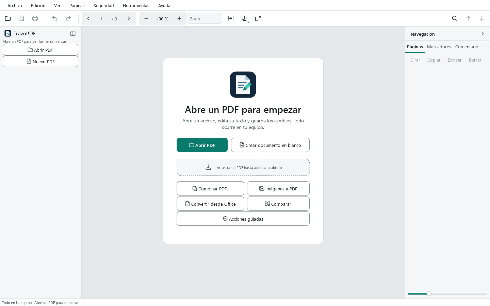

# TrazoPDF User Manual

TrazoPDF is a free PDF editor for Windows. It runs on your computer: it has no accounts or telemetry and does not upload your documents anywhere. It is distributed under the AGPL-3.0-or-later license.

This manual explains each area of the program using the real names of menus, buttons and shortcuts. Features have limits; the most important ones are in chapter 15, and the full details are in [FEATURES.md](../FEATURES.md).

## Contents

1. [Getting started](#1-getting-started)
2. [Read and navigate](#2-read-and-navigate)
3. [Find](#3-find)
4. [Edit text and images](#4-edit-text-and-images)
5. [Annotate and comment](#5-annotate-and-comment)
6. [Forms and signatures](#6-forms-and-signatures)
7. [Organize pages](#7-organize-pages)
8. [Security](#8-security)
9. [OCR, conversion and export](#9-ocr-conversion-and-export)
10. [Compare, accessibility and document tools](#10-compare-accessibility-and-document-tools)
11. [Tabs, autosave and recovery](#11-tabs-autosave-and-recovery)
12. [Languages](#12-languages)
13. [Keyboard shortcuts](#13-keyboard-shortcuts)
14. [Troubleshooting](#14-troubleshooting)
15. [Known limitations](#15-known-limitations)

---

## 1. Getting started

### Requirements

64-bit Windows 10 or 11. OCR is included. You only need to install [LibreOffice](https://www.libreoffice.org/) if you want to convert Office documents to PDF.

### Install

Download one of the two versions from the project's Releases page:

| Version | File | How to use it |
| --- | --- | --- |
| Installer | `TrazoPDF-x.y.z-setup.exe` | Installs for your user, without administrator rights. You can choose to install it for all users. Creates a Start menu shortcut and, if you select it, a desktop shortcut. It is added to "Open with" for PDFs without changing your default program. |
| Portable folder | `TrazoPDF-x.y.z-windows.zip` | Unzip the file and run `TrazoPDF.exe`. No installation required. |

Check the downloaded file with `SHA256SUMS.txt`, which is in the same release.

The program is not signed, so Windows may show a warning the first time you run it. See [SmartScreen](#windows-smartscreen-warns-when-running-the-program) in chapter 14.

### Open a PDF

There are four ways to do it:

- **File > Open…** (`Ctrl+O`) or the **Open PDF** button on the welcome screen.
- **File > Open recent**, which shows the name, date and folder of the latest files.
- Drag a PDF onto the window.
- "Open with" from File Explorer, if you used the installer.

If the PDF has an open password, the program asks you for it. The dialog has a **Show password** button so you can see what you type, and it shows errors without closing.

To start with a blank sheet, use **File > New PDF** (`Ctrl+N`) or **Create blank document** on the welcome screen.

### The welcome screen

When no document is open, you will see:

- **Open PDF** and **Create blank document**.
- An area where you can drag a PDF.
- Quick access buttons: **Merge PDFs**, **Images to PDF**, **Convert from Office**, **Compare** and **Guided actions**.
- The list of recent files with thumbnail and date.



### The interface


| Area | What it contains |
| --- | --- |
| Menu bar | File, Edit, View, Pages, Security, Tools and Help. |
| Top bar | Open, Save, Print, Undo and Redo; page navigator (previous, number, total, next); zoom with the – and + buttons, the **Zoom** list with presets, **Fit to page width**, **View and zoom** and **Rotate view**; on the right, Find and the previous and next match arrows. |
| Tool rail (left) | The **Open PDF** and **New PDF** buttons, and three groups of tools: *Read and edit*, *Comment* and *Forms and security*. |
| Document tabs | One tab for each open PDF, above the canvas. |
| Canvas | The page. Here you read, select and work with the active tool. |
| Side panel (right) | The **Pages**, **Bookmarks**, **Comments**, **Attachments**, **Links**, **Layers**, **Fields** and **Properties** tabs. |
| Status bar | Messages, current page, page size, active tool and the save status (*Unsaved*, *Autosaved at HH:MM* or *Saved*). |

With no document open, the rail only shows **Open PDF** and **New PDF**, plus a message asking you to open a PDF.

### The tool rail

Each tool has a shortcut letter. Press the letter while the canvas is active; it does not work while you are typing text. When you hover over a button, you will see its letter in brackets.

| Group | Tool | Letter |
| --- | --- | --- |
| Read and edit | Select text | `V` |
| | Move objects | `E` |
| | Pan | `H` |
| | Text | `T` |
| | Insert image | `I` |
| | Link | `L` |
| Comment | Highlight | `M` |
| | Underline | `U` |
| | Strikethrough | `X` |
| | Note | `N` |
| | Text box | no letter |
| | Draw | `D` |
| | Line, Arrow, Rectangle, Ellipse | no letter |
| | Measure | `Ctrl+Alt+M` |
| Forms and security | Fill and sign | `F` |
| Forms and security | Create field | `K` |
| | Redact (mark) | `C` |
| | Crop page | no letter |

To gain space, press the button at the top of the rail or use **View > Compact toolbar** (`Ctrl+B`). The rail is reduced to icons only.

### Light and dark theme

Choose **View > Theme** and select light, dark or the system setting.


### Guided actions

**Tools > Guided actions…** opens a dockable panel with step-by-step wizards. Each step uses a regular tool in the program.

| Action | Steps |
| --- | --- |
| Prepare for sending | Remove metadata and hidden data, compress the document, save a copy. |
| Merge and number pages | Merge files, number pages, save. |
| Redact sensitive information | Find and mark patterns, review the marks, apply redactions, remove hidden data, save a copy. |
| Fill and sign | Fill in the document, sign with a certificate (optional), save. |

Choose an action and press **Next** to run the current step. Press **Skip** to skip it. A step is only marked as done if the document really changed or was saved.

---

## 2. Read and navigate

### Moving through the document

- Use the **previous** and **next** arrows on the top bar, or type a number in the page field.
- `Ctrl+G` moves the cursor to the page field (**Go to page…**).
- Keyboard: `PgDn` and `PgUp` change page; `Home` and `End` go to the first and last page.
- Click a thumbnail in the **Pages** panel.
- The **Bookmarks** panel shows the document outline. Click a bookmark to go to its page. With **Edit > Edit bookmarks** you can add and reorganize bookmarks.

### Zoom

| Action | How |
| --- | --- |
| Zoom in and out | The + and – buttons on the bar, `Ctrl++` and `Ctrl+-`, or `Ctrl` + mouse wheel. |
| Exact value | Type a percentage in the zoom field (from 25 % to 400 %). |
| Presets | **Zoom** list: 50, 75, 100, 125, 150 and 200 %, **Fit width**, **Fit page**, **Actual size**. |
| Fit page | `Ctrl+9` |
| Fit width | `Ctrl+0` |
| Actual size (100 %) | `Ctrl+1` |

### Page layout

Under **View > Layout** (or with the **View and zoom** button on the bar) you can choose:

- **One page**
- **Two pages**
- **Continuous scrolling**
- **Two pages, continuous**

Text selection crosses pages in the continuous views.

### Rotating the view

**View > Rotate view** (`Ctrl+Shift+G`) rotates only what you see. It does not change the file. To rotate the pages of the document, use **Rotate 90°** (`Ctrl+R`), described in chapter 7.

### Other View options

- **Full screen** (`F11`; `Esc` to exit).
- **Pages panel** (`Ctrl+Shift+B`) shows or hides the side panel.
- **Message history** shows the last 20 messages from the status bar.

### Per-file memory

Each file remembers its page, zoom and scroll position. When you open it again, you pick up where you left off.

### Printing

**File > Print…** (`Ctrl+P`) opens a print preview before printing. Pages are generated at the printer's resolution, between 150 and 600 dpi.

---

## 3. Find

1. Press `Ctrl+F` or the magnifying glass button. A bar opens below the top bar.
2. Type the text. The results are highlighted and a counter shows how many there are.
3. `Enter` or `F3` goes to the next match. `Shift+Enter` or `Shift+F3` goes to the previous one. You can also use the arrows on the bar.
4. `Esc` closes the bar.

Options on the bar:

| Button | Effect |
| --- | --- |
| **Aa** | Matches upper and lower case. |
| **Whole word** | Matches whole words only. |
| **Replace** | Shows a second row to replace text. |

Search only finds text that has a text layer. In a scanned document, run [OCR](#9-ocr-conversion-and-export) first. Replacement follows the limits of text editing (chapter 4). Each tab remembers its own search.

To find specific data and redact it, see [Find and redact](#redaction).

---

## 4. Edit text and images

### Select and copy text

With **Select text** (`V`), drag over the text. A double-click selects a word and a triple-click selects a line. `Ctrl+C` copies. `Ctrl+A` selects all the text on the page (or all thumbnails if the focus is on the Pages panel).

### The Text tool

The **Text** tool (`T`) does two things depending on where you click:

- **On existing text**: edits that block.
- **On an empty spot on the page**: adds new text at that point.

While you type:

| Key | Effect |
| --- | --- |
| `Ctrl+Enter` | Applies the text. |
| `Esc` | Cancels what you are typing. |

A floating bar lets you change the font, size, color, bold and italic.

With **Move objects** (`E`) you can select a text block, drag it, edit it with `F2` and delete it with `Del`.

Limits: the program does not reflow the other blocks the way Word would, the original fonts may be replaced, and slanted text cannot be edited directly.

### Replace text

Open the search bar with `Ctrl+F`, press **Replace** and type the new text. It only works with real text, not with images.

### Images

With **Move objects** (`E`), click an image to select it. You can:

- Drag it to move it.
- Drag a corner to resize it.
- Replace it with another image. The area is kept, so the new image may end up stretched.
- Delete it with `Del`.

To add a new image, use **Insert image** (`I`) on the rail.

These operations work with the images placed directly in the PDF. Nested or inline images may not support them. Everything can be undone with `Ctrl+Z`.

### Links

The **Link** tool (`L`) creates a link by drawing an area on the page. It can point to a web address, an email address or a page in the document. The **Links** panel and **Edit > Document links…** let you open, edit and delete links. Links only open when you ask them to.

### Crop page

**Crop page** on the rail (in the *Forms and security* group) changes the visible area of the page. It is not a way to redact: what has been cropped is still in the file.

### Undo and redo

`Ctrl+Z` undoes. `Ctrl+Shift+Z` or `Ctrl+Y` redoes. The history belongs to the session and is not kept when you close the document.

---

## 5. Annotate and comment

The tools in the **Comment** group of the rail:

| Tool | What it is for |
| --- | --- |
| Highlight (`M`), Underline (`U`), Strikethrough (`X`) | Mark text. Select the text with the active tool. |
| Note (`N`) | A comment attached to a point on the page. |
| Text box | Free text inside a box. |
| Draw (`D`) | Freehand ink. |
| Line, Arrow, Rectangle, Ellipse | Shapes. |
| Measure | Measures distances on the page. |

### Comments and replies

Comments have an author, a reply thread and a status. You manage them in the **Comments** tab of the side panel or under **Edit > Comments and annotations…**. Deleting a comment from that list can be undone.

### Measure

Choose **Measure** (`Ctrl+Alt+M`) and drag across the page to get a distance. With the **Area** option you can mark vertices. The accuracy depends on the configured scale, and it is not a certified measurement.

### Delete an annotation

Select it and press `Del`.

The appearance of annotations may vary depending on the PDF reader that opens them.

---

## 6. Forms and signatures

### Fill in a form

1. Choose **Fill and sign** on the rail or press `F`.
2. Click a field and type. Check boxes are ticked with a click.
3. `Tab` moves to the next field.

In this tool's palette you can also type free text, add check or cross marks, insert today's date, and place a **Signature** that is drawn, typed or taken from an image (**+ Create signature**). With **Remember signature** it is saved so you can use it again.

There is also **Edit > Fill forms…**, which opens a dialog with the fields. The **Fields** tab of the side panel lists the fields in the document; click one to go to it.

AcroForm forms can be filled in on any visible page, including in the continuous views. Form scripts are not run, and XFA forms cannot be edited.

If you want the fields to stop being editable, use **Tools > Flatten…**: it merges annotations and fields into the page content. It can be undone during the session.

### Create fields

- **Create field** on the rail (or the `K` key): draw the field on the page.
- **Tools > Detect fields**: looks for lines and boxes in a form without fields and proposes creating them. You will see a preview and can choose which ones to apply. It only detects short lines and square boxes, so review the suggestions.

### Sign with a certificate

The digital signature uses your own certificate in PKCS#12 format (`.p12` or `.pfx`). It is not the same as placing an image of your signature with **Fill and sign**: a certificate signature protects the file against later changes.

1. **Security > Sign with certificate…**
2. Choose the certificate and type its password.
3. Under **Signature appearance**, decide whether the signature is invisible or visible:
   - **Signature visible on the page** (if unchecked, the signature is invisible and only a record is kept in the file). If you check it, choose the **Page** and **drag on the page to draw the rectangle** where the signature will go.
   - Select what it shows: **Signer name**, **Date and time**, **Reason** and **Place** (the last two are optional) and, if you want, a **signature image** from the ones you have saved.
4. Under **Signature options** you can enable **Add timestamp** (see below).
5. Choose where to save the copy. A signed copy is generated; the open document does not change.

**Multiple signatures.** If the document already has signatures, the dialog warns you: your signature is added as a new revision and the earlier signatures remain valid. If you later edit and save the document, they will no longer be valid.

The timestamp is optional and disabled by default. If you enable it, you enter the address (`https://…`) of the timestamp authority, and only then is the network used. If the timestamp fails, the program offers to sign without it.

To sign an encrypted document, you must first save a copy without a password. The program does not remove the protection on its own.

### Validate signatures

**Security > Browse signatures…** validates each signature in the PDF locally and shows, for each one:

- the signer and the declared date;
- **integrity**: whether the document was modified after signing;
- **cryptographic validity**;
- the **chain of trust** against the system's root certificates. A self-signed certificate or one with an unknown root appears as "Not verified": this is not an error, it only means the program cannot trust it on its own;
- the timestamp, if there is one.

Limits: **certificate revocation is not checked** (no network is queried) and the result is **not equivalent to an eIDAS qualified electronic signature**. There is no remote signing and no sending to signers. For important documents, also check the file with an independent reader.

---

## 7. Organize pages

### The Pages panel

The **Pages** panel shows thumbnails. Select one or more (`Ctrl+click`, `Shift+click`, or `Ctrl+A` for all). Drag the thumbnails to reorder them. If you have assigned page labels, they appear under the thumbnails.

A bar above the thumbnails has **Rotate**, **Copy**, **Extract** and **Delete**. The context menu (right-click) offers:

- Rotate 90° counterclockwise
- Rotate 90° clockwise
- Duplicate
- Insert blank here
- Insert from image…
- Extract selected…
- Delete
- Page labels…

### Pages menu

| Option | What it does |
| --- | --- |
| **Merge files…** | Merges other PDFs into the document. You can also drop several PDFs onto the window. |
| **Insert blank page** | Adds a blank page. |
| **Insert page…** | Blank page (A4, Letter, A3, A5 or a custom size), image as a page, or a duplicate with copies. |
| **Duplicate page** | Copies the current page. |
| **Delete pages** | Deletes the selected pages. |
| **Rotate 90°** (`Ctrl+R`) | Rotates the pages. |
| **Extract pages…** | Creates a new PDF with the chosen pages. |
| **Split into files…** | Splits the document into several files, with splitting options. |
| **Watermark…** | Adds a watermark. |
| **Number pages…** | Writes the number on each page. |
| **Header and footer…** | Text on the left, center and right. Accepts `{page}`, `{pages}`, `{date}` and `{filename}`. Has margins, color and page range. |
| **Stamps…** | Predefined stamps or an image. Click to center them or drag to set the size. |
| **Page labels…** | Logical numbering by ranges (Arabic, Roman, letters, with a prefix). It only changes what the thumbnails show, not the printed text. |

### Bates numbering

**Tools > Advanced > Bates numbering…**: prefix, suffix, starting number, digits and position, on all pages or on a range. It is written into the page content.

### Create PDF from other files

- **File > Create PDF > Images…** creates a PDF from photos.
- **File > Create PDF > Office…** converts Word, Excel or PowerPoint files (requires [LibreOffice](#libreoffice-is-not-found)).

### Batches and recipes

**Tools > Process multiple PDFs…** applies a **recipe** (an ordered list of steps) to many files at once. The originals are not modified: the results are written to an output folder.

1. **Add files…** or **Add folder…** (with **Include subfolders** if you want to go through them). **Remove** takes the chosen items off the list.
2. Choose the **Output folder**.
3. Under **If the output file already exists**, decide: **Rename output**, **Skip file** or **Overwrite output**.
4. Under **Recipe**, choose a saved one or a preset, or build one with **Add step**. With **Parameters…**, **Remove step**, **Move up** and **Move down** you adjust each step and the order.
5. Press **Process**. The table shows, for each file, the **Status** (OK, Skipped, Error or Canceled) and the **Result**. **Cancel** stops the process without leaving half-written files.

If a file fails, the error is logged and the process moves on to the next one. Encrypted PDFs are not processed. Output files get the suffix `_procesado` (`_texto` if the recipe ends with **Export text**).

#### Available steps

| Step | What it does |
| --- | --- |
| **Anonymize** | Like [Anonymize document](#anonymize-document), with your own terms and expressions. |
| **OCR (searchable text)** | Languages (for example `spa+eng`; empty = automatic) and **Straighten and orient pages**. If it is the first step, it also accepts images (PNG, JPG, TIFF, BMP). |
| **Optimize** | Downsample images to dpi (0 = no change), JPEG quality and remove metadata. |
| **Clean metadata and hidden content** | Same as **Remove hidden data**. |
| **Watermark** | Text and size. |
| **Number pages** | Starting number. |
| **Bates numbering** | Prefix, suffix, starting number, digits and position. |
| **Rotate all pages** | 90, 180 or 270 degrees. |
| **Crop margins** | Left, top, right and bottom margins, in points. |
| **Sign with certificate** | `.p12`/`.pfx` certificate, reason and place. The signature is invisible. |
| **Export text** | Generates a `.txt` file. It must be the last step. |

#### Save, import and export recipes

With **Save recipe…** the recipe is kept in your list, and with **Export…** and **Import…** you can share it as a `.json` file. A recipe never stores passwords: the certificate password is requested when you run it (or, without a window, it is taken from the `PDFEDITOR_SIGN_PASSWORD` variable).

There are three presets:

- **Anonymize and archive**: anonymize and optimize, removing metadata.
- **Scan to searchable PDF**: OCR with straightening, and optimize.
- **Reduce and clean**: optimize and clean metadata.

#### From the command line

TrazoPDF can also process batches without opening a window, for example to automate a scanner. Use a `.json` recipe saved with **Export…**.

```
"TrazoPDF.exe" --batch receta.json --in C:\Escaneos --out C:\Salida --recursive --on-conflict renombrar
"TrazoPDF.exe" --watch C:\Entrada --recipe receta.json --out C:\Salida
```

| Option | Meaning |
| --- | --- |
| `--batch RECETA.json` | Processes once the PDFs in `--in` (a file or a folder). |
| `--watch CARPETA` | Watches the folder (with `--recipe`) and processes each new PDF once it has finished copying. Processed files are moved to the `procesados` subfolder; files that fail stay where they are. Stop it with `Ctrl+C`. |
| `--recipe RECETA.json` | Recipe for `--watch`. |
| `--out CARPETA` | Output folder. |
| `--recursive` | With `--batch`, includes subfolders. |
| `--on-conflict` | `renombrar` (default), `omitir` or `sobrescribir`. These are the literal values accepted by the program. |
| `--interval N` | Seconds between `--watch` checks (default 5). |

The report is printed and saved as `batch-report.json` in the output folder. **Exit codes:** `0` if everything went well, `1` if any file failed, and `2` if the usage is incorrect (missing arguments, or a recipe or input that does not exist).

---

## 8. Security

### Passwords

**Security > Save with password…** protects the document with AES-256 encryption.

- Open password: the one requested to open the file.
- Owner password: controls the printing, editing and copying permissions. You can choose it. If you leave it empty, the program generates a secure one and **shows it only once**, with a button to copy it. It is not stored anywhere: write it down.

**Security > Save copy without password…** saves an unprotected copy.

When saving, the program keeps the encryption, permissions and passwords of the original file. If it cannot keep them, it offers you:

- to enter the owner password,
- to protect the file with new passwords, or
- to save an unprotected copy.

When you open a PDF with restrictions, you are also offered the option to enter the owner password so you can save it while keeping those restrictions.

Printing, editing and copying permissions depend on each reader respecting them. The original owner password cannot be recovered.

Exporting, extracting pages, splitting and signing from a protected document generates **files without a password**. The program warns you before doing so.

### Redaction

Redacting takes two steps: marking and applying.

1. **Mark.** Use **Redact (mark)** (`C`) and draw over what you want to hide. You can also use **Security > Find and redact…**.
2. **Apply.** **Security > Apply redactions** permanently removes what is under the marks.

Important: **a mark that has not been applied hides nothing**. The text is still in the file. That is why saving, exporting, extracting, splitting, signing, or running OCR or a comparison with pending marks asks you for confirmation and offers to apply them.

When applied, the following are removed:

- the text, images and graphics under the mark;
- the links, form fields and annotations that touch it;
- the metadata, XMP and bookmarks that cite the redacted text.

#### Find and redact

**Security > Find and redact…** searches for patterns: cards (with a Luhn check), IBAN, DNI/NIE, NIF/CIF, phone numbers, dates and emails. It also accepts your own text or regular expressions. It marks the matches you choose and then offers to apply them. It detects what is written as text; in a scan, run OCR first. Review the list, because there may be false positives and false negatives.

### Anonymize document

**Security > Anonymize document…** permanently removes the personal data from a document and checks the result. Everything happens on your computer and works on a **new copy**: the original is not modified. It does not work with encrypted documents; save an unprotected copy first.

**What it detects.** Under **What to look for** there are check boxes, all ticked when you open the dialog, for the same patterns as **Find and redact** (cards, IBAN, DNI/NIE, NIF/CIF, phone numbers, dates, emails) and three more: social security number, license plate and IP address. You can also type **Terms** (one per line: names, addresses, references…) and regular **Expressions** (one per line), with **Match case** and **Whole words only**.

**Preview.**

1. Press **Find matches**. A list appears with the page, the type and the text found.
2. Clear the ones you do not want to touch, or use **Mark all** and **Clear all**.
3. Review the **Output file** (by default `name-anonymized.pdf`, next to the original; **Browse…** to change it).
4. Press **Anonymize**.

Matches in metadata, attachments or annotations cannot be cleared: they are always removed.

**What it does.** It applies the redaction to the chosen matches and removes the other channels: metadata and XMP, attachments, JavaScript, bookmarks, thumbnails, and the annotations and fields that cite the data. It then rewrites the whole file, without change history.

**Verification.** The program reads the copy back and looks for the data in the text of the pages, annotations, metadata, bookmarks, attachments and in the bytes of the file, once decompressed. It also checks that there are no attachments, scripts or orphaned objects left. **If verification fails, no file is saved.**

**Report.** When it finishes, a report is shown with the matches by type, where they were found, what was removed and the result of each check. **Save report…** saves it as `.txt` or `.json`. The report does not contain the deleted data.

**Limits.**

- It only detects what is written as text. Scans and images are not read: run OCR first so there is text to search. Text inside an image is not removed.
- Verification looks for the text, not the shape of the letters: embedded subset fonts may keep the glyphs of the characters used.
- There may be false positives and false negatives. Review the list in the preview and the result.
- Some data may remain in what is not analyzed, such as the content of images or information that only a person can recognize. Review the copy before sharing it.

It is also available as a step in a [batch](#batches-and-recipes) recipe.

### Remove hidden data

**Security > Remove hidden data…** removes metadata, attachments, JavaScript, links and other elements. It can modify forms and remove useful content, so review the result.

### Metadata and attachments

- **File > Properties…** (`Alt+Enter`) edits the metadata.
- **Edit > Attached files…** and the **Attachments** tab manage embedded files (add, extract, delete).

### Before sharing a sensitive document

1. Apply the redactions, or use **Anonymize document…**, which does everything and verifies the result.
2. If you do not anonymize, run **Remove hidden data…**.
3. Review the attachments.
4. Save a copy with **Save a copy…**.

---

## 9. OCR, conversion and export

### OCR

**Tools > Recognize text (OCR)…** converts scanned pages into searchable text. Recognition is included in the program: nothing needs to be installed and no network is used.

1. Under **Text languages**, mark the languages of the document: Spanish, English, French, German and Portuguese. Several languages take longer.
2. If the scan is skewed or rotated, mark **Straighten pages and detect their orientation**. It corrects tilts of up to about 10° and takes longer.
3. Accept and wait: progress is shown and you can cancel.

It works with scanned and mixed pages, and avoids duplicating text that already exists. Review the result: recognition errors may remain. OCR creates a text layer. It does not turn the scan into an editable document.

There is also an **OCR (searchable text)** step for [batches and recipes](#batches-and-recipes).

### Office to PDF

**File > Create PDF > Office…** uses LibreOffice. The layout may not match Microsoft Office.

### Export

**File > Export as** offers:

| Option | Result |
| --- | --- |
| **Text (.txt)** | The extracted text. |
| **Word (.docx)** | The extracted text. Does not keep the layout. |
| **Excel (.xlsx)** | The detected tables; if there are no tables, the text in rows. |
| **PowerPoint (.pptx)** | One image of each page per slide. The elements are not editable. |
| **Images…** | Each page as an image. |

Exports from a protected document are saved without a password. The program warns you before doing so.

### Reduce file size

**Tools > Reduce file size…** lowers the resolution of images, recompresses them, cleans up unused objects and, if you want, removes metadata. It shows the estimated size before applying. Lowering the dpi loses quality: save a copy if you have doubts.

### Flatten

**Tools > Flatten…** merges annotations and fields into the page content.

### Long-running tasks

OCR, conversion, export, splitting, signing, optimization and checks show their progress and can be canceled. When you cancel, partial files are deleted.

---

## 10. Compare, accessibility and document tools

### Compare documents

**Tools > Compare documents…** asks how to compare the current document with another PDF:

- **Appearance (visual)**: shows both documents and marks the differences in magenta. There are three views, navigation between changes, synchronized zoom, and export of the report as a ZIP. It can be canceled. A new comparison needs an empty output folder.
- **Text**: lists the differences in text lines, page by page.

Both compare by page number. The visual comparison rasterizes at a maximum of 110 dpi and 1400 px on the longest side, and does not compare metadata, links, signatures or hidden content.

### Check document

**Tools > Check document…** gives a quick report on scanned pages, fonts that are not embedded, accessibility tags, title, language and JavaScript. A double-click on an item takes you to the page. It is not a PDF/UA or PDF/A validation.

### Check accessibility

**Tools > Check accessibility…** gives a report per item: title, language, tags, pages without text, alternative text and bookmarks. The title and language can be fixed with one click (with a list to choose the language). The report can be exported to text. It is not a PDF/UA validation either.

### Other document tools

| Tool | Where |
| --- | --- |
| Reduce file size | Tools |
| Flatten | Tools |
| Measure | Tools and the rail |
| Detect fields | Tools |
| Bates numbering | Tools > Advanced |
| Layers | **Layers** tab of the side panel |

The **Layers** tab shows or hides the optional content layers that the PDF contains. It does not create or edit layers.

---

## 11. Tabs, autosave and recovery

### Several documents at once

Each open PDF has its own tab above the canvas. Each tab keeps its page, zoom, scroll position, search, undo history, side panel and recovery copy. Opening a file that is already open activates its tab.

- Drag a tab to reorder it.
- Use the **×** button on the tab, or `Ctrl+W`, to close it.
- Right-click a tab: **Close**, **Close others** and **Show in folder**.

| Shortcut | Effect |
| --- | --- |
| `Ctrl+Tab` / `Ctrl+Shift+Tab` | Next / previous tab |
| `Alt+1` to `Alt+8` | Go to that tab |
| `Alt+9` | Go to the last tab |
| `Ctrl+W` | Close the current document |

When you close a document with unsaved changes, the program asks you what to do with them.

### Save

| Option | Effect |
| --- | --- |
| **Save** (`Ctrl+S`) | Saves over the file. |
| **Save as…** (`Ctrl+Shift+S`) | Saves under another name. |
| **Save a copy…** (`Ctrl+Alt+S`) | Writes another file without changing the open document. |
| **Revert** | Reloads the saved version and discards the changes made since the last save. Asks for confirmation. |

When you save over an existing file, the program leaves a `.bak` copy of the original, once per session and per file. This copy is enabled by default.

### Autosave and recovery

- Every minute, the program writes a recovery copy of each document with unsaved changes. The original file is not touched.
- The status bar shows *Unsaved*, *Autosaved at HH:MM* or *Saved*.
- If the program closes unexpectedly, a notice appears when you start it: "There is an unsaved document from a previous session". Choose **Recover** or **Discard**.
- The recovery copy is deleted when you save or close normally.

Autosave does not replace saving the file. Documents protected with a password are not autosaved, so that an unencrypted copy is not written; the program notifies you once about this.

### Recent files

**File > Open recent** shows the name, date and folder. Files that no longer exist appear as "Not available", with the option **Remove from recent**. **Clear list** empties the list.

---

## 12. Languages

The interface is available in five languages:

| Code | Language |
| --- | --- |
| es | Español |
| en | English |
| fr | Français |
| de | Deutsch |
| pt | Português |

### Change language

1. Open **Help > Language** and choose the language.
2. **Restart** the program. The change does not apply until then.

By default, the program uses the Windows language; if it is not one of the five, it uses English. To force a language, you can set the `PDFEDITOR_LANG` environment variable (for example `PDFEDITOR_LANG=en`).

This manual uses the names of menus and buttons as they appear in the Spanish interface. In other languages the names change, but the structure is the same.

---

## 13. Keyboard shortcuts

**Help > Keyboard shortcuts** (`F1`) shows the table inside the program.

### File and editing

| Shortcut | Action |
| --- | --- |
| `Ctrl+N` | New PDF |
| `Ctrl+O` | Open |
| `Ctrl+S` | Save |
| `Ctrl+Shift+S` | Save as |
| `Ctrl+Alt+S` | Save a copy |
| `Ctrl+P` | Print |
| `Alt+Enter` | Properties |
| `Ctrl+W` | Close document |
| `Ctrl+Q` | Exit |
| `Ctrl+Z` | Undo |
| `Ctrl+Shift+Z` / `Ctrl+Y` | Redo |
| `Ctrl+A` | Select all (text or thumbnails, depending on focus) |
| `Ctrl+C` | Copy the selected text |
| `Ctrl+E` | Edit PDF |
| `Ctrl+R` | Rotate the pages 90° |
| `Ctrl+Alt+M` | Measure |
| `F1` | Keyboard shortcuts |

### View and navigate

| Shortcut | Action |
| --- | --- |
| `Ctrl+F` | Find |
| `F3` / `Shift+F3` | Next / previous result |
| `Ctrl+G` | Go to page |
| `Ctrl+9` | Fit page |
| `Ctrl+0` | Fit width |
| `Ctrl+1` | Actual size (100 %) |
| `Ctrl++` / `Ctrl+=` | Zoom in |
| `Ctrl+-` | Zoom out |
| `Ctrl` + mouse wheel | Change the zoom |
| `Ctrl+Shift+G` | Rotate view |
| `F11` | Full screen |
| `Ctrl+B` | Compact toolbar |
| `Ctrl+Shift+B` | Pages panel |
| `PgDn` / `PgUp` | Next / previous page |
| `Home` / `End` | First / last page |

### Tabs

| Shortcut | Action |
| --- | --- |
| `Ctrl+Tab` / `Ctrl+Shift+Tab` | Next / previous tab |
| `Alt+1` to `Alt+9` | Go to the indicated tab (`Alt+9` goes to the last one) |

### Tools (with the canvas active)

| Letter | Tool |
| --- | --- |
| `V` | Select text |
| `H` | Pan |
| `E` | Move objects |
| `T` | Text |
| `I` | Insert image |
| `L` | Link |
| `N` | Note |
| `D` | Draw |
| `M` | Highlight |
| `U` | Underline |
| `X` | Strikethrough |
| `F` | Fill and sign |
| `K` | Create field |
| `C` | Redact (mark) |

### While editing

| Shortcut | Action |
| --- | --- |
| `Ctrl+Enter` | Apply the text you are typing |
| `Esc` | Cancel the text being typed |
| `F2` | Edit the selected block |
| `Del` | Delete the selected item |
| `Tab` | Next field when filling in a form |

### Search

| Shortcut | Action |
| --- | --- |
| `Enter` or `F3` | Next match |
| `Shift+Enter` or `Shift+F3` | Previous match |
| `Esc` | Close the search bar |

---

## 14. Troubleshooting

### Windows SmartScreen warns when running the program

TrazoPDF is distributed without code signing. That is why SmartScreen shows "Windows protected your PC" when you run the installer or the program.

1. Click **More info**.
2. Press **Run anyway**.

Before that, check that the file is the original with `SHA256SUMS.txt`:

```powershell
Get-FileHash .\TrazoPDF-x.y.z-setup.exe -Algorithm SHA256
```

The result must match the line for that file in `SHA256SUMS.txt`.

### OCR does not work or does not recognize my language

OCR is included in the installed and portable versions and does not need anything installed. If it fails:

1. Check that the language is ticked under **Text languages**. Only Spanish, English, French, German and Portuguese are available.
2. If the page is skewed or rotated, try again with **Straighten pages and detect their orientation**.
3. Look at **Help > About TrazoPDF**, which includes a diagnostic.

Only if you run TrazoPDF from source code do you need to install [Tesseract](https://github.com/UB-Mannheim/tesseract/wiki); if it is in an unusual path, give that path in the `PDFEDITOR_TESSERACT` environment variable.

### LibreOffice is not found

Creating a PDF from Office needs LibreOffice (https://www.libreoffice.org/), which is **not** included. Install it and restart TrazoPDF. If it is in another path, use the `PDFEDITOR_SOFFICE` variable. The diagnostic is under **Help > About TrazoPDF**.

### Search finds nothing

The PDF is probably a scan without a text layer. Run **Tools > Recognize text (OCR)…**.

### I cannot edit or save a protected PDF

If the PDF has restricted permissions, the program offers to enter the owner password when you open it. If you do not know it, you can save an unprotected copy or protect the document with new passwords.

### Asks for confirmation about pending redactions

You have redaction marks that have not been applied. Choose to apply them with **Security > Apply redactions**, or cancel and review them.

### Text changes font when edited

The PDF uses a font that is not available, and the program substitutes it. This is a known limitation.

### The program closed with unsaved changes

Open it again. A notice appears so you can **Recover** or **Discard** the recovery copy (see chapter 11).

### A signed PDF is no longer valid

Modifying and saving a signed PDF invalidates its signatures. Sign the final copy again. If you added several signatures, always sign last, after the edits.

### Batch processing fails with some files

Check the **Result** column of the table or the `batch-report.json` report in the output folder. Encrypted PDFs are not processed, and a recipe that signs needs the certificate password. Files that fail do not stop the rest of the batch.

### If the problem continues

Check the latest messages with **View > Message history**, and see **Help > About TrazoPDF** for the version and the diagnostic of the tools (OCR and LibreOffice).

---

## 15. Known limitations

TrazoPDF covers common PDF tasks. These are the main limitations.

### Editing

- Editing is designed for digital text. In scans, OCR adds a searchable layer; it does not rebuild the image.
- It does not reflow other blocks like a Word document.
- The original fonts may be replaced.
- Slanted text cannot be edited directly.
- Images: editing is limited to compatible direct images. Replacing keeps the area and may stretch the new image.
- Find and replace only works on text that has a text layer.

### Security and signing

- Redaction marks that have not been applied redact nothing.
- Find and redact does not read scanned images and may produce false positives and false negatives.
- Cropping a page does not hide the data.
- Printing, editing and copying permissions depend on the reader.
- Browse signatures validates integrity and the chain of trust locally, but does not check revocation. The signature is not equivalent to an eIDAS qualified electronic signature, and there is no remote signing service or sending to signers. The timestamp is optional and requires you to specify an authority.
- Anonymize only detects text: it does not read images without OCR, and subset fonts may keep glyphs. Review the copy and the report.
- Batches and recipes do not process encrypted PDFs; signing in batches is always invisible.

### Conversion

- Office to PDF depends on LibreOffice and does not guarantee the same layout.
- PDF to DOCX does not keep the layout.
- PDF to XLSX depends on the visual structure of the tables.
- PDF to PPTX creates page images, not editable objects.

### Forms

- Form scripts are not run, and XFA forms cannot be edited.
- Automatic field detection only recognizes short lines and square boxes.

### Comparison and review

- Visual and text comparison work by page number and do not align inserted pages.
- Check document and Check accessibility are quick reviews, not PDF/UA or PDF/A validations.

### Protected documents

- They are not autosaved.
- Exporting, extracting, splitting and signing generate files without a password.

### Out of scope

PDF/A and PDF/X, 3D and multimedia content, cloud sharing and online review, mobile apps, PDF portfolios, and automatic tagging or editing of accessibility tags. Compatibility with all complex documents, dynamic forms, fonts or color profiles is not guaranteed either.

---

TrazoPDF is free software under the AGPL-3.0-or-later license.
