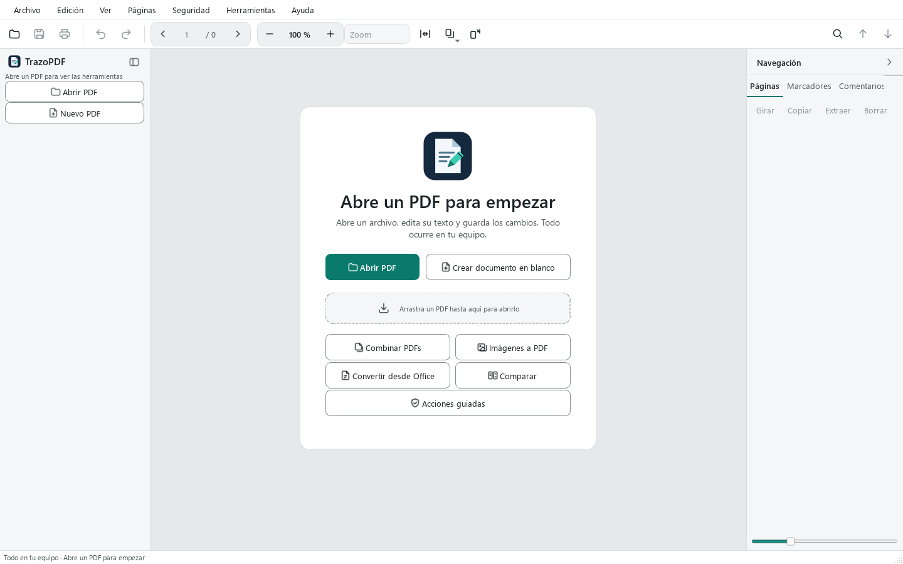

# Manual de usuario de TrazoPDF

TrazoPDF es un editor de PDF gratuito para Windows. Funciona en tu equipo: no tiene cuentas ni telemetría y no sube tus documentos a ningún sitio. Se distribuye bajo la licencia AGPL-3.0-or-later.

Este manual explica cada área del programa con los nombres reales de menús, botones y atajos. Las funciones tienen límites; los más importantes están en el capítulo 15 y el detalle completo en [FEATURES.md](../FEATURES.md).

## Contenido

1. [Primeros pasos](#1-primeros-pasos)
2. [Leer y navegar](#2-leer-y-navegar)
3. [Buscar](#3-buscar)
4. [Editar texto e imágenes](#4-editar-texto-e-imágenes)
5. [Anotar y comentar](#5-anotar-y-comentar)
6. [Formularios y firma](#6-formularios-y-firma)
7. [Organizar páginas](#7-organizar-páginas)
8. [Seguridad](#8-seguridad)
9. [OCR, conversión y exportación](#9-ocr-conversión-y-exportación)
10. [Comparar, accesibilidad y herramientas del documento](#10-comparar-accesibilidad-y-herramientas-del-documento)
11. [Pestañas, autoguardado y recuperación](#11-pestañas-autoguardado-y-recuperación)
12. [Idiomas](#12-idiomas)
13. [Atajos de teclado](#13-atajos-de-teclado)
14. [Solución de problemas](#14-solución-de-problemas)
15. [Límites conocidos](#15-límites-conocidos)

---

## 1. Primeros pasos

### Requisitos

Windows 10 u 11 de 64 bits. El OCR va incluido. Solo necesitas instalar [LibreOffice](https://www.libreoffice.org/) si quieres convertir documentos de Office a PDF.

### Instalar

Descarga una de las dos versiones desde la página de Releases del proyecto:

| Versión | Archivo | Cómo se usa |
| --- | --- | --- |
| Instalador | `TrazoPDF-x.y.z-setup.exe` | Instala para tu usuario, sin permisos de administrador. Puedes elegir instalarlo para todos los usuarios. Crea el acceso en el menú Inicio y, si lo marcas, en el escritorio. Se añade a «Abrir con» para los PDF sin cambiar tu programa predeterminado. |
| Carpeta portable | `TrazoPDF-x.y.z-windows.zip` | Descomprime el archivo y ejecuta `TrazoPDF.exe`. No necesita instalación. |

Comprueba el archivo descargado con `SHA256SUMS.txt`, que está en la misma versión.

El programa no está firmado, así que Windows puede mostrar un aviso la primera vez. Mira [SmartScreen](#windows-smartscreen-avisa-al-ejecutar-el-programa) en el capítulo 14.

### Abrir un PDF

Hay cuatro formas:

- **Archivo > Abrir…** (`Ctrl+O`) o el botón **Abrir PDF** de la pantalla de bienvenida.
- **Archivo > Abrir reciente**, que muestra nombre, fecha y carpeta de los últimos archivos.
- Arrastrar un PDF sobre la ventana.
- «Abrir con» desde el Explorador, si usaste el instalador.

Si el PDF tiene contraseña de apertura, el programa te la pide. El cuadro tiene un botón **Mostrar** para ver lo que escribes y muestra los errores sin cerrarse.

Para empezar con una hoja vacía usa **Archivo > Nuevo PDF** (`Ctrl+N`) o **Crear documento en blanco** en la bienvenida.

### La pantalla de bienvenida

Sin ningún documento abierto verás:

- **Abrir PDF** y **Crear documento en blanco**.
- Una zona para arrastrar un PDF.
- Accesos rápidos: **Combinar PDFs**, **Imágenes a PDF**, **Convertir desde Office**, **Comparar** y **Acciones guiadas**.
- La lista de archivos recientes con miniatura y fecha.



### La interfaz


| Zona | Qué contiene |
| --- | --- |
| Barra de menús | Archivo, Edición, Ver, Páginas, Seguridad, Herramientas y Ayuda. |
| Barra superior | Abrir, Guardar, Imprimir, Deshacer y Rehacer; navegador de páginas (anterior, número, total, siguiente); zoom con botones – y +, lista **Zoom** con preajustes, **Ajustar a la anchura de la página**, **Vista y zoom** y **Girar la vista**; a la derecha, Buscar y las flechas de coincidencia anterior y siguiente. |
| Riel de herramientas (izquierda) | Los botones **Abrir PDF** y **Nuevo PDF**, y tres grupos de herramientas: *Leer y editar*, *Comentar* y *Formularios y seguridad*. |
| Pestañas de documento | Una pestaña por cada PDF abierto, sobre el lienzo. |
| Lienzo | La página. Aquí se lee, se selecciona y se trabaja con la herramienta activa. |
| Panel lateral (derecha) | Pestañas **Páginas**, **Marcadores**, **Comentarios**, **Adjuntos**, **Enlaces**, **Capas**, **Campos** y **Propiedades**. |
| Barra de estado | Mensajes, página actual, tamaño de página, herramienta activa y el estado de guardado (*Sin guardar*, *Autoguardado a las HH:MM* o *Guardado*). |

Sin documento abierto, el riel solo muestra **Abrir PDF** y **Nuevo PDF** y un aviso para abrir un PDF.

### El riel de herramientas

Cada herramienta tiene una letra de acceso rápido. Pulsa la letra con el lienzo activo; no funciona mientras escribes texto. Al pasar el ratón por un botón verás su letra entre paréntesis.

| Grupo | Herramienta | Letra |
| --- | --- | --- |
| Leer y editar | Seleccionar texto | `V` |
| | Mover objetos | `E` |
| | Desplazar | `H` |
| | Texto | `T` |
| | Insertar imagen | `I` |
| | Enlace | `L` |
| Comentar | Resaltar | `M` |
| | Subrayar | `U` |
| | Tachar | `X` |
| | Nota | `N` |
| | Cuadro de texto | sin letra |
| | Dibujar | `D` |
| | Línea, Flecha, Rectángulo, Elipse | sin letra |
| | Medir | `Ctrl+Alt+M` |
| Formularios y seguridad | Rellenar y firmar | `F` |
| Formularios y seguridad | Crear campo | `K` |
| | Censurar (marcar) | `C` |
| | Recortar página | sin letra |

Para ganar espacio, pulsa el botón de la parte superior del riel o usa **Ver > Barra de herramientas compacta** (`Ctrl+B`). El riel queda reducido a iconos.

### Tema claro y oscuro

Elige **Ver > Tema** y selecciona claro, oscuro o el del sistema.


### Acciones guiadas

**Herramientas > Acciones guiadas…** abre un panel acoplable con asistentes paso a paso. Cada paso usa una herramienta normal del programa.

| Acción | Pasos |
| --- | --- |
| Preparar para enviar | Quitar metadatos y datos ocultos, comprimir el documento, guardar una copia. |
| Combinar y numerar páginas | Combinar archivos, numerar páginas, guardar. |
| Censurar información sensible | Buscar y marcar patrones, revisar las marcas, aplicar censuras, quitar datos ocultos, guardar una copia. |
| Rellenar y firmar | Rellenar el documento, firmar con certificado (opcional), guardar. |

Elige una acción y pulsa **Siguiente** para ejecutar el paso en curso. Con **Omitir** lo saltas. Un paso solo se marca como hecho si el documento cambió o se guardó de verdad.

---

## 2. Leer y navegar

### Moverte por el documento

- Flechas **anterior** y **siguiente** de la barra superior, o escribe un número en el campo de página.
- `Ctrl+G` lleva el cursor al campo de página (**Ir a la página…**).
- Teclado: `AvPág` y `RePág` cambian de página; `Inicio` y `Fin` van a la primera y a la última.
- Haz clic en una miniatura del panel **Páginas**.
- El panel **Marcadores** muestra el índice del documento. Haz clic en un marcador para ir a su página. Con **Edición > Editar marcadores** puedes añadir y reorganizar marcadores.

### Zoom

| Acción | Cómo |
| --- | --- |
| Acercar y alejar | Botones + y – de la barra, `Ctrl++` y `Ctrl+-`, o `Ctrl` + rueda del ratón. |
| Valor exacto | Escribe un porcentaje en el campo de zoom (de 25 % a 400 %). |
| Preajustes | Lista **Zoom**: 50, 75, 100, 125, 150 y 200 %, **Ajustar anchura**, **Ajustar página**, **Tamaño real**. |
| Ajustar página | `Ctrl+9` |
| Ajustar ancho | `Ctrl+0` |
| Tamaño real (100 %) | `Ctrl+1` |

### Diseño de página

En **Ver > Diseño** (o en el botón **Vista y zoom** de la barra) eliges:

- **Una página**
- **Dos páginas**
- **Desplazamiento continuo**
- **Dos páginas continuo**

La selección de texto cruza páginas en las vistas continuas.

### Girar la vista

**Ver > Girar la vista** (`Ctrl+Shift+G`) gira solo lo que ves. No cambia el archivo. Para girar las páginas del documento usa **Girar 90°** (`Ctrl+R`), descrito en el capítulo 7.

### Otras opciones de Ver

- **Pantalla completa** (`F11`; `Esc` para salir).
- **Panel de páginas** (`Ctrl+Shift+B`) muestra u oculta el panel lateral.
- **Historial de mensajes** muestra los últimos 20 mensajes de la barra de estado.

### Memoria por archivo

Cada archivo recuerda su página, zoom y desplazamiento. Al volver a abrirlo, sigues donde lo dejaste.

### Imprimir

**Archivo > Imprimir…** (`Ctrl+P`) abre una vista previa antes de imprimir. Las páginas se generan a la resolución de la impresora, entre 150 y 600 ppp.

---

## 3. Buscar

1. Pulsa `Ctrl+F` o el botón de la lupa. Se abre una barra bajo la barra superior.
2. Escribe el texto. Los resultados se marcan y un contador muestra cuántos hay.
3. `Intro` o `F3` van a la siguiente coincidencia. `Mayús+Intro` o `Mayús+F3`, a la anterior. También puedes usar las flechas de la barra.
4. `Esc` cierra la barra.

Opciones de la barra:

| Botón | Efecto |
| --- | --- |
| **Aa** | Distingue mayúsculas y minúsculas. |
| **Palabra completa** | Solo palabras completas. |
| **Reemplazar** | Muestra una segunda fila para reemplazar texto. |

La búsqueda solo encuentra texto que tenga capa de texto. En un documento escaneado, haz primero el [OCR](#9-ocr-conversión-y-exportación). El reemplazo sigue los límites de la edición de texto (capítulo 4). Cada pestaña recuerda su propia búsqueda.

Para encontrar datos concretos y censurarlos, mira [Buscar y censurar](#censura).

---

## 4. Editar texto e imágenes

### Seleccionar y copiar texto

Con **Seleccionar texto** (`V`) arrastra sobre el texto. Un clic doble selecciona una palabra y un clic triple, una línea. `Ctrl+C` copia. `Ctrl+A` selecciona todo el texto de la página (o todas las miniaturas si el foco está en el panel de páginas).

### La herramienta Texto

La herramienta **Texto** (`T`) hace dos cosas según dónde hagas clic:

- **Sobre texto existente**: edita ese bloque.
- **Sobre un hueco de la página**: añade texto nuevo en ese punto.

Mientras escribes:

| Tecla | Efecto |
| --- | --- |
| `Ctrl+Intro` | Aplica el texto. |
| `Esc` | Cancela lo que estás escribiendo. |

Una barra flotante permite cambiar la fuente, el tamaño, el color, la negrita y la cursiva.

Con **Mover objetos** (`E`) puedes seleccionar un bloque de texto, arrastrarlo, editarlo con `F2` y eliminarlo con `Supr`.

Límites: el programa no reorganiza los demás bloques como lo haría Word, las fuentes originales pueden sustituirse y el texto inclinado no se edita directamente.

### Reemplazar texto

Abre la barra de búsqueda con `Ctrl+F`, pulsa **Reemplazar** y escribe el texto nuevo. Solo funciona con texto real, no con imágenes.

### Imágenes

Con **Mover objetos** (`E`) haz clic en una imagen para seleccionarla. Puedes:

- Arrastrarla para moverla.
- Arrastrar una esquina para redimensionarla.
- Sustituirla por otra imagen. Se conserva el área, así que la nueva puede quedar estirada.
- Eliminarla con `Supr`.

Para añadir una imagen nueva usa **Insertar imagen** (`I`) en el riel.

Estas operaciones funcionan con imágenes directas del PDF. Las imágenes anidadas o en línea pueden no admitirlas. Todo se puede deshacer con `Ctrl+Z`.

### Enlaces

La herramienta **Enlace** (`L`) crea un enlace dibujando un área sobre la página. Puede apuntar a una dirección web, a un correo o a una página del documento. El panel **Enlaces** y **Edición > Enlaces del documento…** permiten abrir, editar y eliminar enlaces. Los enlaces solo se abren cuando tú lo pides.

### Recortar página

**Recortar página** en el riel (grupo *Formularios y seguridad*) cambia el área visible de la página. No es una forma de censurar: lo recortado sigue en el archivo.

### Deshacer y rehacer

`Ctrl+Z` deshace. `Ctrl+Shift+Z` o `Ctrl+Y` rehacen. El historial es de la sesión y no se conserva al cerrar el documento.

---

## 5. Anotar y comentar

Las herramientas del grupo **Comentar** del riel:

| Herramienta | Para qué sirve |
| --- | --- |
| Resaltar (`M`), Subrayar (`U`), Tachar (`X`) | Marcar texto. Selecciona el texto con la herramienta activa. |
| Nota (`N`) | Un comentario anclado a un punto de la página. |
| Cuadro de texto | Texto libre dentro de un recuadro. |
| Dibujar (`D`) | Tinta a mano alzada. |
| Línea, Flecha, Rectángulo, Elipse | Figuras. |
| Medir | Mide distancias sobre la página. |

### Comentarios y respuestas

Los comentarios tienen autor, hilo de respuestas y estado. Los gestionas en la pestaña **Comentarios** del panel lateral o en **Edición > Comentarios y anotaciones…**. Eliminar un comentario desde esa lista se puede deshacer.

### Medir

Elige **Medir** (`Ctrl+Alt+M`) y arrastra sobre la página para obtener una distancia. Con la opción **Área** puedes marcar vértices. La precisión depende de la escala configurada y no es una medición certificada.

### Eliminar una anotación

Selecciónala y pulsa `Supr`.

La apariencia de las anotaciones puede variar según el lector de PDF que las abra.

---

## 6. Formularios y firma

### Rellenar un formulario

1. Elige **Rellenar y firmar** en el riel o pulsa `F`.
2. Haz clic en un campo y escribe. Las casillas se marcan con un clic.
3. `Tab` pasa al campo siguiente.

En la paleta de esta herramienta también puedes escribir texto libre, poner marcas de verificación o cancelación, insertar la fecha de hoy y colocar una **Firma** dibujada, escrita o a partir de una imagen (**+ Crear firma**). Con **Recordar firma** se guarda para usarla otra vez.

También está **Edición > Rellenar formularios…**, que abre un diálogo con los campos. La pestaña **Campos** del panel lateral lista los campos del documento; un clic te lleva a cada uno.

Los formularios AcroForm se rellenan en cualquier página visible, también en las vistas continuas. No se ejecutan scripts de formulario ni se editan formularios XFA.

Si quieres que los campos dejen de ser editables, usa **Herramientas > Aplanar…**: incorpora anotaciones y campos al contenido de la página. Se puede deshacer en la sesión.

### Crear campos

- **Crear campo** en el riel (o la tecla `K`): dibuja el campo sobre la página.
- **Herramientas > Detectar campos**: busca líneas y casillas en un formulario sin campos y propone crearlos. Verás una vista previa y podrás elegir cuáles aplicar. Solo detecta líneas cortas y casillas cuadradas, así que revisa las propuestas.

### Firmar con certificado

La firma digital usa un certificado propio en formato PKCS#12 (`.p12` o `.pfx`). No es lo mismo que colocar una imagen de tu firma con **Rellenar y firmar**: la firma con certificado protege el archivo frente a cambios posteriores.

1. **Seguridad > Firmar con certificado…**
2. Elige el certificado y escribe su contraseña.
3. En **Apariencia de la firma** decide si es invisible o visible:
   - **Firma visible en la página** (sin marcar, la firma es invisible: solo queda constancia en el archivo). Si la marcas, elige la **Página** y **arrastra sobre la página para dibujar el rectángulo** donde irá la firma.
   - Marca qué muestra: **Nombre del firmante**, **Fecha y hora**, **Motivo** y **Lugar** (los dos últimos, opcionales) y, si quieres, una **imagen de firma** de las que tienes guardadas.
4. En **Opciones de firma** puedes activar **Añadir sello de tiempo** (ver más abajo).
5. Decide dónde guardar la copia. Se genera una copia firmada; el documento abierto no cambia.

**Varias firmas.** Si el documento ya tiene firmas, el diálogo te avisa: la tuya se añade como una revisión nueva y las anteriores siguen siendo válidas. Si después editas y guardas el documento, dejarán de serlo.

El sello de tiempo es opcional y está desactivado. Si lo activas, indicas tú la dirección (`https://…`) de la autoridad de sellado, y solo entonces se usa la red. Si el sello falla, el programa te ofrece firmar sin él.

Para firmar un documento cifrado hay que guardar antes una copia sin contraseña. El programa no quita la protección por su cuenta.

### Validar firmas

**Seguridad > Examinar firmas…** valida cada firma del PDF de forma local y muestra, por firma:

- el firmante y la fecha declarada;
- la **integridad**: si el documento se modificó después de firmar;
- la **validez criptográfica**;
- la **cadena de confianza** frente a los certificados raíz del sistema. Un certificado autofirmado o de raíz desconocida aparece como «No verificada»: no es un fallo, solo indica que el programa no puede confiar en él por sí mismo;
- el sello de tiempo, si lo hay.

Límites: **no se comprueba la revocación** de los certificados (no se consulta ninguna red) y el resultado **no equivale a una firma electrónica cualificada eIDAS**. No hay firma remota ni envío a firmantes. Para documentos importantes, revisa el archivo también con un lector independiente.

---

## 7. Organizar páginas

### El panel Páginas

El panel **Páginas** muestra miniaturas. Selecciona una o varias (`Ctrl+clic`, `Mayús+clic`, o `Ctrl+A` para todas). Arrastra las miniaturas para reordenarlas. Si has asignado etiquetas de página, aparecen bajo las miniaturas.

Sobre las miniaturas hay una barra con **Girar**, **Copiar**, **Extraer** y **Borrar**. El menú contextual (clic derecho) ofrece:

- Girar 90° a la izquierda
- Girar 90° a la derecha
- Duplicar
- Insertar en blanco aquí
- Insertar desde imagen…
- Extraer seleccionadas…
- Eliminar
- Etiquetas de página…

### Menú Páginas

| Opción | Qué hace |
| --- | --- |
| **Combinar archivos…** | Une otros PDF al documento. También puedes soltar varios PDF sobre la ventana. |
| **Insertar página en blanco** | Añade una página en blanco. |
| **Insertar página…** | Página en blanco (A4, Carta, A3, A5 o medida propia), imagen como página o duplicado con copias. |
| **Duplicar página** | Copia la página actual. |
| **Eliminar páginas** | Elimina las seleccionadas. |
| **Girar 90°** (`Ctrl+R`) | Gira las páginas. |
| **Extraer páginas…** | Crea un PDF nuevo con las páginas elegidas. |
| **Dividir en archivos…** | Reparte el documento en varios archivos, con opciones de reparto. |
| **Marca de agua…** | Añade una marca de agua. |
| **Numerar páginas…** | Escribe el número en cada página. |
| **Encabezado y pie de página…** | Texto a izquierda, centro y derecha. Admite `{page}`, `{pages}`, `{date}` y `{filename}`. Tiene márgenes, color y rango de páginas. |
| **Sellos…** | Sellos predefinidos o una imagen. Haz un clic para centrarlos o arrastra para fijar el tamaño. |
| **Etiquetas de página…** | Numeración lógica por rangos (arábiga, romana, letras, con prefijo). Solo cambia lo que muestran las miniaturas, no el texto impreso. |

### Numeración Bates

**Herramientas > Avanzado > Numeración Bates…**: prefijo, sufijo, número inicial, dígitos y posición, en todas las páginas o en un rango. Se escribe en el contenido de la página.

### Crear PDF desde otros archivos

- **Archivo > Crear PDF > Imágenes…** crea un PDF a partir de fotos.
- **Archivo > Crear PDF > Office…** convierte Word, Excel o PowerPoint (necesita [LibreOffice](#libreoffice-no-se-encuentra)).

### Lotes y recetas

**Herramientas > Procesar varios PDFs…** aplica una **receta** (una lista ordenada de pasos) a muchos archivos de una vez. Los originales no se modifican: los resultados se escriben en una carpeta de salida.

1. **Añadir archivos…** o **Añadir carpeta…** (con **Incluir subcarpetas** si quieres recorrerlas). **Quitar** saca los elegidos de la lista.
2. Elige la **Carpeta de salida**.
3. En **Si el archivo de salida ya existe** decide: **Renombrar la salida**, **Omitir el archivo** o **Sobrescribir la salida**.
4. En **Receta**, elige una guardada o una predefinida, o construye una con **Añadir paso**. Con **Parámetros…**, **Quitar paso**, **Subir** y **Bajar** ajustas cada paso y el orden.
5. Pulsa **Procesar**. La tabla muestra, por archivo, el **Estado** (Correcto, Omitido, Error o Cancelado) y el **Resultado**. **Cancelar** detiene el proceso sin dejar archivos a medias.

Si un archivo falla, se registra el error y se sigue con el siguiente. Los PDF cifrados no se procesan. Los archivos de salida llevan el sufijo `_procesado` (`_texto` si la receta termina en **Exportar texto**).

#### Pasos disponibles

| Paso | Qué hace |
| --- | --- |
| **Anonimizar** | Como [Anonimizar documento](#anonimizar-documento), con tus términos y expresiones. |
| **OCR (texto buscable)** | Idiomas (por ejemplo `spa+eng`; vacío = automático) y **Enderezar y orientar las páginas**. Si es el primer paso, también acepta imágenes (PNG, JPG, TIFF, BMP). |
| **Optimizar** | Reducir imágenes a ppp (0 = sin cambiar), calidad JPEG y quitar metadatos. |
| **Limpiar metadatos y contenido oculto** | Equivale a **Eliminar datos ocultos**. |
| **Marca de agua** | Texto y tamaño. |
| **Numerar páginas** | Número inicial. |
| **Numeración Bates** | Prefijo, sufijo, número inicial, dígitos y posición. |
| **Girar todas las páginas** | 90, 180 o 270 grados. |
| **Recortar márgenes** | Margen izquierdo, superior, derecho e inferior, en puntos. |
| **Firmar con certificado** | Certificado `.p12`/`.pfx`, motivo y lugar. La firma es invisible. |
| **Exportar texto** | Genera un `.txt`. Debe ser el último paso. |

#### Guardar, importar y exportar recetas

Con **Guardar receta…** la receta queda en tu lista, y con **Exportar…** e **Importar…** la compartes como archivo `.json`. Una receta nunca guarda contraseñas: la del certificado se pide al ejecutar (o, sin ventana, se toma de la variable `PDFEDITOR_SIGN_PASSWORD`).

Hay tres recetas predefinidas:

- **Anonimizar y archivar**: anonimizar y optimizar quitando metadatos.
- **Escaneo a PDF buscable**: OCR con enderezado y optimizar.
- **Reducir y limpiar**: optimizar y limpiar metadatos.

#### Desde la línea de comandos

TrazoPDF también procesa lotes sin abrir ventana, por ejemplo para automatizar un escáner. Usa una receta `.json` guardada con **Exportar…**.

```
"TrazoPDF.exe" --batch receta.json --in C:\Escaneos --out C:\Salida --recursive --on-conflict renombrar
"TrazoPDF.exe" --watch C:\Entrada --recipe receta.json --out C:\Salida
```

| Opción | Significado |
| --- | --- |
| `--batch RECETA.json` | Procesa una vez los PDF de `--in` (archivo o carpeta). |
| `--watch CARPETA` | Vigila la carpeta (con `--recipe`) y procesa cada PDF nuevo cuando termina de copiarse. Los procesados se mueven a la subcarpeta `procesados`; los que fallan se quedan donde están. Se para con `Ctrl+C`. |
| `--recipe RECETA.json` | Receta para `--watch`. |
| `--out CARPETA` | Carpeta de salida. |
| `--recursive` | Con `--batch`, incluye subcarpetas. |
| `--on-conflict` | `renombrar` (por defecto), `omitir` o `sobrescribir`. |
| `--interval N` | Segundos entre revisiones de `--watch` (por defecto 5). |

El informe se imprime y se guarda como `batch-report.json` en la carpeta de salida. **Códigos de salida:** `0` si todo fue bien, `1` si algún archivo falló y `2` si el uso es incorrecto (argumentos que faltan, receta o entrada que no existen).

---

## 8. Seguridad

### Contraseñas

**Seguridad > Guardar con contraseña…** protege el documento con cifrado AES-256.

- Contraseña de apertura: la que se pide para abrir el archivo.
- Contraseña de propietario: controla los permisos de impresión, edición y copia. Puedes elegirla. Si la dejas vacía, el programa genera una segura y **la muestra una sola vez**, con un botón para copiarla. No se guarda en ningún sitio: anótala.

**Seguridad > Guardar copia sin contraseña…** guarda una copia sin protección.

Al guardar, el programa conserva el cifrado, los permisos y las contraseñas del archivo original. Si no puede conservarlos, te ofrece:

- introducir la contraseña de propietario,
- proteger con contraseñas nuevas, o
- guardar una copia sin protección.

Al abrir un PDF con restricciones también se ofrece introducir la contraseña de propietario para poder guardarlo conservándolas.

Los permisos de impresión, edición y copia dependen de que cada lector los respete. La contraseña de propietario original no se puede recuperar.

Exportar, extraer páginas, dividir y firmar desde un documento protegido genera archivos **sin contraseña**. El programa avisa antes.

### Censura

Censurar es dos pasos: marcar y aplicar.

1. **Marcar.** Usa **Censurar (marcar)** (`C`) y dibuja sobre lo que quieres ocultar. También puedes usar **Seguridad > Buscar y censurar…**.
2. **Aplicar.** **Seguridad > Aplicar censuras** elimina de forma definitiva lo que hay bajo las marcas.

Importante: **una marca sin aplicar no oculta nada**. El texto sigue en el archivo. Por eso, guardar, exportar, extraer, dividir, firmar o ejecutar OCR o una comparación con marcas pendientes te pide confirmación y te ofrece aplicarlas.

Al aplicar se eliminan:

- el texto, las imágenes y los gráficos bajo la marca;
- los enlaces, campos de formulario y anotaciones que la tocan;
- los metadatos, XMP y marcadores que citan el texto censurado.

#### Buscar y censurar

**Seguridad > Buscar y censurar…** busca patrones: tarjetas (con comprobación Luhn), IBAN, DNI/NIE, NIF/CIF, teléfonos, fechas y correos. También acepta texto o expresiones regulares propias. Marca las coincidencias que elijas y después ofrece aplicarlas. Detecta lo escrito como texto; en un escaneo, haz OCR antes. Revisa la lista, porque puede haber falsos positivos y negativos.

### Anonimizar documento

**Seguridad > Anonimizar documento…** elimina de forma definitiva los datos personales de un documento y comprueba el resultado. Todo ocurre en tu equipo y trabaja sobre una **copia nueva**: el original no se modifica. No funciona con documentos cifrados; guarda antes una copia sin contraseña.

**Qué detecta.** En **Qué buscar** hay casillas, todas marcadas al abrir, para los mismos patrones de **Buscar y censurar** (tarjetas, IBAN, DNI/NIE, NIF/CIF, teléfonos, fechas, correos) y tres más: nº de Seguridad Social, matrícula y dirección IP. Además puedes escribir **Términos** (uno por línea: nombres, direcciones, referencias…) y **Expresiones** regulares (una por línea), con **Distinguir mayúsculas y minúsculas** y **Solo palabras completas**.

**Vista previa.**

1. Pulsa **Buscar coincidencias**. Aparece una lista con la página, el tipo y el texto encontrado.
2. Desmarca las que no quieras tocar, o usa **Marcar todo** y **Desmarcar todo**.
3. Revisa el **Archivo de salida** (por defecto `nombre-anonimizado.pdf`, junto al original; **Examinar…** para cambiarlo).
4. Pulsa **Anonimizar**.

Las coincidencias en metadatos, adjuntos o anotaciones no se pueden desmarcar: se eliminan siempre.

**Qué hace.** Aplica la censura sobre las coincidencias elegidas y elimina el resto de canales: metadatos y XMP, archivos adjuntos, JavaScript, marcadores, miniaturas y las anotaciones y campos que citan los datos. Después reescribe el archivo completo, sin historial de cambios.

**Verificación.** El programa vuelve a leer la copia y busca los datos en el texto de las páginas, anotaciones, metadatos, marcadores, adjuntos y en los bytes del archivo, ya descomprimidos. También comprueba que no queden adjuntos, scripts ni objetos huérfanos. **Si la verificación falla, no se guarda ningún archivo.**

**Informe.** Al terminar se muestra un informe con las coincidencias por tipo, dónde se encontraron, qué se eliminó y el resultado de cada comprobación. **Guardar informe…** lo guarda en `.txt` o `.json`. El informe no contiene los datos eliminados.

**Límites.**

- Solo detecta lo que está escrito como texto. Los escaneos y las imágenes no se leen: haz antes OCR para que haya texto que buscar. El texto dentro de una imagen no se elimina.
- La verificación busca el texto, no la forma de las letras: las fuentes incrustadas como subconjunto pueden conservar los glifos de los caracteres usados.
- Puede haber falsos positivos y negativos. Revisa la lista de la vista previa y el resultado.
- Pueden quedar datos en lo que no se analiza, como el contenido de las imágenes o información que solo un humano reconoce. Revisa la copia antes de compartirla.

También está disponible como paso de una receta de [lotes](#lotes-y-recetas).

### Eliminar datos ocultos

**Seguridad > Eliminar datos ocultos…** elimina metadatos, adjuntos, JavaScript, enlaces y otros elementos. Puede modificar formularios y quitar contenido útil, así que revisa el resultado.

### Metadatos y adjuntos

- **Archivo > Propiedades…** (`Alt+Intro`) edita los metadatos.
- **Edición > Archivos adjuntos…** y la pestaña **Adjuntos** gestionan los archivos incrustados (añadir, extraer, eliminar).

### Antes de compartir un documento sensible

1. Aplica las censuras, o usa **Anonimizar documento…**, que lo hace todo y verifica el resultado.
2. Si no anonimizas, ejecuta **Eliminar datos ocultos…**.
3. Revisa los adjuntos.
4. Guarda una copia con **Guardar una copia…**.

---

## 9. OCR, conversión y exportación

### OCR

**Herramientas > Reconocer texto (OCR)…** convierte páginas escaneadas en texto buscable. El reconocimiento va incluido en el programa: no hace falta instalar nada ni usar la red.

1. En **Idiomas del texto**, marca los idiomas del documento: español, inglés, francés, alemán y portugués. Varios idiomas tardan más.
2. Si el escaneo está torcido o girado, marca **Enderezar páginas y detectar su orientación**. Corrige inclinaciones de hasta unos 10° y tarda más.
3. Acepta y espera: se muestra el progreso y puedes cancelar.

Funciona con páginas escaneadas y mixtas, y evita duplicar texto que ya existe. Revisa el resultado: pueden quedar errores de reconocimiento. El OCR crea una capa de texto. No convierte el escaneo en un documento editable.

También hay un paso **OCR (texto buscable)** para [lotes y recetas](#lotes-y-recetas).

### Office a PDF

**Archivo > Crear PDF > Office…** usa LibreOffice. El diseño puede no coincidir con el de Microsoft Office.

### Exportar

**Archivo > Exportar como** ofrece:

| Opción | Resultado |
| --- | --- |
| **Texto (.txt)** | El texto extraído. |
| **Word (.docx)** | El texto extraído. No mantiene la maquetación. |
| **Excel (.xlsx)** | Las tablas detectadas; si no hay tablas, el texto en filas. |
| **PowerPoint (.pptx)** | Una imagen de cada página por diapositiva. Los elementos no son editables. |
| **Imágenes…** | Cada página como imagen. |

Las exportaciones de un documento protegido salen sin contraseña. El programa lo avisa antes.

### Optimizar tamaño

**Herramientas > Optimizar tamaño…** reduce la resolución de las imágenes, las recomprime, limpia objetos sin uso y, si quieres, retira metadatos. Muestra el tamaño estimado antes de aplicar. Reducir ppp pierde calidad: guarda una copia si tienes dudas.

### Aplanar

**Herramientas > Aplanar…** incorpora anotaciones y campos al contenido de la página.

### Tareas largas

OCR, conversión, exportación, división, firma, optimización y comprobación muestran su progreso y se pueden cancelar. Al cancelar se borran los archivos parciales.

---

## 10. Comparar, accesibilidad y herramientas del documento

### Comparar documentos

**Herramientas > Comparar documentos…** pregunta cómo comparar el documento actual con otro PDF:

- **Apariencia (visual)**: muestra ambos documentos y marca las diferencias en magenta. Hay tres vistas, navegación entre cambios, zoom sincronizado y exportación del informe en un ZIP. Es cancelable. Una nueva comparación necesita una carpeta de salida vacía.
- **Texto**: lista las diferencias de líneas de texto por página.

Ambas comparan por número de página. La visual rasteriza a un máximo de 110 ppp y 1400 px de lado, y no compara metadatos, enlaces, firmas ni contenido oculto.

### Comprobar documento

**Herramientas > Comprobar documento…** da un informe rápido de páginas escaneadas, fuentes no incrustadas, etiquetas de accesibilidad, título, idioma y JavaScript. Un doble clic en un elemento lleva a la página. No es una validación PDF/UA ni PDF/A.

### Comprobar accesibilidad

**Herramientas > Comprobar accesibilidad…** da un informe por elemento: título, idioma, etiquetas, páginas sin texto, texto alternativo y marcadores. El título y el idioma se corrigen con un clic (con una lista para elegir el idioma). El informe se puede exportar a texto. Tampoco es una validación PDF/UA.

### Otras herramientas del documento

| Herramienta | Dónde |
| --- | --- |
| Optimizar tamaño | Herramientas |
| Aplanar | Herramientas |
| Medir | Herramientas y riel |
| Detectar campos | Herramientas |
| Numeración Bates | Herramientas > Avanzado |
| Capas | Pestaña **Capas** del panel lateral |

La pestaña **Capas** muestra u oculta las capas de contenido opcional que trae el PDF. No crea ni edita capas.

---

## 11. Pestañas, autoguardado y recuperación

### Varios documentos a la vez

Cada PDF abierto tiene su pestaña sobre el lienzo. Cada pestaña guarda su página, zoom, desplazamiento, búsqueda, historial de deshacer, panel lateral y copia de recuperación. Abrir un archivo que ya está abierto activa su pestaña.

- Arrastra una pestaña para reordenarla.
- Botón **×** de la pestaña, o `Ctrl+W`, para cerrarla.
- Clic derecho en una pestaña: **Cerrar**, **Cerrar otras** y **Mostrar en carpeta**.

| Atajo | Efecto |
| --- | --- |
| `Ctrl+Tab` / `Ctrl+Shift+Tab` | Pestaña siguiente / anterior |
| `Alt+1` a `Alt+8` | Ir a esa pestaña |
| `Alt+9` | Ir a la última pestaña |
| `Ctrl+W` | Cerrar el documento actual |

Al cerrar un documento con cambios, el programa te pregunta qué hacer con ellos.

### Guardar

| Opción | Efecto |
| --- | --- |
| **Guardar** (`Ctrl+S`) | Guarda sobre el archivo. |
| **Guardar como…** (`Ctrl+Shift+S`) | Guarda con otro nombre. |
| **Guardar una copia…** (`Ctrl+Alt+S`) | Escribe otro archivo sin cambiar el documento abierto. |
| **Revertir** | Recarga la versión guardada y descarta los cambios hechos desde el último guardado. Pide confirmación. |

Al guardar sobre un archivo existente, el programa deja una copia `.bak` del original, una vez por sesión y archivo. Esta copia está activada por defecto.

### Autoguardado y recuperación

- Cada minuto, el programa escribe una copia de recuperación de cada documento con cambios sin guardar. El archivo original no se toca.
- La barra de estado muestra *Sin guardar*, *Autoguardado a las HH:MM* o *Guardado*.
- Si el programa se cierra de forma inesperada, al iniciar aparece un aviso: «Hay un documento sin guardar de una sesión anterior». Elige **Recuperar** o **Descartar**.
- La copia de recuperación se elimina al guardar o cerrar con normalidad.

El autoguardado no sustituye a guardar el archivo. Los documentos protegidos con contraseña no se autoguardan, para no escribir una copia sin cifrar; el programa lo avisa una vez.

### Archivos recientes

**Archivo > Abrir reciente** muestra nombre, fecha y carpeta. Los archivos que ya no existen aparecen como «No disponible», con la opción **Quitar de recientes**. **Borrar lista** vacía la lista.

---

## 12. Idiomas

La interfaz está disponible en cinco idiomas:

| Código | Idioma |
| --- | --- |
| es | Español |
| en | English |
| fr | Français |
| de | Deutsch |
| pt | Português |

### Cambiar de idioma

1. Abre **Ayuda > Idioma** y elige el idioma.
2. **Reinicia** el programa. El cambio no se aplica hasta entonces.

Por defecto, el programa usa el idioma de Windows; si no está entre los cinco, usa inglés. Para forzar uno puedes definir la variable de entorno `PDFEDITOR_LANG` (por ejemplo `PDFEDITOR_LANG=en`).

Este manual usa los nombres de menús y botones tal como aparecen en la interfaz en español. En otros idiomas los nombres cambian, pero la estructura es la misma.

---

## 13. Atajos de teclado

**Ayuda > Atajos de teclado** (`F1`) muestra la tabla dentro del programa.

### Archivo y edición

| Atajo | Acción |
| --- | --- |
| `Ctrl+N` | Nuevo PDF |
| `Ctrl+O` | Abrir |
| `Ctrl+S` | Guardar |
| `Ctrl+Shift+S` | Guardar como |
| `Ctrl+Alt+S` | Guardar una copia |
| `Ctrl+P` | Imprimir |
| `Alt+Intro` | Propiedades |
| `Ctrl+W` | Cerrar documento |
| `Ctrl+Q` | Salir |
| `Ctrl+Z` | Deshacer |
| `Ctrl+Shift+Z` / `Ctrl+Y` | Rehacer |
| `Ctrl+A` | Seleccionar todo (texto o miniaturas, según el foco) |
| `Ctrl+C` | Copiar el texto seleccionado |
| `Ctrl+E` | Editar PDF |
| `Ctrl+R` | Girar 90° las páginas |
| `Ctrl+Alt+M` | Medir |
| `F1` | Atajos de teclado |

### Ver y navegar

| Atajo | Acción |
| --- | --- |
| `Ctrl+F` | Buscar |
| `F3` / `Mayús+F3` | Resultado siguiente / anterior |
| `Ctrl+G` | Ir a la página |
| `Ctrl+9` | Ajustar página |
| `Ctrl+0` | Ajustar ancho |
| `Ctrl+1` | Tamaño real (100 %) |
| `Ctrl++` / `Ctrl+=` | Acercar |
| `Ctrl+-` | Alejar |
| `Ctrl` + rueda del ratón | Cambiar el zoom |
| `Ctrl+Shift+G` | Girar la vista |
| `F11` | Pantalla completa |
| `Ctrl+B` | Barra de herramientas compacta |
| `Ctrl+Shift+B` | Panel de páginas |
| `AvPág` / `RePág` | Página siguiente / anterior |
| `Inicio` / `Fin` | Primera / última página |

### Pestañas

| Atajo | Acción |
| --- | --- |
| `Ctrl+Tab` / `Ctrl+Shift+Tab` | Pestaña siguiente / anterior |
| `Alt+1` a `Alt+9` | Ir a la pestaña indicada (`Alt+9` va a la última) |

### Herramientas (con el lienzo activo)

| Letra | Herramienta |
| --- | --- |
| `V` | Seleccionar texto |
| `H` | Desplazar |
| `E` | Mover objetos |
| `T` | Texto |
| `I` | Insertar imagen |
| `L` | Enlace |
| `N` | Nota |
| `D` | Dibujar |
| `M` | Resaltar |
| `U` | Subrayar |
| `X` | Tachar |
| `F` | Rellenar y firmar |
| `K` | Crear campo |
| `C` | Censurar (marcar) |

### Mientras editas

| Atajo | Acción |
| --- | --- |
| `Ctrl+Intro` | Aplicar el texto que estás escribiendo |
| `Esc` | Cancelar la escritura en curso |
| `F2` | Editar el bloque seleccionado |
| `Supr` | Eliminar el elemento seleccionado |
| `Tab` | Campo siguiente al rellenar un formulario |

### Búsqueda

| Atajo | Acción |
| --- | --- |
| `Intro` o `F3` | Siguiente coincidencia |
| `Mayús+Intro` o `Mayús+F3` | Coincidencia anterior |
| `Esc` | Cerrar la barra de búsqueda |

---

## 14. Solución de problemas

### Windows SmartScreen avisa al ejecutar el programa

TrazoPDF se distribuye sin firma de código. Por eso SmartScreen muestra «Windows protegió su PC» al ejecutar el instalador o el programa.

1. Haz clic en **Más información**.
2. Pulsa **Ejecutar de todas formas**.

Antes, comprueba que el archivo es el original con `SHA256SUMS.txt`:

```powershell
Get-FileHash .\TrazoPDF-x.y.z-setup.exe -Algorithm SHA256
```

El resultado debe coincidir con la línea de ese archivo en `SHA256SUMS.txt`.

### El OCR no funciona o no reconoce mi idioma

El OCR viene incluido en la versión instalada y en la portable, y no necesita instalar nada. Si falla:

1. Comprueba que el idioma está marcado en **Idiomas del texto**. Solo están disponibles español, inglés, francés, alemán y portugués.
2. Si la página está torcida o girada, repite con **Enderezar páginas y detectar su orientación**.
3. Mira **Ayuda > Acerca de TrazoPDF**, que incluye un diagnóstico.

Solo si ejecutas TrazoPDF desde el código fuente necesitas instalar [Tesseract](https://github.com/UB-Mannheim/tesseract/wiki); si está en una ruta poco habitual, indícala con la variable de entorno `PDFEDITOR_TESSERACT`.

### LibreOffice no se encuentra

Crear PDF desde Office necesita LibreOffice (https://www.libreoffice.org/), que **no** viene incluido. Instálalo y reinicia TrazoPDF. Si está en otra ruta, usa la variable `PDFEDITOR_SOFFICE`. El diagnóstico está en **Ayuda > Acerca de TrazoPDF**.

### La búsqueda no encuentra nada

Es probable que el PDF sea un escaneo, sin capa de texto. Ejecuta **Herramientas > Reconocer texto (OCR)…**.

### No puedo editar o guardar un PDF protegido

Si el PDF tiene permisos restringidos, al abrirlo el programa ofrece introducir la contraseña de propietario. Si no la conoces, puedes guardar una copia sin protección o proteger el documento con contraseñas nuevas.

### Pide confirmación por censuras pendientes

Tienes marcas de censura sin aplicar. Elige aplicarlas con **Seguridad > Aplicar censuras**, o cancela y revísalas.

### El texto cambia de fuente al editarlo

El PDF usa una fuente que no está disponible y el programa la sustituye. Es un límite conocido.

### Se cerró el programa con cambios sin guardar

Vuelve a abrirlo. Aparece un aviso para **Recuperar** o **Descartar** la copia de recuperación (ver el capítulo 11).

### Un PDF firmado dejó de ser válido

Modificar y guardar un PDF firmado invalida sus firmas. Vuelve a firmar la copia final. Si añadiste varias firmas, firma siempre en último lugar, tras las ediciones.

### El procesamiento por lotes falla con algunos archivos

Mira la columna **Resultado** de la tabla o el informe `batch-report.json` en la carpeta de salida. Los PDF cifrados no se procesan, y una receta que firma necesita la contraseña del certificado. Los archivos que fallan no detienen el resto del lote.

### Si el problema continúa

Mira los últimos mensajes con **Ver > Historial de mensajes** y consulta **Ayuda > Acerca de TrazoPDF** para ver la versión y el diagnóstico de las herramientas (OCR y LibreOffice).

---

## 15. Límites conocidos

TrazoPDF cubre las tareas habituales con PDF. No es una réplica de Adobe Acrobat Pro. Estos son los límites principales.

### Edición

- La edición está pensada para texto digital. En escaneos, el OCR añade una capa buscable; no reconstruye la imagen.
- No redistribuye otros bloques como un documento de Word.
- Las fuentes originales pueden sustituirse.
- El texto inclinado no se edita directamente.
- Imágenes: la edición se limita a imágenes directas compatibles. Sustituir conserva el área y puede estirar la imagen nueva.
- Buscar y reemplazar solo actúa sobre texto con capa de texto.

### Seguridad y firma

- Las marcas de censura sin aplicar no censuran nada.
- Buscar y censurar no lee imágenes escaneadas y puede dar falsos positivos y negativos.
- Recortar una página no oculta los datos.
- Los permisos de impresión, edición y copia dependen del lector.
- Examinar firmas valida la integridad y la cadena de confianza en local, pero no comprueba la revocación. La firma no equivale a una firma electrónica cualificada eIDAS, y no hay servicio de firma remota ni envío a firmantes. El sello de tiempo es opcional y requiere indicar una autoridad.
- Anonimizar solo detecta texto: no lee imágenes sin OCR, y las fuentes subconjunto pueden conservar glifos. Revisa la copia y el informe.
- Lotes y recetas no procesan PDF cifrados; la firma en lotes es siempre invisible.

### Conversión

- Office a PDF depende de LibreOffice y no garantiza el mismo diseño.
- PDF a DOCX no mantiene la maquetación.
- PDF a XLSX depende de la estructura visual de las tablas.
- PDF a PPTX crea imágenes de página, no objetos editables.

### Formularios

- No se ejecutan scripts de formulario ni se editan formularios XFA.
- La detección automática de campos solo reconoce líneas cortas y casillas cuadradas.

### Comparación y revisión

- La comparación visual y la de texto trabajan por número de página y no alinean páginas insertadas.
- Comprobar documento y Comprobar accesibilidad son revisiones rápidas, no validaciones PDF/UA ni PDF/A.

### Documentos protegidos

- No se autoguardan.
- Exportar, extraer, dividir y firmar generan archivos sin contraseña.

### Fuera de alcance

PDF/A y PDF/X, contenido 3D y multimedia, compartir en la nube y revisión en línea, aplicaciones móviles, carteras PDF, y el etiquetado automático o la edición de etiquetas de accesibilidad. Tampoco se garantiza la compatibilidad con todos los documentos complejos, formularios dinámicos, fuentes o perfiles de color.

---

TrazoPDF es software libre bajo la licencia AGPL-3.0-or-later. No contiene código, interfaz ni recursos gráficos de Adobe.
