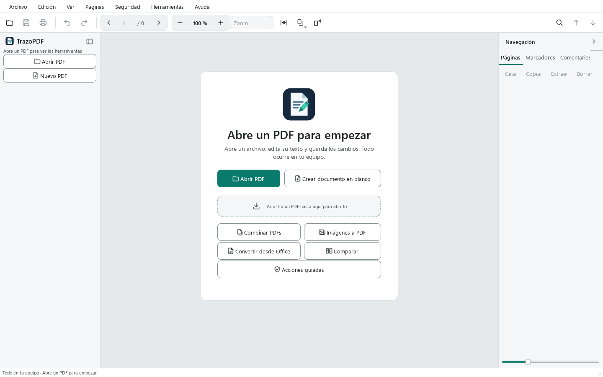

# Manuel de l'utilisateur de TrazoPDF

TrazoPDF est un éditeur de PDF gratuit pour Windows. Il fonctionne sur votre ordinateur : il n'a ni compte ni télémétrie et n'envoie vos documents nulle part. Il est distribué sous la licence AGPL-3.0-or-later.

Ce manuel décrit chaque domaine du programme avec les noms réels des menus, des boutons et des raccourcis. Les fonctions ont des limites ; les plus importantes figurent au chapitre 15, et le détail complet se trouve dans [FEATURES.md](../FEATURES.md).

## Sommaire

1. [Premiers pas](#1-premiers-pas)
2. [Lire et naviguer](#2-lire-et-naviguer)
3. [Rechercher](#3-rechercher)
4. [Modifier le texte et les images](#4-modifier-le-texte-et-les-images)
5. [Annoter et commenter](#5-annoter-et-commenter)
6. [Formulaires et signature](#6-formulaires-et-signature)
7. [Organiser les pages](#7-organiser-les-pages)
8. [Sécurité](#8-sécurité)
9. [OCR, conversion et exportation](#9-ocr-conversion-et-exportation)
10. [Comparer, accessibilité et outils du document](#10-comparer-accessibilité-et-outils-du-document)
11. [Onglets, enregistrement automatique et récupération](#11-onglets-enregistrement-automatique-et-récupération)
12. [Langues](#12-langues)
13. [Raccourcis clavier](#13-raccourcis-clavier)
14. [Résolution des problèmes](#14-résolution-des-problèmes)
15. [Limites connues](#15-limites-connues)

---

## 1. Premiers pas

### Configuration requise

Windows 10 ou 11 en 64 bits. L'OCR est inclus. Vous n'avez besoin d'installer [LibreOffice](https://www.libreoffice.org/) que si vous voulez convertir des documents Office en PDF.

### Installer

Téléchargez l'une des deux versions depuis la page des Releases du projet :

| Version | Fichier | Utilisation |
| --- | --- | --- |
| Programme d'installation | `TrazoPDF-x.y.z-setup.exe` | S'installe pour votre utilisateur, sans droits d'administrateur. Vous pouvez choisir de l'installer pour tous les utilisateurs. Crée le raccourci dans le menu Démarrer et, si vous le cochez, sur le bureau. Il est ajouté à « Ouvrir avec » pour les PDF, sans modifier votre programme par défaut. |
| Dossier portable | `TrazoPDF-x.y.z-windows.zip` | Décompressez le fichier et lancez `TrazoPDF.exe`. Aucune installation n'est nécessaire. |

Vérifiez le fichier téléchargé avec `SHA256SUMS.txt`, qui se trouve dans la même version.

Le programme n'est pas signé : Windows peut donc afficher un avertissement lors du premier lancement. Consultez [SmartScreen](#smartscreen-affiche-un-avertissement-au-lancement-du-programme) au chapitre 14.

### Ouvrir un PDF

Il existe quatre façons de faire :

- **Fichier > Ouvrir…** (`Ctrl+O`) ou le bouton **Ouvrir un PDF** de l'écran d'accueil.
- **Fichier > Ouvrir récent**, qui affiche le nom, la date et le dossier des derniers fichiers.
- Glisser un PDF sur la fenêtre.
- « Ouvrir avec » depuis l'Explorateur, si vous avez utilisé le programme d'installation.

Si le PDF a un mot de passe d'ouverture, le programme vous le demande. La boîte de dialogue comporte un bouton **Afficher** pour voir ce que vous saisissez, et elle affiche les erreurs sans se fermer.

Pour commencer avec une feuille vierge, utilisez **Fichier > Nouveau PDF** (`Ctrl+N`) ou **Créer un document vierge** sur l'écran d'accueil.

### L'écran d'accueil

Lorsqu'aucun document n'est ouvert, vous voyez :

- **Ouvrir un PDF** et **Créer un document vierge**.
- Une zone où glisser un PDF.
- Des accès rapides : **Fusionner des PDF**, **Images vers PDF**, **Convertir depuis Office**, **Comparer** et **Actions guidées**.
- La liste des fichiers récents avec une miniature et la date.



### L'interface


| Zone | Contenu |
| --- | --- |
| Barre de menus | Fichier, Édition, Affichage, Pages, Sécurité, Outils et Aide. |
| Barre supérieure | Ouvrir, Enregistrer, Imprimer, Annuler et Rétablir ; navigateur de pages (précédente, numéro, total, suivante) ; zoom avec les boutons – et +, la liste **Zoom** avec des préréglages, **Ajuster la largeur de la page**, **Affichage et zoom** et **Faire pivoter l'affichage** ; à droite, Rechercher et les flèches de correspondance précédente et suivante. |
| Barre d'outils latérale (gauche) | Les boutons **Ouvrir un PDF** et **Nouveau PDF**, et trois groupes d'outils : *Lecture et modification*, *Commenter* et *Formulaires et sécurité*. |
| Onglets de document | Un onglet par PDF ouvert, au-dessus de la page affichée. |
| Page affichée | La page. C'est ici que vous lisez, sélectionnez et travaillez avec l'outil actif. |
| Panneau latéral (droite) | Onglets **Pages**, **Signets**, **Commentaires**, **Pièces jointes**, **Liens**, **Calques**, **Champs** et **Propriétés**. |
| Barre d'état | Messages, page actuelle, taille de la page, outil actif et état d'enregistrement (*Non enregistré*, *Enregistrement automatique à HH:MM* ou *Enregistré*). |

Sans document ouvert, la barre d'outils latérale n'affiche que **Ouvrir un PDF** et **Nouveau PDF**, ainsi qu'un message vous invitant à ouvrir un PDF.

### La barre d'outils latérale

Chaque outil a une lettre de raccourci. Appuyez sur la lettre lorsque la page affichée est active ; cela ne fonctionne pas pendant la saisie de texte. En passant la souris sur un bouton, vous voyez sa lettre entre parenthèses.

| Groupe | Outil | Lettre |
| --- | --- | --- |
| Lecture et modification | Sélectionner le texte | `V` |
| | Déplacer des objets | `E` |
| | Déplacer | `H` |
| | Texte | `T` |
| | Insérer une image | `I` |
| | Lien | `L` |
| Commenter | Surligner | `M` |
| | Souligner | `U` |
| | Barrer | `X` |
| | Note | `N` |
| | Zone de texte | sans lettre |
| | Dessiner | `D` |
| | Ligne, Flèche, Rectangle, Ellipse | sans lettre |
| | Mesurer | `Ctrl+Alt+M` |
| Formulaires et sécurité | Remplir et signer | `F` |
| Formulaires et sécurité | Créer un champ | `K` |
| | Caviarder (marquer) | `C` |
| | Recadrer la page | sans lettre |

Pour gagner de la place, cliquez sur le bouton situé en haut de la barre d'outils ou utilisez **Affichage > Barre d'outils compacte** (`Ctrl+B`). La barre est alors réduite aux icônes.

### Thème clair et sombre

Choisissez **Affichage > Thème**, puis sélectionnez Clair, Sombre ou Système.


### Actions guidées

**Outils > Actions guidées…** ouvre un panneau détachable avec des assistants pas à pas. Chaque étape utilise un outil normal du programme.

| Action | Étapes |
| --- | --- |
| Préparer l'envoi | Supprimer les métadonnées et les données cachées, compresser le document, enregistrer une copie. |
| Fusionner et numéroter les pages | Fusionner des fichiers, numéroter les pages, enregistrer. |
| Caviarder les informations sensibles | Rechercher et marquer les motifs, vérifier les marques, appliquer les caviardages, supprimer les données cachées, enregistrer une copie. |
| Remplir et signer | Remplir le document, signer avec un certificat (facultatif), enregistrer. |

Choisissez une action et cliquez sur **Suivant** pour exécuter l'étape en cours. Avec **Ignorer**, vous la sautez. Une étape n'est marquée comme terminée que si le document a réellement été modifié ou enregistré.

---

## 2. Lire et naviguer

### Se déplacer dans le document

- Flèches **précédente** et **suivante** de la barre supérieure, ou saisissez un numéro dans le champ de page.
- `Ctrl+G` place le curseur dans le champ de page (**Aller à la page…**).
- Clavier : `Pg suiv.` et `Pg préc.` changent de page ; `Début` et `Fin` vont à la première et à la dernière page.
- Cliquez sur une miniature du panneau **Pages**.
- Le panneau **Signets** affiche la table des matières du document. Cliquez sur un signet pour aller à sa page. Avec **Édition > Modifier les signets**, vous pouvez ajouter et réorganiser les signets.

### Zoom

| Action | Comment |
| --- | --- |
| Zoom avant et arrière | Boutons + et – de la barre, `Ctrl++` et `Ctrl+-`, ou `Ctrl` + molette de la souris. |
| Valeur exacte | Saisissez un pourcentage dans le champ de zoom (de 25 % à 400 %). |
| Préréglages | Liste **Zoom** : 50, 75, 100, 125, 150 et 200 %, **Ajuster la largeur**, **Ajuster la page**, **Taille réelle**. |
| Ajuster la page | `Ctrl+9` |
| Ajuster la largeur | `Ctrl+0` |
| Taille réelle (100 %) | `Ctrl+1` |

### Mise en page

Dans **Affichage > Mise en page** (ou avec le bouton **Affichage et zoom** de la barre), choisissez :

- **Une page**
- **Deux pages**
- **Défilement continu**
- **Deux pages en continu**

En affichage continu, la sélection de texte passe d'une page à l'autre.

### Faire pivoter l'affichage

**Affichage > Faire pivoter l'affichage** (`Ctrl+Maj+G`) fait pivoter uniquement ce que vous voyez. Le fichier n'est pas modifié. Pour faire pivoter les pages du document, utilisez **Pivoter de 90°** (`Ctrl+R`), décrit au chapitre 7.

### Autres options d'Affichage

- **Plein écran** (`F11` ; `Échap` pour quitter).
- **Panneau des pages** (`Ctrl+Maj+B`) affiche ou masque le panneau latéral.
- **Historique des messages** affiche les 20 derniers messages de la barre d'état.

### Mémoire par fichier

Chaque fichier mémorise sa page, son zoom et son défilement. Lorsque vous le rouvrez, vous reprenez là où vous vous étiez arrêté.

### Imprimer

**Fichier > Imprimer…** (`Ctrl+P`) ouvre un aperçu avant impression. Les pages sont générées à la résolution de l'imprimante, entre 150 et 600 ppp.

---

## 3. Rechercher

1. Appuyez sur `Ctrl+F` ou cliquez sur la loupe. Une barre s'ouvre sous la barre supérieure.
2. Saisissez le texte. Les résultats sont mis en évidence et un compteur indique leur nombre.
3. `Entrée` ou `F3` vont à la correspondance suivante. `Maj+Entrée` ou `Maj+F3` vont à la précédente. Vous pouvez aussi utiliser les flèches de la barre.
4. `Échap` ferme la barre.

Options de la barre :

| Bouton | Effet |
| --- | --- |
| **Aa** | Respecte la casse (majuscules et minuscules). |
| **Mot entier** | Ne trouve que les mots complets. |
| **Remplacer** | Affiche une deuxième ligne pour remplacer du texte. |

La recherche ne trouve que le texte qui possède une couche de texte. Sur un document numérisé, effectuez d'abord un [OCR](#9-ocr-conversion-et-exportation). Le remplacement suit les limites de la modification de texte (chapitre 4). Chaque onglet conserve sa propre recherche.

Pour trouver des données précises et les caviarder, consultez [Rechercher et caviarder](#caviardage).

---

## 4. Modifier le texte et les images

### Sélectionner et copier du texte

Avec **Sélectionner le texte** (`V`), faites glisser le pointeur sur le texte. Un double-clic sélectionne un mot et un triple-clic une ligne. `Ctrl+C` copie. `Ctrl+A` sélectionne tout le texte de la page (ou toutes les miniatures si le focus se trouve dans le panneau des pages).

### L'outil Texte

L'outil **Texte** (`T`) fait deux choses selon l'endroit où vous cliquez :

- **Sur un texte existant** : il modifie ce bloc.
- **Sur un espace vide de la page** : il ajoute un nouveau texte à cet endroit.

Pendant la saisie :

| Touche | Effet |
| --- | --- |
| `Ctrl+Entrée` | Applique le texte. |
| `Échap` | Annule la saisie en cours. |

Une barre flottante permet de modifier la police, la taille, la couleur, le gras et l'italique.

Avec **Déplacer des objets** (`E`), vous pouvez sélectionner un bloc de texte, le faire glisser, le modifier avec `F2` et le supprimer avec `Suppr`.

Limites : le programme ne réorganise pas les autres blocs comme le ferait Word, les polices d'origine peuvent être remplacées, et le texte incliné ne se modifie pas directement.

### Remplacer du texte

Ouvrez la barre de recherche avec `Ctrl+F`, cliquez sur **Remplacer** et saisissez le nouveau texte. Cela ne fonctionne qu'avec du texte réel, pas avec des images.

### Images

Avec **Déplacer des objets** (`E`), cliquez sur une image pour la sélectionner. Vous pouvez :

- La faire glisser pour la déplacer.
- Faire glisser un coin pour la redimensionner.
- La remplacer par une autre image. La zone est conservée : la nouvelle image peut donc apparaître étirée.
- La supprimer avec `Suppr`.

Pour ajouter une nouvelle image, utilisez **Insérer une image** (`I`) dans la barre d'outils.

Ces opérations fonctionnent avec les images directes du PDF. Les images imbriquées ou intégrées au texte peuvent ne pas être prises en charge. Tout peut être annulé avec `Ctrl+Z`.

### Liens

L'outil **Lien** (`L`) crée un lien en dessinant une zone sur la page. Le lien peut pointer vers une adresse web, une adresse de courriel ou une page du document. Le panneau **Liens** et **Édition > Liens du document…** permettent d'ouvrir, de modifier et de supprimer des liens. Les liens ne s'ouvrent que lorsque vous le demandez.

### Recadrer la page

**Recadrer la page** dans la barre d'outils (groupe *Formulaires et sécurité*) modifie la zone visible de la page. Ce n'est pas un moyen de caviarder : ce qui est recadré reste dans le fichier.

### Annuler et rétablir

`Ctrl+Z` annule. `Ctrl+Maj+Z` ou `Ctrl+Y` rétablit. L'historique concerne la session et n'est pas conservé lorsque vous fermez le document.

---

## 5. Annoter et commenter

Les outils du groupe **Commenter** de la barre d'outils :

| Outil | À quoi il sert |
| --- | --- |
| Surligner (`M`), Souligner (`U`), Barrer (`X`) | Marquer du texte. Sélectionnez le texte avec l'outil actif. |
| Note (`N`) | Un commentaire attaché à un point de la page. |
| Zone de texte | Du texte libre dans un encadré. |
| Dessiner (`D`) | De l'encre à main levée. |
| Ligne, Flèche, Rectangle, Ellipse | Des formes. |
| Mesurer | Mesure des distances sur la page. |

### Commentaires et réponses

Les commentaires ont un auteur, un fil de réponses et un état. Vous les gérez dans l'onglet **Commentaires** du panneau latéral ou dans **Édition > Commentaires et annotations…**. La suppression d'un commentaire depuis cette liste peut être annulée.

### Mesurer

Choisissez **Mesurer** (`Ctrl+Alt+M`) et faites glisser le pointeur sur la page pour obtenir une distance. Avec l'option **Zone**, vous pouvez marquer des sommets. La précision dépend de l'échelle configurée et ce n'est pas une mesure certifiée.

### Supprimer une annotation

Sélectionnez-la et appuyez sur `Suppr`.

L'apparence des annotations peut varier selon le lecteur de PDF qui les ouvre.

---

## 6. Formulaires et signature

### Remplir un formulaire

1. Choisissez **Remplir et signer** dans la barre d'outils ou appuyez sur `F`.
2. Cliquez sur un champ et saisissez du texte. Les cases à cocher se cochent d'un clic.
3. `Tab` passe au champ suivant.

Dans la palette de cet outil, vous pouvez aussi saisir du texte libre, placer des coches ou des croix, insérer la date du jour et placer une **Signature** dessinée, écrite ou issue d'une image (**+ Créer une signature**). Avec **Mémoriser la signature**, elle est enregistrée pour être réutilisée.

Il existe aussi **Édition > Remplir les formulaires…**, qui ouvre une boîte de dialogue avec les champs. L'onglet **Champs** du panneau latéral liste les champs du document ; un clic vous mène à chacun d'eux.

Les formulaires AcroForm se remplissent sur n'importe quelle page visible, y compris en affichage continu. Les scripts de formulaire ne sont pas exécutés et les formulaires XFA ne sont pas modifiés.

Si vous voulez que les champs ne soient plus modifiables, utilisez **Outils > Aplatir…** : il intègre les annotations et les champs au contenu de la page. Cette opération peut être annulée pendant la session.

### Créer des champs

- **Créer un champ** dans la barre d'outils (ou la touche `K`) : dessinez le champ sur la page.
- **Outils > Détecter les champs** : cherche des lignes et des cases dans un formulaire sans champs et propose de les créer. Vous verrez un aperçu et pourrez choisir lesquels appliquer. Seules les lignes courtes et les cases carrées sont détectées : vérifiez donc les propositions.

### Signer avec un certificat

La signature numérique utilise un certificat personnel au format PKCS#12 (`.p12` ou `.pfx`). Ce n'est pas la même chose que placer une image de votre signature avec **Remplir et signer** : la signature avec certificat protège le fichier contre les modifications ultérieures.

1. **Sécurité > Signer avec un certificat…**
2. Choisissez le certificat et saisissez son mot de passe.
3. Dans **Apparence de la signature**, choisissez si elle est invisible ou visible :
   - **Signature visible sur la page** (si la case n'est pas cochée, la signature est invisible : elle n'apparaît que dans le fichier). Si vous la cochez, choisissez la **Page** et **faites glisser sur la page pour dessiner le rectangle** où la signature sera placée.
   - Indiquez ce qu'elle affiche : **Nom du signataire**, **Date et heure**, **Motif** et **Lieu** (les deux derniers sont facultatifs) et, si vous le souhaitez, une **image de signature** parmi celles que vous avez enregistrées.
4. Dans **Options de signature**, vous pouvez activer **Ajouter un horodatage** (voir plus bas).
5. Choisissez où enregistrer la copie. Une copie signée est générée ; le document ouvert ne change pas.

**Plusieurs signatures.** Si le document contient déjà des signatures, la boîte de dialogue vous prévient : la vôtre s'ajoute comme une nouvelle révision et les précédentes restent valides. Si vous modifiez ensuite le document et l'enregistrez, elles ne seront plus valides.

L'horodatage est facultatif et désactivé par défaut. Si vous l'activez, vous indiquez vous-même l'adresse (`https://…`) de l'autorité d'horodatage ; c'est seulement à ce moment-là que le réseau est utilisé. Si l'horodatage échoue, le programme vous propose de signer sans lui.

Pour signer un document chiffré, il faut d'abord enregistrer une copie sans mot de passe. Le programme ne supprime pas la protection de lui-même.

### Valider les signatures

**Sécurité > Parcourir les signatures…** valide localement chaque signature du PDF et affiche, pour chacune :

- le signataire et la date déclarée ;
- l'**intégrité** : si le document a été modifié après la signature ;
- la **validité cryptographique** ;
- la **chaîne de confiance** par rapport aux certificats racines du système. Un certificat auto-signé ou dont la racine est inconnue apparaît comme « Non vérifiée » : ce n'est pas une erreur, cela indique seulement que le programme ne peut pas lui faire confiance par lui-même ;
- l'horodatage, s'il existe.

Limites : la **révocation** des certificats **n'est pas vérifiée** (aucun réseau n'est consulté) et le résultat **n'équivaut pas à une signature électronique qualifiée eIDAS**. Il n'y a ni signature à distance ni envoi aux signataires. Pour les documents importants, vérifiez également le fichier avec un lecteur indépendant.

---

## 7. Organiser les pages

### Le panneau Pages

Le panneau **Pages** affiche des miniatures. Sélectionnez-en une ou plusieurs (`Ctrl+clic`, `Maj+clic`, ou `Ctrl+A` pour toutes). Faites glisser les miniatures pour les réordonner. Si vous avez défini des étiquettes de page, elles apparaissent sous les miniatures.

Au-dessus des miniatures se trouve une barre avec **Pivoter**, **Copier**, **Extraire** et **Supprimer**. Le menu contextuel (clic droit) propose :

- Pivoter de 90° vers la gauche
- Pivoter de 90° vers la droite
- Dupliquer
- Insérer une page vierge ici
- Insérer depuis une image…
- Extraire les pages sélectionnées…
- Supprimer
- Étiquettes de page…

### Menu Pages

| Option | Ce qu'elle fait |
| --- | --- |
| **Fusionner des fichiers…** | Ajoute d'autres PDF au document. Vous pouvez aussi déposer plusieurs PDF sur la fenêtre. |
| **Insérer une page vierge** | Ajoute une page vierge. |
| **Insérer une page…** | Page vierge (A4, Lettre, A3, A5 ou format personnalisé), image comme page ou duplication avec des copies. |
| **Dupliquer la page** | Copie la page actuelle. |
| **Supprimer des pages** | Supprime les pages sélectionnées. |
| **Pivoter de 90°** (`Ctrl+R`) | Fait pivoter les pages. |
| **Extraire des pages…** | Crée un nouveau PDF avec les pages choisies. |
| **Diviser en fichiers…** | Répartit le document entre plusieurs fichiers, avec des options de répartition. |
| **Filigrane…** | Ajoute un filigrane. |
| **Numéroter les pages…** | Écrit le numéro sur chaque page. |
| **En-tête et pied de page…** | Texte à gauche, au centre et à droite. Accepte `{page}`, `{pages}`, `{date}` et `{filename}`. Dispose de marges, de couleur et d'une plage de pages. |
| **Tampons…** | Tampons prédéfinis ou une image. Un clic les centre, ou faites glisser pour fixer leur taille. |
| **Étiquettes de page…** | Numérotation logique par plages (arabe, romaine, lettres, avec préfixe). Ne modifie que l'affichage des miniatures, pas le texte imprimé. |

### Numérotation Bates

**Outils > Avancé > Numérotation Bates…** : préfixe, suffixe, numéro de départ, nombre de chiffres et position, sur toutes les pages ou sur une plage. Le numéro est écrit dans le contenu de la page.

### Créer un PDF à partir d'autres fichiers

- **Fichier > Créer un PDF > Images…** crée un PDF à partir de photos.
- **Fichier > Créer un PDF > Office…** convertit Word, Excel ou PowerPoint (nécessite [LibreOffice](#libreoffice-est-introuvable)).

### Traitement par lots et recettes

**Outils > Traiter plusieurs PDF…** applique une **recette** (une liste ordonnée d'étapes) à de nombreux fichiers à la fois. Les originaux ne sont pas modifiés : les résultats sont écrits dans un dossier de sortie.

1. **Ajouter des fichiers…** ou **Ajouter un dossier…** (avec **Inclure les sous-dossiers** si vous voulez les parcourir). **Supprimer** retire de la liste les fichiers choisis.
2. Choisissez le **Dossier de sortie**.
3. Dans **Si le fichier de sortie existe déjà**, décidez : **Renommer la sortie**, **Ignorer le fichier** ou **Écraser la sortie**.
4. Dans **Recette**, choisissez une recette enregistrée ou prédéfinie, ou construisez-en une avec **Ajouter une étape**. Avec **Paramètres…**, **Supprimer l'étape**, **Monter** et **Descendre**, vous ajustez chaque étape et l'ordre.
5. Cliquez sur **Traiter**. Le tableau affiche, pour chaque fichier, l'**État** (OK, Ignoré, Erreur ou Annulé) et le **Résultat**. **Annuler** arrête le traitement sans laisser de fichiers à moitié écrits.

Si un fichier échoue, l'erreur est consignée et le programme passe au suivant. Les PDF chiffrés ne sont pas traités. Les fichiers de sortie portent le suffixe `_procesado` (`_texto` si la recette se termine par **Exporter le texte**).

#### Étapes disponibles

| Étape | Ce qu'elle fait |
| --- | --- |
| **Anonymiser** | Comme [Anonymiser le document](#anonymiser-le-document), avec vos termes et expressions. |
| **OCR (texte consultable)** | Langues (par exemple `spa+eng` ; vide = automatique) et **Redresser et orienter les pages**. Si c'est la première étape, elle accepte aussi les images (PNG, JPG, TIFF, BMP). |
| **Optimiser** | Réduit les images à un nombre de ppp (0 = sans changement), qualité JPEG et suppression des métadonnées. |
| **Nettoyer les métadonnées et le contenu masqué** | Équivaut à **Supprimer les données cachées**. |
| **Filigrane** | Texte et taille. |
| **Numéroter les pages** | Numéro de départ. |
| **Numérotation Bates** | Préfixe, suffixe, numéro de départ, nombre de chiffres et position. |
| **Faire pivoter toutes les pages** | 90, 180 ou 270 degrés. |
| **Rogner les marges** | Marge gauche, haute, droite et basse, en points. |
| **Signer avec un certificat** | Certificat `.p12`/`.pfx`, motif et lieu. La signature est invisible. |
| **Exporter le texte** | Génère un `.txt`. Doit être la dernière étape. |

#### Enregistrer, importer et exporter des recettes

Avec **Enregistrer la recette…**, la recette est ajoutée à votre liste ; avec **Exporter…** et **Importer…**, vous la partagez sous forme de fichier `.json`. Une recette n'enregistre jamais de mots de passe : celui du certificat est demandé à l'exécution (ou, sans fenêtre, lu dans la variable `PDFEDITOR_SIGN_PASSWORD`).

Il existe trois recettes prédéfinies :

- **Anonymiser et archiver** : anonymiser et optimiser en supprimant les métadonnées.
- **Numérisation en PDF consultable** : OCR avec redressement, puis optimisation.
- **Réduire et nettoyer** : optimiser et nettoyer les métadonnées.

#### En ligne de commande

TrazoPDF traite aussi les lots sans ouvrir de fenêtre, par exemple pour automatiser un scanner. Utilisez une recette `.json` enregistrée avec **Exporter…**.

```
"TrazoPDF.exe" --batch receta.json --in C:\Escaneos --out C:\Salida --recursive --on-conflict renombrar
"TrazoPDF.exe" --watch C:\Entrada --recipe receta.json --out C:\Salida
```

| Option | Signification |
| --- | --- |
| `--batch RECETA.json` | Traite une fois les PDF de `--in` (fichier ou dossier). |
| `--watch CARPETA` | Surveille le dossier (avec `--recipe`) et traite chaque nouveau PDF une fois sa copie terminée. Les fichiers traités sont déplacés dans le sous-dossier `procesados` ; ceux qui échouent restent à leur place. S'arrête avec `Ctrl+C`. |
| `--recipe RECETA.json` | Recette pour `--watch`. |
| `--out CARPETA` | Dossier de sortie. |
| `--recursive` | Avec `--batch`, inclut les sous-dossiers. |
| `--on-conflict` | `renombrar` (par défaut), `omitir` ou `sobrescribir`. |
| `--interval N` | Secondes entre deux vérifications de `--watch` (5 par défaut). |

Le rapport s'affiche et est enregistré sous le nom `batch-report.json` dans le dossier de sortie. **Codes de sortie :** `0` si tout s'est bien passé, `1` si un fichier a échoué et `2` si l'utilisation est incorrecte (arguments manquants, recette ou entrée inexistante).

---

## 8. Sécurité

### Mots de passe

**Sécurité > Enregistrer avec mot de passe…** protège le document par un chiffrement AES-256.

- Mot de passe d'ouverture : celui qui est demandé pour ouvrir le fichier.
- Mot de passe propriétaire : contrôle les autorisations d'impression, de modification et de copie. Vous pouvez le choisir. Si vous le laissez vide, le programme en génère un sûr et **l'affiche une seule fois**, avec un bouton pour le copier. Il n'est enregistré nulle part : notez-le.

**Sécurité > Enregistrer une copie sans mot de passe…** enregistre une copie sans protection.

Lors de l'enregistrement, le programme conserve le chiffrement, les autorisations et les mots de passe du fichier d'origine. S'il ne peut pas les conserver, il vous propose :

- de saisir le mot de passe propriétaire,
- de protéger le fichier avec de nouveaux mots de passe, ou
- d'enregistrer une copie sans protection.

À l'ouverture d'un PDF avec restrictions, il vous est aussi proposé de saisir le mot de passe propriétaire afin de pouvoir l'enregistrer en les conservant.

Les autorisations d'impression, de modification et de copie dépendent du respect de ces règles par chaque lecteur. Le mot de passe propriétaire d'origine ne peut pas être récupéré.

L'exportation, l'extraction de pages, la division et la signature à partir d'un document protégé génèrent des fichiers **sans mot de passe**. Le programme vous en avertit au préalable.

### Caviardage

Caviarder se fait en deux étapes : marquer et appliquer.

1. **Marquer.** Utilisez **Caviarder (marquer)** (`C`) et dessinez sur ce que vous voulez masquer. Vous pouvez aussi utiliser **Sécurité > Rechercher et caviarder…**.
2. **Appliquer.** **Sécurité > Appliquer les caviardages** supprime de façon définitive ce qui se trouve sous les marques.

Important : **une marque non appliquée ne masque rien**. Le texte reste dans le fichier. C'est pourquoi enregistrer, exporter, extraire, diviser, signer, lancer un OCR ou une comparaison avec des marques en attente demande une confirmation et vous propose de les appliquer.

L'application supprime :

- le texte, les images et les graphiques situés sous la marque ;
- les liens, champs de formulaire et annotations qui la touchent ;
- les métadonnées, XMP et signets qui citent le texte caviardé.

#### Rechercher et caviarder

**Sécurité > Rechercher et caviarder…** recherche des motifs : cartes bancaires (avec contrôle de Luhn), IBAN, DNI/NIE, NIF/CIF, téléphones, dates et courriels. Il accepte aussi votre propre texte ou vos propres expressions régulières. Vous marquez les correspondances de votre choix, puis le programme propose de les appliquer. Il détecte le texte écrit ; sur une numérisation, effectuez d'abord un OCR. Vérifiez la liste, car il peut y avoir des faux positifs et des faux négatifs.

### Anonymiser le document

**Sécurité > Anonymiser le document…** supprime de façon définitive les données personnelles d'un document et vérifie le résultat. Tout se passe sur votre ordinateur et le travail porte sur une **nouvelle copie** : l'original n'est pas modifié. Cela ne fonctionne pas avec les documents chiffrés ; enregistrez d'abord une copie sans mot de passe.

**Ce qu'il détecte.** Dans **Quoi rechercher**, des cases sont cochées par défaut pour les mêmes motifs que **Rechercher et caviarder** (cartes bancaires, IBAN, DNI/NIE, NIF/CIF, téléphones, dates, courriels), ainsi que trois autres : numéro de sécurité sociale, immatriculation et adresse IP. Vous pouvez aussi saisir des **Termes** (un par ligne : noms, adresses, références…) et des **Expressions** régulières (une par ligne), avec **Respecter la casse** et **Mots entiers uniquement**.

**Aperçu.**

1. Cliquez sur **Rechercher les correspondances**. Une liste apparaît avec la page, le type et le texte trouvé.
2. Décochez celles que vous ne voulez pas toucher, ou utilisez **Tout marquer** et **Tout désélectionner**.
3. Vérifiez le **Fichier de sortie** (par défaut `nom-anonimizado.pdf`, à côté de l'original ; **Parcourir…** permet de le changer).
4. Cliquez sur **Anonymiser**.

Les correspondances présentes dans les métadonnées, les pièces jointes ou les annotations ne peuvent pas être décochées : elles sont toujours supprimées.

**Ce qu'il fait.** Il applique le caviardage aux correspondances choisies et supprime les autres canaux : métadonnées et XMP, pièces jointes, JavaScript, signets, miniatures, ainsi que les annotations et champs qui citent les données. Puis il réécrit le fichier entier, sans historique des modifications.

**Vérification.** Le programme relit la copie et recherche les données dans le texte des pages, les annotations, les métadonnées, les signets, les pièces jointes et dans les octets du fichier, une fois décompressés. Il vérifie aussi qu'il ne reste ni pièce jointe, ni script, ni objet orphelin. **Si la vérification échoue, aucun fichier n'est enregistré.**

**Rapport.** À la fin, un rapport affiche les correspondances par type, leur emplacement, ce qui a été supprimé et le résultat de chaque contrôle. **Enregistrer le rapport…** le sauvegarde en `.txt` ou en `.json`. Le rapport ne contient pas les données supprimées.

**Limites.**

- Il ne détecte que ce qui est écrit sous forme de texte. Les numérisations et les images ne sont pas lues : effectuez d'abord un OCR pour qu'il y ait du texte à chercher. Le texte présent dans une image n'est pas supprimé.
- La vérification recherche le texte, pas la forme des lettres : les polices intégrées en sous-ensemble peuvent conserver les glyphes des caractères utilisés.
- Il peut y avoir des faux positifs et des faux négatifs. Vérifiez la liste de l'aperçu et le résultat.
- Des données peuvent subsister dans ce qui n'est pas analysé, comme le contenu des images ou des informations qu'un humain seul peut reconnaître. Relisez la copie avant de la partager.

Cette fonction est aussi disponible comme étape d'une recette de [traitement par lots](#traitement-par-lots-et-recettes).

### Supprimer les données cachées

**Sécurité > Supprimer les données cachées…** supprime les métadonnées, les pièces jointes, le JavaScript, les liens et d'autres éléments. Cela peut modifier les formulaires et supprimer du contenu utile : vérifiez le résultat.

### Métadonnées et pièces jointes

- **Fichier > Propriétés…** (`Alt+Entrée`) modifie les métadonnées.
- **Édition > Fichiers joints…** et l'onglet **Pièces jointes** gèrent les fichiers intégrés (ajouter, extraire, supprimer).

### Avant de partager un document sensible

1. Appliquez les caviardages, ou utilisez **Anonymiser le document…**, qui fait tout et vérifie le résultat.
2. Si vous n'anonymisez pas, exécutez **Supprimer les données cachées…**.
3. Vérifiez les pièces jointes.
4. Enregistrez une copie avec **Enregistrer une copie…**.

---

## 9. OCR, conversion et exportation

### OCR

**Outils > Reconnaître le texte (OCR)…** transforme les pages numérisées en texte consultable. La reconnaissance est incluse dans le programme : vous n'avez rien à installer ni à utiliser le réseau.

1. Dans **Langues du texte**, cochez les langues du document : espagnol, anglais, français, allemand et portugais. Plusieurs langues prennent plus de temps.
2. Si le scan est de travers ou tourné, cochez **Redresser les pages et détecter leur orientation**. Cela corrige les inclinaisons allant jusqu'à environ 10° et prend plus de temps.
3. Acceptez et patientez : la progression s'affiche et vous pouvez annuler.

Cela fonctionne avec des pages numérisées ou mixtes, et évite de dupliquer le texte déjà présent. Vérifiez le résultat : des erreurs de reconnaissance peuvent subsister. L'OCR crée une couche de texte. Il ne transforme pas le scan en document modifiable.

Il existe aussi une étape **OCR (texte consultable)** pour les [lots et recettes](#traitement-par-lots-et-recettes).

### Office vers PDF

**Fichier > Créer un PDF > Office…** utilise LibreOffice. La mise en page peut ne pas correspondre à celle de Microsoft Office.

### Exporter

**Fichier > Exporter au format** propose :

| Option | Résultat |
| --- | --- |
| **Texte (.txt)** | Le texte extrait. |
| **Word (.docx)** | Le texte extrait. La mise en page n'est pas conservée. |
| **Excel (.xlsx)** | Les tableaux détectés ; s'il n'y en a pas, le texte en lignes. |
| **PowerPoint (.pptx)** | Une image de chaque page par diapositive. Les éléments ne sont pas modifiables. |
| **Images…** | Chaque page sous forme d'image. |

Les exportations d'un document protégé sont générées sans mot de passe. Le programme vous en avertit au préalable.

### Réduire la taille

**Outils > Réduire la taille…** diminue la résolution des images, les recompresse, supprime les objets inutilisés et, si vous le souhaitez, retire les métadonnées. Il affiche la taille estimée avant d'appliquer. Réduire les ppp fait perdre en qualité : enregistrez une copie en cas de doute.

### Aplatir

**Outils > Aplatir…** intègre les annotations et les champs au contenu de la page.

### Tâches longues

L'OCR, la conversion, l'exportation, la division, la signature, l'optimisation et la vérification affichent leur progression et peuvent être annulés. Lors d'une annulation, les fichiers partiels sont supprimés.

---

## 10. Comparer, accessibilité et outils du document

### Comparer des documents

**Outils > Comparer des documents…** demande comment comparer le document actuel avec un autre PDF :

- **Apparence (visuelle)** : affiche les deux documents et marque les différences en magenta. Il existe trois vues, une navigation entre les modifications, un zoom synchronisé et l'exportation du rapport dans un ZIP. Cette opération peut être annulée. Une nouvelle comparaison nécessite un dossier de sortie vide.
- **Texte** : liste les différences de lignes de texte par page.

Les deux comparent par numéro de page. La comparaison visuelle effectue un rendu à 110 ppp maximum et 1400 px de côté, et ne compare ni les métadonnées, ni les liens, ni les signatures, ni le contenu masqué.

### Vérifier le document

**Outils > Vérifier le document…** fournit un rapport rapide sur les pages numérisées, les polices non intégrées, les balises d'accessibilité, le titre, la langue et le JavaScript. Un double-clic sur un élément vous mène à la page. Ce n'est pas une validation PDF/UA ni PDF/A.

### Vérifier l'accessibilité

**Outils > Vérifier l'accessibilité…** fournit un rapport par élément : titre, langue, balises, pages sans texte, texte alternatif et signets. Le titre et la langue se corrigent d'un clic (avec une liste pour choisir la langue). Le rapport peut être exporté en texte. Ce n'est pas non plus une validation PDF/UA.

### Autres outils du document

| Outil | Emplacement |
| --- | --- |
| Réduire la taille | Outils |
| Aplatir | Outils |
| Mesurer | Outils et barre d'outils |
| Détecter les champs | Outils |
| Numérotation Bates | Outils > Avancé |
| Calques | Onglet **Calques** du panneau latéral |

L'onglet **Calques** affiche ou masque les calques de contenu facultatif présents dans le PDF. Il ne crée ni ne modifie de calques.

---

## 11. Onglets, enregistrement automatique et récupération

### Plusieurs documents à la fois

Chaque PDF ouvert a son onglet au-dessus de la page affichée. Chaque onglet conserve sa page, son zoom, son défilement, sa recherche, son historique d'annulation, son panneau latéral et sa copie de récupération. Ouvrir un fichier déjà ouvert active son onglet.

- Faites glisser un onglet pour le réordonner.
- Bouton **×** de l'onglet, ou `Ctrl+W`, pour le fermer.
- Clic droit sur un onglet : **Fermer**, **Fermer les autres** et **Afficher dans le dossier**.

| Raccourci | Effet |
| --- | --- |
| `Ctrl+Tab` / `Ctrl+Maj+Tab` | Onglet suivant / précédent |
| `Alt+1` à `Alt+8` | Aller à cet onglet |
| `Alt+9` | Aller au dernier onglet |
| `Ctrl+W` | Fermer le document actuel |

Lorsque vous fermez un document comportant des modifications, le programme vous demande ce que vous voulez en faire.

### Enregistrer

| Option | Effet |
| --- | --- |
| **Enregistrer** (`Ctrl+S`) | Enregistre dans le fichier. |
| **Enregistrer sous…** (`Ctrl+Maj+S`) | Enregistre sous un autre nom. |
| **Enregistrer une copie…** (`Ctrl+Alt+S`) | Écrit un autre fichier sans modifier le document ouvert. |
| **Revenir** | Recharge la version enregistrée et annule les modifications faites depuis le dernier enregistrement. Demande une confirmation. |

Lorsque vous enregistrez sur un fichier existant, le programme crée une copie `.bak` de l'original, une fois par session et par fichier. Cette copie est activée par défaut.

### Enregistrement automatique et récupération

- Chaque minute, le programme écrit une copie de récupération de chaque document comportant des modifications non enregistrées. Le fichier d'origine n'est pas touché.
- La barre d'état affiche *Non enregistré*, *Enregistrement automatique à HH:MM* ou *Enregistré*.
- Si le programme se ferme de manière inattendue, un avertissement apparaît au démarrage : « Un document non enregistré d'une session précédente existe ». Choisissez **Récupérer** ou **Ignorer**.
- La copie de récupération est supprimée lors d'un enregistrement ou d'une fermeture normale.

L'enregistrement automatique ne remplace pas l'enregistrement du fichier. Les documents protégés par mot de passe ne sont pas enregistrés automatiquement, afin de ne pas écrire une copie non chiffrée ; le programme vous en avertit une fois.

### Fichiers récents

**Fichier > Ouvrir récent** affiche le nom, la date et le dossier. Les fichiers qui n'existent plus apparaissent comme « Indisponible », avec l'option **Retirer des récents**. **Vider la liste** supprime toute la liste.

---

## 12. Langues

L'interface est disponible en cinq langues :

| Code | Langue |
| --- | --- |
| es | Español |
| en | English |
| fr | Français |
| de | Deutsch |
| pt | Português |

### Changer de langue

1. Ouvrez **Aide > Langue** et choisissez la langue.
2. **Redémarrez** le programme. Le changement ne s'applique qu'à ce moment-là.

Par défaut, le programme utilise la langue de Windows ; si elle ne fait pas partie des cinq, il utilise l'anglais. Pour forcer une langue, vous pouvez définir la variable d'environnement `PDFEDITOR_LANG` (par exemple `PDFEDITOR_LANG=en`).

Ce manuel utilise les noms de menus et de boutons tels qu'ils apparaissent dans l'interface en français. Dans les autres langues, les noms changent mais la structure reste la même.

---

## 13. Raccourcis clavier

**Aide > Raccourcis clavier** (`F1`) affiche le tableau dans le programme.

### Fichier et édition

| Raccourci | Action |
| --- | --- |
| `Ctrl+N` | Nouveau PDF |
| `Ctrl+O` | Ouvrir |
| `Ctrl+S` | Enregistrer |
| `Ctrl+Maj+S` | Enregistrer sous |
| `Ctrl+Alt+S` | Enregistrer une copie |
| `Ctrl+P` | Imprimer |
| `Alt+Entrée` | Propriétés |
| `Ctrl+W` | Fermer le document |
| `Ctrl+Q` | Quitter |
| `Ctrl+Z` | Annuler |
| `Ctrl+Maj+Z` / `Ctrl+Y` | Rétablir |
| `Ctrl+A` | Tout sélectionner (texte ou miniatures, selon le focus) |
| `Ctrl+C` | Copier le texte sélectionné |
| `Ctrl+E` | Modifier le PDF |
| `Ctrl+R` | Pivoter les pages de 90° |
| `Ctrl+Alt+M` | Mesurer |
| `F1` | Raccourcis clavier |

### Affichage et navigation

| Raccourci | Action |
| --- | --- |
| `Ctrl+F` | Rechercher |
| `F3` / `Maj+F3` | Résultat suivant / précédent |
| `Ctrl+G` | Aller à la page |
| `Ctrl+9` | Ajuster la page |
| `Ctrl+0` | Ajuster la largeur |
| `Ctrl+1` | Taille réelle (100 %) |
| `Ctrl++` / `Ctrl+=` | Zoom avant |
| `Ctrl+-` | Zoom arrière |
| `Ctrl` + molette de la souris | Modifier le zoom |
| `Ctrl+Maj+G` | Faire pivoter l'affichage |
| `F11` | Plein écran |
| `Ctrl+B` | Barre d'outils compacte |
| `Ctrl+Maj+B` | Panneau des pages |
| `Pg suiv.` / `Pg préc.` | Page suivante / précédente |
| `Début` / `Fin` | Première / dernière page |

### Onglets

| Raccourci | Action |
| --- | --- |
| `Ctrl+Tab` / `Ctrl+Maj+Tab` | Onglet suivant / précédent |
| `Alt+1` à `Alt+9` | Aller à l'onglet indiqué (`Alt+9` va au dernier) |

### Outils (avec la page active)

| Lettre | Outil |
| --- | --- |
| `V` | Sélectionner le texte |
| `H` | Déplacer |
| `E` | Déplacer des objets |
| `T` | Texte |
| `I` | Insérer une image |
| `L` | Lien |
| `N` | Note |
| `D` | Dessiner |
| `M` | Surligner |
| `U` | Souligner |
| `X` | Barrer |
| `F` | Remplir et signer |
| `K` | Créer un champ |
| `C` | Caviarder (marquer) |

### Pendant la modification

| Raccourci | Action |
| --- | --- |
| `Ctrl+Entrée` | Appliquer le texte en cours de saisie |
| `Échap` | Annuler la saisie en cours |
| `F2` | Modifier le bloc sélectionné |
| `Suppr` | Supprimer l'élément sélectionné |
| `Tab` | Champ suivant lors du remplissage d'un formulaire |

### Recherche

| Raccourci | Action |
| --- | --- |
| `Entrée` ou `F3` | Correspondance suivante |
| `Maj+Entrée` ou `Maj+F3` | Correspondance précédente |
| `Échap` | Fermer la barre de recherche |

---

## 14. Résolution des problèmes

### SmartScreen affiche un avertissement au lancement du programme

TrazoPDF est distribué sans signature de code. C'est pourquoi SmartScreen affiche « Windows a protégé votre PC » lorsque vous lancez le programme d'installation ou le programme lui-même.

1. Cliquez sur **Informations complémentaires**.
2. Cliquez sur **Exécuter quand même**.

Auparavant, vérifiez que le fichier est bien l'original avec `SHA256SUMS.txt` :

```powershell
Get-FileHash .\TrazoPDF-x.y.z-setup.exe -Algorithm SHA256
```

Le résultat doit correspondre à la ligne de ce fichier dans `SHA256SUMS.txt`.

### L'OCR ne fonctionne pas ou ne reconnaît pas ma langue

L'OCR est inclus dans la version installée et dans la version portable : vous n'avez rien à installer. En cas d'échec :

1. Vérifiez que la langue est cochée dans **Langues du texte**. Seuls l'espagnol, l'anglais, le français, l'allemand et le portugais sont disponibles.
2. Si la page est de travers ou tournée, recommencez avec **Redresser les pages et détecter leur orientation**.
3. Consultez **Aide > À propos de TrazoPDF**, qui contient un diagnostic.

Il n'est nécessaire d'installer [Tesseract](https://github.com/UB-Mannheim/tesseract/wiki) que si vous exécutez TrazoPDF depuis le code source ; s'il se trouve à un emplacement inhabituel, indiquez-le avec la variable d'environnement `PDFEDITOR_TESSERACT`.

### LibreOffice est introuvable

Créer un PDF à partir de fichiers Office nécessite LibreOffice (https://www.libreoffice.org/), qui **n'est pas** inclus. Installez-le puis redémarrez TrazoPDF. S'il se trouve dans un autre dossier, utilisez la variable `PDFEDITOR_SOFFICE`. Le diagnostic figure dans **Aide > À propos de TrazoPDF**.

### La recherche ne trouve rien

Il est probable que le PDF soit une numérisation, sans couche de texte. Exécutez **Outils > Reconnaître le texte (OCR)…**.

### Je ne peux pas modifier ni enregistrer un PDF protégé

Si le PDF a des autorisations restreintes, le programme vous propose de saisir le mot de passe propriétaire à l'ouverture. Si vous ne le connaissez pas, vous pouvez enregistrer une copie sans protection ou protéger le document avec de nouveaux mots de passe.

### Le programme demande confirmation pour des caviardages en attente

Des marques de caviardage ne sont pas encore appliquées. Choisissez de les appliquer avec **Sécurité > Appliquer les caviardages**, ou annulez et vérifiez-les.

### Le texte change de police lors de la modification

Le PDF utilise une police qui n'est pas disponible, et le programme la remplace. C'est une limite connue.

### Le programme s'est fermé avec des modifications non enregistrées

Relancez-le. Un avertissement apparaît pour **Récupérer** ou **Ignorer** la copie de récupération (voir le chapitre 11).

### Un PDF signé n'est plus valide

La modification puis l'enregistrement d'un PDF signé invalident ses signatures. Signez de nouveau la copie finale. Si vous avez ajouté plusieurs signatures, signez toujours en dernier, après les modifications.

### Le traitement par lots échoue pour certains fichiers

Consultez la colonne **Résultat** du tableau ou le rapport `batch-report.json` dans le dossier de sortie. Les PDF chiffrés ne sont pas traités, et une recette qui signe a besoin du mot de passe du certificat. Les fichiers en erreur n'arrêtent pas le reste du lot.

### Si le problème persiste

Consultez les derniers messages avec **Affichage > Historique des messages**, puis **Aide > À propos de TrazoPDF** pour connaître la version et le diagnostic des outils (OCR et LibreOffice).

---

## 15. Limites connues

TrazoPDF couvre les tâches courantes avec les PDF. Voici les principales limites.

### Modification

- La modification est conçue pour le texte numérique. Sur les numérisations, l'OCR ajoute une couche consultable ; il ne reconstruit pas l'image.
- Il ne réorganise pas les autres blocs comme le ferait un document Word.
- Les polices d'origine peuvent être remplacées.
- Le texte incliné ne se modifie pas directement.
- Images : la modification se limite aux images directes compatibles. Le remplacement conserve la zone et peut étirer la nouvelle image.
- Rechercher et remplacer n'agit que sur le texte qui possède une couche de texte.

### Sécurité et signature

- Les marques de caviardage non appliquées ne masquent rien.
- Rechercher et caviarder ne lit pas les images numérisées et peut donner des faux positifs et des faux négatifs.
- Recadrer une page ne masque pas les données.
- Les autorisations d'impression, de modification et de copie dépendent du lecteur.
- Parcourir les signatures valide localement l'intégrité et la chaîne de confiance, mais ne vérifie pas la révocation. La signature n'équivaut pas à une signature électronique qualifiée eIDAS, et il n'existe ni service de signature à distance ni envoi aux signataires. L'horodatage est facultatif et exige d'indiquer une autorité.
- Anonymiser ne détecte que le texte : il ne lit pas les images sans OCR, et les polices en sous-ensemble peuvent conserver des glyphes. Relisez la copie et le rapport.
- Les lots et recettes ne traitent pas les PDF chiffrés ; la signature en lot est toujours invisible.

### Conversion

- La conversion Office vers PDF dépend de LibreOffice et ne garantit pas la même mise en page.
- La conversion PDF vers DOCX ne conserve pas la mise en page.
- La conversion PDF vers XLSX dépend de la structure visuelle des tableaux.
- La conversion PDF vers PPTX crée des images de page, pas des objets modifiables.

### Formulaires

- Les scripts de formulaire ne sont pas exécutés et les formulaires XFA ne sont pas modifiés.
- La détection automatique des champs ne reconnaît que les lignes courtes et les cases carrées.

### Comparaison et vérification

- La comparaison visuelle et celle du texte travaillent par numéro de page et n'alignent pas les pages insérées.
- Vérifier le document et Vérifier l'accessibilité sont des contrôles rapides, pas des validations PDF/UA ni PDF/A.

### Documents protégés

- Ils ne sont pas enregistrés automatiquement.
- L'exportation, l'extraction, la division et la signature génèrent des fichiers sans mot de passe.

### Hors périmètre

PDF/A et PDF/X, contenus 3D et multimédias, partage dans le nuage et révision en ligne, applications mobiles, portefeuilles PDF, et étiquetage automatique ou modification des balises d'accessibilité. La compatibilité avec tous les documents complexes, les formulaires dynamiques, les polices ou les profils de couleur n'est pas non plus garantie.

---

TrazoPDF est un logiciel libre distribué sous la licence AGPL-3.0-or-later.
