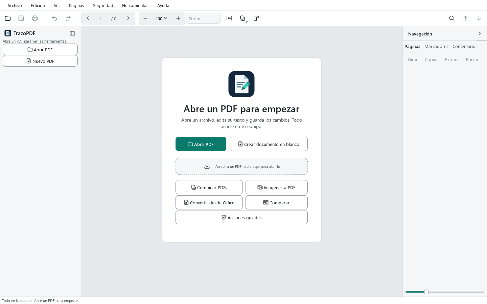

# Manual do usuário do TrazoPDF

O TrazoPDF é um editor de PDF gratuito para Windows. Ele funciona no seu computador: não tem contas nem telemetria e não envia seus documentos para nenhum lugar. É distribuído sob a licença AGPL-3.0-or-later.

Este manual explica cada área do programa com os nomes reais de menus, botões e atalhos. As funções têm limites; os mais importantes estão no capítulo 15 e o detalhe completo em [FEATURES.md](../FEATURES.md).

## Conteúdo

1. [Primeiros passos](#1-primeiros-passos)
2. [Ler e navegar](#2-ler-e-navegar)
3. [Localizar](#3-localizar)
4. [Editar texto e imagens](#4-editar-texto-e-imagens)
5. [Anotar e comentar](#5-anotar-e-comentar)
6. [Formulários e assinatura](#6-formulários-e-assinatura)
7. [Organizar páginas](#7-organizar-páginas)
8. [Segurança](#8-segurança)
9. [OCR, conversão e exportação](#9-ocr-conversão-e-exportação)
10. [Comparar, acessibilidade e ferramentas do documento](#10-comparar-acessibilidade-e-ferramentas-do-documento)
11. [Abas, salvamento automático e recuperação](#11-abas-salvamento-automático-e-recuperação)
12. [Idiomas](#12-idiomas)
13. [Atalhos de teclado](#13-atalhos-de-teclado)
14. [Solução de problemas](#14-solução-de-problemas)
15. [Limites conhecidos](#15-limites-conhecidos)

---

## 1. Primeiros passos

### Requisitos

Windows 10 ou 11 de 64 bits. O OCR já vem incluído. Você só precisa instalar o [LibreOffice](https://www.libreoffice.org/) se quiser converter documentos do Office para PDF.

### Instalar

Baixe uma das duas versões na página de Releases do projeto:

| Versão | Arquivo | Como usar |
| --- | --- | --- |
| Instalador | `TrazoPDF-x.y.z-setup.exe` | Instala para o seu usuário, sem permissões de administrador. Você pode escolher instalar para todos os usuários. Cria o atalho no menu Iniciar e, se marcar a opção, na área de trabalho. Aparece em «Abrir com» para os PDFs, sem alterar seu programa padrão. |
| Pasta portátil | `TrazoPDF-x.y.z-windows.zip` | Descompacte o arquivo e execute `TrazoPDF.exe`. Não precisa de instalação. |

Confira o arquivo baixado com `SHA256SUMS.txt`, que está na mesma versão.

O programa não é assinado, então o Windows pode mostrar um aviso na primeira vez. Veja [SmartScreen](#o-windows-smartscreen-avisa-ao-executar-o-programa) no capítulo 14.

### Abrir um PDF

Há quatro formas:

- **Arquivo > Abrir…** (`Ctrl+O`) ou o botão **Abrir PDF** da tela de boas-vindas.
- **Arquivo > Abrir recente**, que mostra nome, data e pasta dos últimos arquivos.
- Arrastar um PDF para cima da janela.
- «Abrir com» pelo Explorador de Arquivos, se você usou o instalador.

Se o PDF tiver senha de abertura, o programa a pede. A caixa tem um botão **Mostrar** para ver o que você digita e exibe os erros sem fechar.

Para começar com uma folha em branco, use **Arquivo > Novo PDF** (`Ctrl+N`) ou **Criar documento em branco** na tela de boas-vindas.

### A tela de boas-vindas

Sem nenhum documento aberto, você verá:

- **Abrir PDF** e **Criar documento em branco**.
- Uma área para arrastar um PDF.
- Atalhos: **Combinar PDFs**, **Imagens para PDF**, **Converter do Office**, **Comparar** e **Ações guiadas**.
- A lista de arquivos recentes, com miniatura e data.



### A interface


| Zona | O que contém |
| --- | --- |
| Barra de menus | Arquivo, Edição, Exibir, Páginas, Segurança, Ferramentas e Ajuda. |
| Barra superior | Abrir, Salvar, Imprimir, Desfazer e Refazer; navegador de páginas (anterior, número, total, próxima); zoom com os botões – e +, lista **Zoom** com predefinições, **Ajustar à largura da página**, **Exibição e zoom** e **Girar a vista**; à direita, Localizar e as setas de correspondência anterior e próxima. |
| Barra de ferramentas lateral (esquerda) | Os botões **Abrir PDF** e **Novo PDF**, e três grupos de ferramentas: *Ler e editar*, *Comentar* e *Formulários e segurança*. |
| Abas do documento | Uma aba para cada PDF aberto, acima da área do documento. |
| Área do documento | A página. Aqui você lê, seleciona e trabalha com a ferramenta ativa. |
| Painel lateral (direita) | Abas **Páginas**, **Marcadores**, **Comentários**, **Anexos**, **Links**, **Camadas**, **Campos** e **Propriedades**. |
| Barra de status | Mensagens, página atual, tamanho da página, ferramenta ativa e o estado de salvamento (*Não salvo*, *Salvo automaticamente às HH:MM* ou *Salvo*). |

Sem documento aberto, a barra de ferramentas lateral mostra apenas **Abrir PDF** e **Novo PDF** e um aviso para abrir um PDF.

### A barra de ferramentas lateral

Cada ferramenta tem uma letra de atalho. Pressione a letra com a área do documento ativa; ela não funciona enquanto você digita texto. Ao passar o mouse sobre um botão, a letra aparece entre parênteses.

| Grupo | Ferramenta | Letra |
| --- | --- | --- |
| Ler e editar | Selecionar texto | `V` |
| | Mover objetos | `E` |
| | Mover | `H` |
| | Texto | `T` |
| | Inserir imagem | `I` |
| | Link | `L` |
| Comentar | Realçar | `M` |
| | Sublinhar | `U` |
| | Riscar | `X` |
| | Nota | `N` |
| | Caixa de texto | sem letra |
| | Desenhar | `D` |
| | Linha, Seta, Retângulo, Elipse | sem letra |
| | Medir | `Ctrl+Alt+M` |
| Formulários e segurança | Preencher e assinar | `F` |
| | Criar campo | `K` |
| | Tarjar (marcar) | `C` |
| | Recortar página | sem letra |

Para ganhar espaço, clique no botão da parte superior da barra de ferramentas lateral ou use **Exibir > Barra de ferramentas compacta** (`Ctrl+B`). A barra fica reduzida a ícones.

### Tema claro e escuro

Escolha **Exibir > Tema** e selecione claro, escuro ou o do sistema.


### Ações guiadas

**Ferramentas > Ações guiadas…** abre um painel acoplável com assistentes passo a passo. Cada passo usa uma ferramenta normal do programa.

| Ação | Passos |
| --- | --- |
| Preparar para envio | Remover metadados e dados ocultos, reduzir o tamanho do documento, salvar uma cópia. |
| Combinar e numerar páginas | Combinar arquivos, numerar páginas, salvar. |
| Localizar e tarjar informações sensíveis | Localizar e marcar padrões, verificar as marcas, aplicar tarjas, remover dados ocultos, salvar uma cópia. |
| Preencher e assinar | Preencher o documento, assinar com certificado (opcional), salvar. |

Escolha uma ação e clique em **Próximo** para executar o passo atual. Com **Ignorar** você pula o passo. Um passo só fica marcado como feito se o documento foi alterado ou salvo de fato.

---

## 2. Ler e navegar

### Movimentar-se pelo documento

- Use as setas **anterior** e **próxima** da barra superior, ou digite um número no campo de página.
- `Ctrl+G` leva o cursor ao campo de página (**Ir para a página…**).
- Teclado: `Page Down` e `Page Up` mudam de página; `Home` e `End` vão para a primeira e a última.
- Clique em uma miniatura do painel **Páginas**.
- O painel **Marcadores** mostra o índice do documento. Clique em um marcador para ir à sua página. Com **Edição > Editar marcadores** você pode adicionar e reorganizar marcadores.

### Zoom

| Ação | Como |
| --- | --- |
| Aumentar e reduzir | Botões + e – da barra, `Ctrl++` e `Ctrl+-`, ou `Ctrl` + roda do mouse. |
| Valor exato | Digite uma porcentagem no campo de zoom (de 25 % a 400 %). |
| Predefinições | Lista **Zoom**: 50, 75, 100, 125, 150 e 200 %, **Ajustar largura**, **Ajustar página**, **Tamanho real**. |
| Ajustar página | `Ctrl+9` |
| Ajustar largura | `Ctrl+0` |
| Tamanho real (100 %) | `Ctrl+1` |

### Disposição da página

Em **Exibir > Disposição** (ou no botão **Exibição e zoom** da barra) você escolhe:

- **Uma página**
- **Duas páginas**
- **Rolagem contínua**
- **Duas páginas contínuas**

A seleção de texto atravessa as páginas nas exibições contínuas.

### Girar a vista

**Exibir > Girar a vista** (`Ctrl+Shift+G`) gira apenas o que você vê. Não altera o arquivo. Para girar as páginas do documento, use **Girar 90°** (`Ctrl+R`), descrito no capítulo 7.

### Outras opções de Exibir

- **Tela cheia** (`F11`; `Esc` para sair).
- **Painel de páginas** (`Ctrl+Shift+B`) mostra ou oculta o painel lateral.
- **Histórico de mensagens** mostra as últimas 20 mensagens da barra de status.

### Memória por arquivo

Cada arquivo lembra sua página, zoom e posição de rolagem. Ao reabri-lo, você continua de onde parou.

### Imprimir

**Arquivo > Imprimir…** (`Ctrl+P`) abre uma pré-visualização antes de imprimir. As páginas são geradas na resolução da impressora, entre 150 e 600 ppp.

---

## 3. Localizar

1. Pressione `Ctrl+F` ou o botão da lupa. Aparece uma barra abaixo da barra superior.
2. Digite o texto. Os resultados são marcados e um contador mostra quantos há.
3. `Enter` ou `F3` vão para a próxima correspondência. `Shift+Enter` ou `Shift+F3`, para a anterior. Você também pode usar as setas da barra.
4. `Esc` fecha a barra.

Opções da barra:

| Botão | Efeito |
| --- | --- |
| **Aa** | Diferenciar maiúsculas e minúsculas. |
| **Palavra inteira** | Apenas palavras inteiras. |
| **Substituir** | Mostra uma segunda linha para substituir texto. |

A busca só encontra texto que tenha camada de texto. Em um documento digitalizado, faça primeiro o [OCR](#9-ocr-conversão-e-exportação). A substituição segue os limites da edição de texto (capítulo 4). Cada aba mantém a sua própria busca.

Para encontrar dados específicos e tarjá-los, veja [Localizar e tarjar](#tarjas).

---

## 4. Editar texto e imagens

### Selecionar e copiar texto

Com **Selecionar texto** (`V`), arraste sobre o texto. Um clique duplo seleciona uma palavra e um clique triplo, uma linha. `Ctrl+C` copia. `Ctrl+A` seleciona todo o texto da página (ou todas as miniaturas, se o foco estiver no painel de páginas).

### A ferramenta Texto

A ferramenta **Texto** (`T`) faz duas coisas, conforme onde você clica:

- **Sobre texto existente**: edita esse bloco.
- **Em um espaço vazio da página**: adiciona texto novo nesse ponto.

Enquanto digita:

| Tecla | Efeito |
| --- | --- |
| `Ctrl+Enter` | Aplica o texto. |
| `Esc` | Cancela o que você está digitando. |

Uma barra flutuante permite mudar a fonte, o tamanho, a cor, o negrito e o itálico.

Com **Mover objetos** (`E`) você pode selecionar um bloco de texto, arrastá-lo, editá-lo com `F2` e excluí-lo com `Del`.

Limites: o programa não reorganiza os outros blocos como faria o Word, as fontes originais podem ser substituídas e o texto inclinado não é editado diretamente.

### Substituir texto

Abra a barra de busca com `Ctrl+F`, clique em **Substituir** e digite o texto novo. Funciona apenas com texto real, não com imagens.

### Imagens

Com **Mover objetos** (`E`), clique em uma imagem para selecioná-la. Você pode:

- Arrastá-la para mover.
- Arrastar um canto para redimensionar.
- Substituí-la por outra imagem. A área é mantida, então a nova imagem pode ficar esticada.
- Excluí-la com `Del`.

Para adicionar uma imagem nova, use **Inserir imagem** (`I`) na barra de ferramentas lateral.

Essas operações funcionam com imagens diretas do PDF. Imagens aninhadas ou em linha podem não ser suportadas. Tudo pode ser desfeito com `Ctrl+Z`.

### Links

A ferramenta **Link** (`L`) cria um link desenhando uma área sobre a página. Ela pode apontar para um endereço web, um e-mail ou uma página do documento. O painel **Links** e **Edição > Links do documento…** permitem abrir, editar e excluir links. Os links só são abertos quando você pede.

### Recortar página

**Recortar página** na barra de ferramentas lateral (grupo *Formulários e segurança*) altera a área visível da página. Não é uma forma de tarjar informações: o conteúdo cortado continua no arquivo.

### Desfazer e refazer

`Ctrl+Z` desfaz. `Ctrl+Shift+Z` ou `Ctrl+Y` refazem. O histórico pertence à sessão e não é mantido ao fechar o documento.

---

## 5. Anotar e comentar

As ferramentas do grupo **Comentar** da barra de ferramentas lateral:

| Ferramenta | Para que serve |
| --- | --- |
| Realçar (`M`), Sublinhar (`U`), Riscar (`X`) | Marcar texto. Selecione o texto com a ferramenta ativa. |
| Nota (`N`) | Um comentário preso a um ponto da página. |
| Caixa de texto | Texto livre dentro de uma caixa. |
| Desenhar (`D`) | Tinta à mão livre. |
| Linha, Seta, Retângulo, Elipse | Formas. |
| Medir | Mede distâncias sobre a página. |

### Comentários e respostas

Os comentários têm autor, encadeamento de respostas e estado. Você os gerencia na aba **Comentários** do painel lateral ou em **Edição > Comentários e anotações…**. Excluir um comentário dessa lista pode ser desfeito.

### Medir

Escolha **Medir** (`Ctrl+Alt+M`) e arraste sobre a página para obter uma distância. Com a opção **Área** você pode marcar vértices. A precisão depende da escala configurada e não é uma medição certificada.

### Excluir uma anotação

Selecione-a e pressione `Del`.

A aparência das anotações pode variar conforme o leitor de PDF que as abrir.

---

## 6. Formulários e assinatura

### Preencher um formulário

1. Escolha **Preencher e assinar** na barra de ferramentas lateral ou pressione `F`.
2. Clique em um campo e digite. As caixas de seleção são marcadas com um clique.
3. `Tab` vai para o próximo campo.

Na paleta desta ferramenta você também pode digitar texto livre, colocar marcas de verificação ou de cancelamento, inserir a data de hoje e posicionar uma **Assinatura** desenhada, escrita ou criada a partir de uma imagem (**+ Criar assinatura**). Com **Lembrar assinatura** ela fica salva para usar de novo.

Também existe **Edição > Preencher formulários…**, que abre uma caixa de diálogo com os campos. A aba **Campos** do painel lateral lista os campos do documento; um clique leva você a cada um.

Os formulários AcroForm são preenchidos em qualquer página visível, inclusive nas exibições contínuas. Scripts de formulário não são executados e formulários XFA não são editados.

Se quiser que os campos deixem de ser editáveis, use **Ferramentas > Nivelar…**: ele incorpora anotações e campos ao conteúdo da página. Pode ser desfeito na sessão.

### Criar campos

- **Criar campo** na barra de ferramentas lateral (ou a tecla `K`): desenhe o campo sobre a página.
- **Ferramentas > Detectar campos**: procura linhas e caixas em um formulário sem campos e propõe criá-los. Você verá uma pré-visualização e poderá escolher quais aplicar. Ele só detecta linhas curtas e caixas quadradas, então revise as propostas.

### Assinar com certificado

A assinatura digital usa um certificado próprio no formato PKCS#12 (`.p12` ou `.pfx`). Não é o mesmo que colocar uma imagem da sua assinatura com **Preencher e assinar**: a assinatura com certificado protege o arquivo contra alterações posteriores.

1. **Segurança > Assinar com certificado…**
2. Escolha o certificado e digite a senha dele.
3. Em **Aparência da assinatura**, decida se ela será invisível ou visível:
   - **Assinatura visível na página** (sem marcar, a assinatura é invisível: fica apenas registrada no arquivo). Se marcar, escolha a **Página** e **arraste sobre a página para desenhar o retângulo** onde a assinatura ficará.
   - Marque o que ela mostra: **Nome do signatário**, **Data e hora**, **Motivo** e **Local** (os dois últimos são opcionais) e, se quiser, uma **imagem de assinatura** entre as que você tiver salvas.
4. Em **Opções de assinatura** você pode ativar **Adicionar carimbo de data/hora** (veja mais abaixo).
5. Decida onde salvar a cópia. É gerada uma cópia assinada; o documento aberto não muda.

**Várias assinaturas.** Se o documento já tiver assinaturas, o diálogo avisa: a sua será adicionada como uma nova revisão e as anteriores continuam válidas. Se depois você editar e salvar o documento, elas deixarão de ser válidas.

O carimbo de data/hora é opcional e vem desativado. Se você o ativar, informa o endereço (`https://…`) da autoridade de carimbo, e só então a rede é usada. Se o carimbo falhar, o programa oferece assinar sem ele.

Para assinar um documento criptografado, é preciso salvar antes uma cópia sem senha. O programa não remove a proteção por conta própria.

### Validar assinaturas

**Segurança > Procurar assinaturas…** valida cada assinatura do PDF localmente e mostra, para cada uma:

- o signatário e a data declarada;
- a **integridade**: se o documento foi modificado depois de assinado;
- a **validade criptográfica**;
- a **cadeia de confiança** em relação aos certificados raiz do sistema. Um certificado autoassinado ou de raiz desconhecida aparece como «Não verificada»: não é uma falha; apenas indica que o programa não pode confiar nele por si só;
- o carimbo de data/hora, se houver.

Limites: a **revogação** dos certificados **não é verificada** (nenhuma rede é consultada) e o resultado **não equivale a uma assinatura eletrônica qualificada eIDAS**. Não há assinatura remota nem envio a signatários. Para documentos importantes, confira o arquivo também com um leitor independente.

---

## 7. Organizar páginas

### O painel Páginas

O painel **Páginas** mostra miniaturas. Selecione uma ou várias (`Ctrl+clique`, `Shift+clique`, ou `Ctrl+A` para todas). Arraste as miniaturas para reordená-las. Se você atribuiu rótulos de página, eles aparecem abaixo das miniaturas.

Sobre as miniaturas há uma barra com **Girar**, **Copiar**, **Extrair** e **Excluir**. O menu de contexto (clique com o botão direito) oferece:

- Girar 90° para a esquerda
- Girar 90° para a direita
- Duplicar
- Inserir em branco aqui
- Inserir a partir de imagem…
- Extrair selecionadas…
- Excluir
- Etiquetas de página…

### Menu Páginas

| Opção | O que faz |
| --- | --- |
| **Combinar arquivos…** | Une outros PDFs ao documento. Você também pode soltar vários PDFs sobre a janela. |
| **Inserir página em branco** | Adiciona uma página em branco. |
| **Inserir página…** | Página em branco (A4, Carta, A3, A5 ou tamanho personalizado), imagem como página ou duplicado com cópias. |
| **Duplicar página** | Copia a página atual. |
| **Excluir páginas** | Exclui as páginas selecionadas. |
| **Girar 90°** (`Ctrl+R`) | Gira as páginas. |
| **Extrair páginas…** | Cria um PDF novo com as páginas escolhidas. |
| **Dividir em arquivos…** | Divide o documento em vários arquivos, com opções de divisão. |
| **Marca d'água…** | Adiciona uma marca d'água. |
| **Numerar páginas…** | Escreve o número em cada página. |
| **Cabeçalho e rodapé…** | Texto à esquerda, no centro e à direita. Aceita `{page}`, `{pages}`, `{date}` e `{filename}`. Tem margens, cor e intervalo de páginas. |
| **Carimbos…** | Carimbos predefinidos ou uma imagem. Clique para centralizá-los ou arraste para definir o tamanho. |
| **Etiquetas de página…** | Numeração lógica por intervalos (arábica, romana, letras, com prefixo). Altera apenas o que as miniaturas mostram, não o texto impresso. |

### Numeração Bates

**Ferramentas > Avançado > Numeração Bates…**: prefixo, sufixo, número inicial, dígitos e posição, em todas as páginas ou em um intervalo. A numeração é escrita no conteúdo da página.

### Criar PDF a partir de outros arquivos

- **Arquivo > Criar PDF > Imagens…** cria um PDF a partir de fotos.
- **Arquivo > Criar PDF > Office…** converte Word, Excel ou PowerPoint (precisa do [LibreOffice](#libreoffice-não-encontrado)).

### Lotes e receitas

**Ferramentas > Processar vários PDFs…** aplica uma **receita** (uma lista ordenada de passos) a vários arquivos de uma vez. Os originais não são alterados: os resultados são gravados em uma pasta de saída.

1. **Adicionar arquivos…** ou **Adicionar pasta…** (com **Incluir subpastas** se quiser percorrê-las). **Remover** tira da lista os itens escolhidos.
2. Escolha a **Pasta de saída**.
3. Em **Se o arquivo de saída já existir**, decida: **Renomear a saída**, **Ignorar o arquivo** ou **Sobrescrever a saída**.
4. Em **Receita**, escolha uma salva ou uma predefinida, ou monte uma com **Adicionar passo**. Com **Parâmetros…**, **Remover passo**, **Subir** e **Descer** você ajusta cada passo e a ordem.
5. Clique em **Processar**. A tabela mostra, para cada arquivo, o **Estado** (OK, Ignorado, Erro ou Cancelado) e o **Resultado**. **Cancelar** interrompe o processo sem deixar arquivos pela metade.

Se um arquivo falhar, o erro é registrado e o programa segue com o próximo. PDFs criptografados não são processados. Os arquivos de saída levam o sufixo `_procesado` (`_texto` se a receita terminar em **Exportar texto**).

#### Passos disponíveis

| Passo | O que faz |
| --- | --- |
| **Anonimizar** | Igual a [Anonimizar documento](#anonimizar-documento), com seus termos e expressões. |
| **OCR (texto pesquisável)** | Idiomas (por exemplo `spa+eng`; vazio = automático) e **Endireitar e orientar as páginas**. Se for o primeiro passo, também aceita imagens (PNG, JPG, TIFF, BMP). |
| **Otimizar** | Reduz imagens a ppp (0 = sem alterar), define a qualidade JPEG e remove metadados. |
| **Limpar metadados e conteúdo oculto** | Equivale a **Remover dados ocultos**. |
| **Marca d'água** | Texto e tamanho. |
| **Numerar páginas** | Número inicial. |
| **Numeração Bates** | Prefixo, sufixo, número inicial, dígitos e posição. |
| **Girar todas as páginas** | 90, 180 ou 270 graus. |
| **Cortar margens** | Margem esquerda, superior, direita e inferior, em pontos. |
| **Assinar com certificado** | Certificado `.p12`/`.pfx`, motivo e local. A assinatura é invisível. |
| **Exportar texto** | Gera um `.txt`. Deve ser o último passo. |

#### Salvar, importar e exportar receitas

Com **Salvar receita…** a receita fica na sua lista, e com **Exportar…** e **Importar…** você a compartilha como arquivo `.json`. Uma receita nunca salva senhas: a do certificado é pedida ao executar (ou, sem janela, é lida da variável `PDFEDITOR_SIGN_PASSWORD`).

Há três receitas predefinidas:

- **Anonimizar e arquivar**: anonimizar e otimizar, removendo metadados.
- **Digitalização para PDF pesquisável**: OCR com endireitamento e otimização.
- **Reduzir e limpar**: otimizar e limpar metadados.

#### Pela linha de comando

O TrazoPDF também processa lotes sem abrir janela, por exemplo para automatizar um scanner. Use uma receita `.json` salva com **Exportar…**.

```
"TrazoPDF.exe" --batch receta.json --in C:\Escaneos --out C:\Salida --recursive --on-conflict renombrar
"TrazoPDF.exe" --watch C:\Entrada --recipe receta.json --out C:\Salida
```

| Opção | Significado |
| --- | --- |
| `--batch RECETA.json` | Processa uma vez os PDFs de `--in` (arquivo ou pasta). |
| `--watch PASTA` | Monitora a pasta (com `--recipe`) e processa cada PDF novo quando terminar de ser copiado. Os processados são movidos para a subpasta `procesados`; os que falham ficam onde estão. Para com `Ctrl+C`. |
| `--recipe RECETA.json` | Receita para `--watch`. |
| `--out PASTA` | Pasta de saída. |
| `--recursive` | Com `--batch`, inclui subpastas. |
| `--on-conflict` | `renombrar` (padrão), `omitir` ou `sobrescribir`. |
| `--interval N` | Segundos entre as verificações de `--watch` (padrão 5). |

O relatório é exibido e salvo como `batch-report.json` na pasta de saída. **Códigos de saída:** `0` se tudo correu bem, `1` se algum arquivo falhou e `2` se o uso estiver incorreto (argumentos faltando, receita ou entrada inexistente).

---

## 8. Segurança

### Senhas

**Segurança > Salvar com senha…** protege o documento com criptografia AES-256.

- Senha de abertura: a que é pedida para abrir o arquivo.
- Senha do proprietário: controla as permissões de impressão, edição e cópia. Você pode escolhê-la. Se deixá-la vazia, o programa gera uma segura e **a mostra uma única vez**, com um botão para copiá-la. Ela não é salva em lugar nenhum: anote-a.

**Segurança > Salvar cópia sem senha…** salva uma cópia sem proteção.

Ao salvar, o programa mantém a criptografia, as permissões e as senhas do arquivo original. Se não conseguir mantê-las, oferece:

- informar a senha do proprietário,
- proteger com senhas novas, ou
- salvar uma cópia sem proteção.

Ao abrir um PDF com restrições, também é oferecido informar a senha do proprietário, para poder salvá-lo mantendo essas restrições.

As permissões de impressão, edição e cópia dependem de cada leitor respeitá-las. A senha original do proprietário não pode ser recuperada.

Exportar, extrair páginas, dividir e assinar a partir de um documento protegido gera arquivos **sem senha**. O programa avisa antes.

### Tarjas

Tarjar envolve dois passos: marcar e aplicar.

1. **Marcar.** Use **Tarjar (marcar)** (`C`) e desenhe sobre o que quer tarjar. Você também pode usar **Segurança > Localizar e tarjar…**.
2. **Aplicar.** **Segurança > Aplicar tarjas** remove de forma definitiva o conteúdo sob as marcas.

Importante: **uma marca não aplicada não tarja nada**. O texto continua no arquivo. Por isso, salvar, exportar, extrair, dividir, assinar, executar OCR ou uma comparação com marcas pendentes pede sua confirmação e oferece aplicá-las.

Ao aplicar, são removidos:

- o texto, as imagens e os gráficos sob a marca;
- os links, os campos de formulário e as anotações que a tocam;
- os metadados, XMP e marcadores que citam o texto tarjado.

#### Localizar e tarjar

**Segurança > Localizar e tarjar…** busca padrões: cartões (com verificação Luhn), IBAN, DNI/NIE, NIF/CIF, telefones, datas e e-mails. Também aceita texto ou expressões regulares próprias. Marque as correspondências que escolher e depois oferece aplicá-las. Detecta o que está escrito como texto; em uma digitalização, faça OCR antes. Revise a lista, porque podem existir falsos positivos e falsos negativos.

### Anonimizar documento

**Segurança > Anonimizar documento…** remove de forma definitiva os dados pessoais de um documento e verifica o resultado. Tudo acontece no seu computador e trabalha sobre uma **cópia nova**: o original não é alterado. Não funciona com documentos criptografados; salve antes uma cópia sem senha.

**O que detecta.** Em **O que procurar** há caixas de seleção, todas marcadas ao abrir, para os mesmos padrões de **Localizar e tarjar** (cartões, IBAN, DNI/NIE, NIF/CIF, telefones, datas, e-mails) e mais três: número da Seguridade Social, placa de veículo e endereço IP. Além disso, você pode digitar **Termos** (um por linha: nomes, endereços, referências…) e **Expressões** regulares (uma por linha), com **Diferenciar maiúsculas e minúsculas** e **Apenas palavras inteiras**.

**Pré-visualização.**

1. Clique em **Pesquisar correspondências**. Aparece uma lista com a página, o tipo e o texto encontrado.
2. Desmarque as que não quiser tocar, ou use **Marcar tudo** e **Desmarcar tudo**.
3. Confira o **Arquivo de saída** (por padrão `nome-anonimizado.pdf`, junto ao original; **Procurar…** para alterá-lo).
4. Clique em **Anonimizar**.

As correspondências em metadados, anexos ou anotações não podem ser desmarcadas: são sempre removidas.

**O que faz.** Aplica a tarja sobre as correspondências escolhidas e remove os demais canais: metadados e XMP, anexos, JavaScript, marcadores, miniaturas e as anotações e campos que citam os dados. Depois reescreve o arquivo inteiro, sem histórico de alterações.

**Verificação.** O programa relê a cópia e procura os dados no texto das páginas, nas anotações, nos metadados, nos marcadores, nos anexos e nos bytes do arquivo, já descompactados. Também confere se não restam anexos, scripts nem objetos órfãos. **Se a verificação falhar, nenhum arquivo é salvo.**

**Relatório.** Ao terminar, é exibido um relatório com as correspondências por tipo, onde foram encontradas, o que foi removido e o resultado de cada verificação. **Salvar relatório…** o grava em `.txt` ou `.json`. O relatório não contém os dados removidos.

**Limites.**

- Detecta apenas o que está escrito como texto. Digitalizações e imagens não são lidas: faça OCR antes para haver texto a procurar. O texto dentro de uma imagem não é removido.
- A verificação procura o texto, não o formato das letras: fontes incorporadas como subconjunto podem manter os glifos dos caracteres usados.
- Podem existir falsos positivos e falsos negativos. Revise a lista da pré-visualização e o resultado.
- Podem permanecer dados no que não é analisado, como o conteúdo das imagens ou informações que só uma pessoa reconhece. Revise a cópia antes de compartilhá-la.

Também está disponível como passo de uma receita de [lotes](#lotes-e-receitas).

### Remover dados ocultos

**Segurança > Remover dados ocultos…** remove metadados, anexos, JavaScript, links e outros elementos. Pode alterar formulários e remover conteúdo útil, então revise o resultado.

### Metadados e anexos

- **Arquivo > Propriedades…** (`Alt+Enter`) edita os metadados.
- **Edição > Arquivos anexados…** e a aba **Anexos** gerenciam os arquivos incorporados (adicionar, extrair, excluir).

### Antes de compartilhar um documento sensível

1. Aplique as tarjas, ou use **Anonimizar documento…**, que faz tudo e verifica o resultado.
2. Se não anonimizar, execute **Remover dados ocultos…**.
3. Revise os anexos.
4. Salve uma cópia com **Salvar uma cópia…**.

---

## 9. OCR, conversão e exportação

### OCR

**Ferramentas > Reconhecer texto (OCR)…** converte páginas digitalizadas em texto pesquisável. O reconhecimento vem incluído no programa: não é preciso instalar nada nem usar a rede.

1. Em **Idiomas do texto**, marque os idiomas do documento: espanhol, inglês, francês, alemão e português. Vários idiomas levam mais tempo.
2. Se a digitalização estiver torta ou girada, marque **Endireitar páginas e detectar a orientação**. Isso corrige inclinações de até cerca de 10° e leva mais tempo.
3. Confirme e aguarde: o progresso é exibido e você pode cancelar.

Funciona com páginas digitalizadas e mistas, e evita duplicar texto que já existe. Revise o resultado: podem restar erros de reconhecimento. O OCR cria uma camada de texto; ele não transforma a digitalização em um documento editável.

Também há um passo **OCR (texto pesquisável)** para [lotes e receitas](#lotes-e-receitas).

### Office para PDF

**Arquivo > Criar PDF > Office…** usa o LibreOffice. A diagramação pode não coincidir com a do Microsoft Office.

### Exportar

**Arquivo > Exportar como** oferece:

| Opção | Resultado |
| --- | --- |
| **Texto (.txt)** | O texto extraído. |
| **Word (.docx)** | O texto extraído. Não mantém a diagramação. |
| **Excel (.xlsx)** | As tabelas detectadas; se não houver tabelas, o texto em linhas. |
| **PowerPoint (.pptx)** | Uma imagem de cada página por slide. Os elementos não são editáveis. |
| **Imagens…** | Cada página como imagem. |

As exportações de um documento protegido saem sem senha. O programa avisa antes.

### Reduzir tamanho

**Ferramentas > Reduzir tamanho…** reduz a resolução das imagens, recomprime-as, limpa objetos não usados e, se quiser, remove metadados. Mostra o tamanho estimado antes de aplicar. Reduzir o ppp perde qualidade: salve uma cópia se tiver dúvidas.

### Nivelar

**Ferramentas > Nivelar…** incorpora anotações e campos ao conteúdo da página.

### Tarefas longas

OCR, conversão, exportação, divisão, assinatura, redução de tamanho e verificação mostram o progresso e podem ser cancelados. Ao cancelar, os arquivos parciais são apagados.

---

## 10. Comparar, acessibilidade e ferramentas do documento

### Comparar documentos

**Ferramentas > Comparar documentos…** pergunta como comparar o documento atual com outro PDF:

- **Aparência (visual)**: mostra os dois documentos e marca as diferenças em magenta. Há três visualizações, navegação entre as alterações, zoom sincronizado e exportação do relatório em um ZIP. Pode ser cancelada. Uma nova comparação precisa de uma pasta de saída vazia.
- **Texto**: lista as diferenças de linhas de texto por página.

As duas comparam por número de página. A visual rasteriza com no máximo 110 ppp e 1400 px de lado, e não compara metadados, links, assinaturas nem conteúdo oculto.

### Verificar documento

**Ferramentas > Verificar documento…** gera um relatório rápido de páginas digitalizadas, fontes não incorporadas, tags de acessibilidade, título, idioma e JavaScript. Um clique duplo em um item leva à página. Não é uma validação PDF/UA nem PDF/A.

### Verificar acessibilidade

**Ferramentas > Verificar acessibilidade…** gera um relatório por item: título, idioma, tags, páginas sem texto, texto alternativo e marcadores. O título e o idioma podem ser corrigidos com um clique (com uma lista para escolher o idioma). O relatório pode ser exportado para texto. Também não é uma validação PDF/UA.

### Outras ferramentas do documento

| Ferramenta | Onde |
| --- | --- |
| Reduzir tamanho | Ferramentas |
| Nivelar | Ferramentas |
| Medir | Ferramentas e barra de ferramentas lateral |
| Detectar campos | Ferramentas |
| Numeração Bates | Ferramentas > Avançado |
| Camadas | Aba **Camadas** do painel lateral |

A aba **Camadas** mostra ou oculta as camadas de conteúdo opcional que o PDF traz. Não cria nem edita camadas.

---

## 11. Abas, salvamento automático e recuperação

### Vários documentos ao mesmo tempo

Cada PDF aberto tem sua aba acima da área do documento. Cada aba mantém sua página, zoom, posição de rolagem, busca, histórico de desfazer, painel lateral e cópia de recuperação. Abrir um arquivo que já está aberto ativa a aba dele.

- Arraste uma aba para reordená-la.
- Use o botão **×** da aba, ou `Ctrl+W`, para fechá-la.
- Clique com o botão direito em uma aba: **Fechar**, **Fechar outras** e **Mostrar na pasta**.

| Atalho | Efeito |
| --- | --- |
| `Ctrl+Tab` / `Ctrl+Shift+Tab` | Aba próxima / anterior |
| `Alt+1` a `Alt+8` | Ir para essa aba |
| `Alt+9` | Ir para a última aba |
| `Ctrl+W` | Fechar o documento atual |

Ao fechar um documento com alterações, o programa pergunta o que fazer com elas.

### Salvar

| Opção | Efeito |
| --- | --- |
| **Salvar** (`Ctrl+S`) | Salva sobre o arquivo. |
| **Salvar como…** (`Ctrl+Shift+S`) | Salva com outro nome. |
| **Salvar uma cópia…** (`Ctrl+Alt+S`) | Grava outro arquivo sem alterar o documento aberto. |
| **Reverter** | Recarrega a versão salva e descarta as alterações feitas desde o último salvamento. Pede confirmação. |

Ao salvar sobre um arquivo existente, o programa deixa uma cópia `.bak` do original, uma vez por sessão e por arquivo. Essa cópia vem ativada por padrão.

### Salvamento automático e recuperação

- A cada minuto, o programa grava uma cópia de recuperação de cada documento com alterações não salvas. O arquivo original não é tocado.
- A barra de status mostra *Não salvo*, *Salvo automaticamente às HH:MM* ou *Salvo*.
- Se o programa fechar de forma inesperada, ao iniciar aparece um aviso: «Há um documento não salvo de uma sessão anterior». Escolha **Recuperar** ou **Descartar**.
- A cópia de recuperação é apagada ao salvar ou fechar normalmente.

O salvamento automático não substitui salvar o arquivo. Documentos protegidos por senha não são salvos automaticamente, para não gravar uma cópia sem criptografia; o programa avisa uma vez.

### Arquivos recentes

**Arquivo > Abrir recente** mostra nome, data e pasta. Os arquivos que não existem mais aparecem como «Indisponível», com a opção **Remover dos recentes**. **Limpar lista** esvazia a lista.

---

## 12. Idiomas

A interface está disponível em cinco idiomas:

| Código | Idioma |
| --- | --- |
| es | Español |
| en | English |
| fr | Français |
| de | Deutsch |
| pt | Português |

### Mudar de idioma

1. Abra **Ajuda > Idioma** e escolha o idioma.
2. **Reinicie** o programa. A mudança só vale depois disso.

Por padrão, o programa usa o idioma do Windows; se ele não estiver entre os cinco, usa o inglês. Para forçar um idioma, você pode definir a variável de ambiente `PDFEDITOR_LANG` (por exemplo `PDFEDITOR_LANG=en`).

Este manual usa os nomes de menus e botões tal como aparecem na interface em português. Nos outros idiomas os nomes mudam, mas a estrutura é a mesma.

---

## 13. Atalhos de teclado

**Ajuda > Atalhos de teclado** (`F1`) mostra a tabela dentro do programa.

### Arquivo e edição

| Atalho | Ação |
| --- | --- |
| `Ctrl+N` | Novo PDF |
| `Ctrl+O` | Abrir |
| `Ctrl+S` | Salvar |
| `Ctrl+Shift+S` | Salvar como |
| `Ctrl+Alt+S` | Salvar uma cópia |
| `Ctrl+P` | Imprimir |
| `Alt+Enter` | Propriedades |
| `Ctrl+W` | Fechar documento |
| `Ctrl+Q` | Sair |
| `Ctrl+Z` | Desfazer |
| `Ctrl+Shift+Z` / `Ctrl+Y` | Refazer |
| `Ctrl+A` | Selecionar tudo (texto ou miniaturas, conforme o foco) |
| `Ctrl+C` | Copiar o texto selecionado |
| `Ctrl+E` | Editar PDF |
| `Ctrl+R` | Girar as páginas 90° |
| `Ctrl+Alt+M` | Medir |
| `F1` | Atalhos de teclado |

### Exibir e navegar

| Atalho | Ação |
| --- | --- |
| `Ctrl+F` | Localizar |
| `F3` / `Shift+F3` | Próximo resultado / anterior |
| `Ctrl+G` | Ir para a página |
| `Ctrl+9` | Ajustar página |
| `Ctrl+0` | Ajustar largura |
| `Ctrl+1` | Tamanho real (100 %) |
| `Ctrl++` / `Ctrl+=` | Aumentar zoom |
| `Ctrl+-` | Reduzir zoom |
| `Ctrl` + roda do mouse | Alterar o zoom |
| `Ctrl+Shift+G` | Girar a vista |
| `F11` | Tela cheia |
| `Ctrl+B` | Barra de ferramentas compacta |
| `Ctrl+Shift+B` | Painel de páginas |
| `Page Down` / `Page Up` | Próxima página / anterior |
| `Home` / `End` | Primeira / última página |

### Abas

| Atalho | Ação |
| --- | --- |
| `Ctrl+Tab` / `Ctrl+Shift+Tab` | Aba próxima / anterior |
| `Alt+1` a `Alt+9` | Ir para a aba indicada (`Alt+9` vai para a última) |

### Ferramentas (com a área do documento ativa)

| Tecla | Ferramenta |
| --- | --- |
| `V` | Selecionar texto |
| `H` | Mover |
| `E` | Mover objetos |
| `T` | Texto |
| `I` | Inserir imagem |
| `L` | Link |
| `N` | Nota |
| `D` | Desenhar |
| `M` | Realçar |
| `U` | Sublinhar |
| `X` | Riscar |
| `F` | Preencher e assinar |
| `K` | Criar campo |
| `C` | Tarjar (marcar) |

### Enquanto edita

| Atalho | Ação |
| --- | --- |
| `Ctrl+Enter` | Aplicar o texto que você está digitando |
| `Esc` | Cancelar a digitação em curso |
| `F2` | Editar o bloco selecionado |
| `Del` | Excluir o elemento selecionado |
| `Tab` | Próximo campo ao preencher um formulário |

### Localizar

| Atalho | Ação |
| --- | --- |
| `Enter` ou `F3` | Próxima correspondência |
| `Shift+Enter` ou `Shift+F3` | Correspondência anterior |
| `Esc` | Fechar a barra de busca |

---

## 14. Solução de problemas

### O Windows SmartScreen avisa ao executar o programa

O TrazoPDF é distribuído sem assinatura de código. Por isso, o SmartScreen mostra «O Windows protegeu o seu PC» ao executar o instalador ou o programa.

1. Clique em **Mais informações**.
2. Pressione **Executar mesmo assim**.

Antes, confira que o arquivo é o original com `SHA256SUMS.txt`:

```powershell
Get-FileHash .\TrazoPDF-x.y.z-setup.exe -Algorithm SHA256
```

O resultado deve coincidir com a linha desse arquivo em `SHA256SUMS.txt`.

### O OCR não funciona ou não reconhece meu idioma

O OCR vem incluído na versão instalada e na portátil, e não precisa de instalação. Se falhar:

1. Confira se o idioma está marcado em **Idiomas do texto**. Só estão disponíveis espanhol, inglês, francês, alemão e português.
2. Se a página estiver torta ou girada, repita com **Endireitar páginas e detectar a orientação**.
3. Consulte **Ajuda > Sobre o TrazoPDF**, que inclui um diagnóstico.

Só se você executar o TrazoPDF a partir do código-fonte é preciso instalar o [Tesseract](https://github.com/UB-Mannheim/tesseract/wiki). Se ele estiver em um caminho incomum, informe-o na variável de ambiente `PDFEDITOR_TESSERACT`.

### LibreOffice não encontrado

Criar PDF a partir do Office precisa do LibreOffice (https://www.libreoffice.org/), que **não** vem incluído. Instale-o e reinicie o TrazoPDF. Se ele estiver em outro caminho, use a variável `PDFEDITOR_SOFFICE`. O diagnóstico está em **Ajuda > Sobre o TrazoPDF**.

### A busca não encontra nada

Provavelmente o PDF é uma digitalização, sem camada de texto. Execute **Ferramentas > Reconhecer texto (OCR)…**.

### Não consigo editar ou salvar um PDF protegido

Se o PDF tiver permissões restritas, ao abri-lo o programa oferece informar a senha do proprietário. Se você não a souber, pode salvar uma cópia sem proteção ou proteger o documento com senhas novas.

### Pede confirmação por tarjas pendentes

Você tem marcas de tarja sem aplicar. Escolha aplicá-las com **Segurança > Aplicar tarjas**, ou cancele e revise-as.

### O texto muda de fonte ao editar

O PDF usa uma fonte que não está disponível, e o programa a substitui. É um limite conhecido.

### O programa fechou com alterações não salvas

Abra-o de novo. Aparece um aviso para **Recuperar** ou **Descartar** a cópia de recuperação (veja o capítulo 11).

### Um PDF assinado deixou de ser válido

Alterar e salvar um PDF assinado invalida as assinaturas. Assine novamente a cópia final. Se você adicionou várias assinaturas, assine sempre por último, depois das edições.

### O processamento em lote falha com alguns arquivos

Veja a coluna **Resultado** da tabela ou o relatório `batch-report.json` na pasta de saída. PDFs criptografados não são processados, e uma receita que assina precisa da senha do certificado. Os arquivos que falham não interrompem o restante do lote.

### Se o problema continuar

Veja as últimas mensagens em **Exibir > Histórico de mensagens** e consulte **Ajuda > Sobre o TrazoPDF**, que mostra a versão e o diagnóstico das ferramentas (OCR e LibreOffice).

---

## 15. Limites conhecidos

O TrazoPDF cobre as tarefas habituais com PDF. Não é uma réplica do Adobe Acrobat Pro. Estes são os principais limites.

### Edição

- A edição é pensada para texto digital. Em digitalizações, o OCR adiciona uma camada pesquisável; ele não reconstrói a imagem.
- Não redistribui outros blocos como um documento do Word.
- As fontes originais podem ser substituídas.
- O texto inclinado não é editado diretamente.
- Imagens: a edição se limita a imagens diretas compatíveis. Substituir mantém a área e pode esticar a imagem nova.
- Localizar e substituir atua apenas sobre texto com camada de texto.

### Segurança e assinatura

- Marcas de tarja não aplicadas não tarjam nada.
- Localizar e tarjar não lê imagens digitalizadas e pode gerar falsos positivos e falsos negativos.
- Recortar uma página não remove os dados.
- As permissões de impressão, edição e cópia dependem do leitor.
- Procurar assinaturas valida a integridade e a cadeia de confiança localmente, mas não verifica a revogação. A assinatura não equivale a uma assinatura eletrônica qualificada eIDAS, e não há serviço de assinatura remota nem envio a signatários. O carimbo de data/hora é opcional e exige informar uma autoridade.
- Anonimizar detecta apenas texto: não lê imagens sem OCR, e fontes em subconjunto podem manter glifos. Revise a cópia e o relatório.
- Lotes e receitas não processam PDFs criptografados; a assinatura em lotes é sempre invisível.

### Conversão

- Office para PDF depende do LibreOffice e não garante a mesma diagramação.
- PDF para DOCX não mantém a diagramação.
- PDF para XLSX depende da estrutura visual das tabelas.
- PDF para PPTX cria imagens de página, não objetos editáveis.

### Formulários

- Scripts de formulário não são executados e formulários XFA não são editados.
- A detecção automática de campos só reconhece linhas curtas e caixas quadradas.

### Comparação e revisão

- A comparação visual e a de texto trabalham por número de página e não alinham páginas inseridas.
- Verificar documento e Verificar acessibilidade são revisões rápidas, não validações PDF/UA nem PDF/A.

### Documentos protegidos

- Não são salvos automaticamente.
- Exportar, extrair, dividir e assinar geram arquivos sem senha.

### Fora do escopo

PDF/A e PDF/X, conteúdo 3D e multimídia, compartilhamento na nuvem e revisão online, aplicativos móveis, portfólios PDF, e a rotulagem automática ou a edição de rótulos de acessibilidade. Também não há garantia de compatibilidade com todos os documentos complexos, formulários dinâmicos, fontes ou perfis de cor.

---

O TrazoPDF é software livre sob a licença AGPL-3.0-or-later. Não contém código, interface nem recursos gráficos da Adobe.
